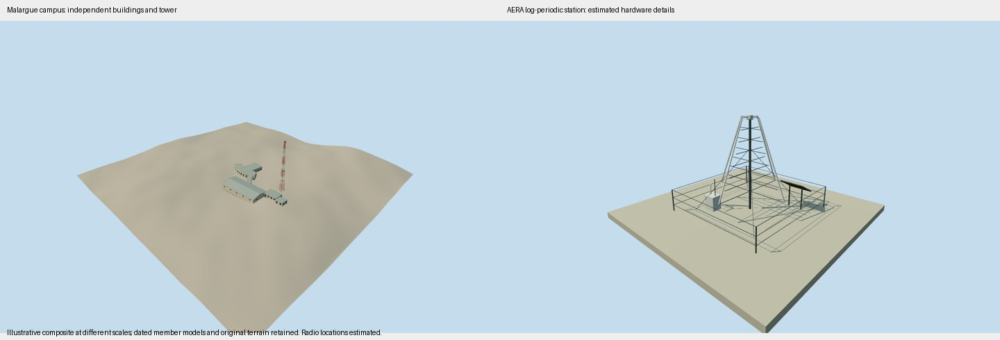

# Pierre Auger Observatory

A geographically dispersed collection of29 independent model types and1,813 placements:1,638 operator event-active surface-detector records,26 other completed buildings/instruments and149 main-family AERA radio positions. The latter comprise24 log-periodic stations and125 butterfly stations with original approximate layouts based on published phase counts/spacings. Exact antenna GPS positions, phase boundaries and experimental variants are unverified.

Fluorescence buildings, HEAT telescopes, service structures, communication towers, Malargue campus, laser/lidar and electric-field equipment retain their accepted independent geometry, placements and terrain fields. New antenna dimensions follow primary written facts; missing service details, finishes and azimuths are estimates. No appearance images were used for the new antenna models.

The assembly has an original100km overview field from16 Terrarium tiles, sampled on a129×129 grid. This is broad context, not surveyed local ground. Source-anchor datums remain independent; additional terrain-relative instances use the frozen broad field for this assembly only. Runtime geographic placements remain unchanged. Member dates and equipment phases form an illustrative composite rather than a simultaneous installation census. Minor apparatus, every weather sensor, later detector upgrades and internal electronics/optics are outside this characteristic exterior scope.

[Qualla story](https://qualla.com/pierre-auger-observatory/)
