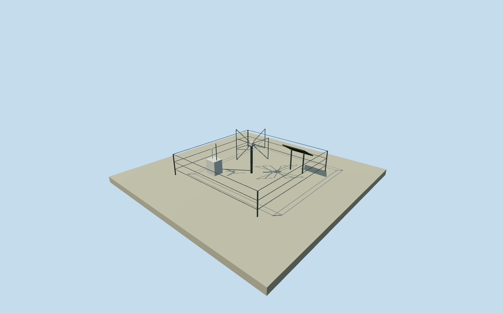

# AERA butterfly radio station

Whole butterfly radio station: documented orthogonal antenna geometry, mast, electronics, GPS/communications, solar power and cattle fence. Source dimensions retained. Number of dipole elements, rod profiles/visibility thickness, hardware dimensions/arrangement, materials/finish and station positions are original estimates. Known AERAWS point anchors an explicitly estimated anonymous layout; no claimed actual radio GPS/table, WCD substitution or private-data reconstruction. Primary Holt2018station text supplies LPDA4x4x3.5m antenna and electric footpoint around4.5m, butterfly2x2x1m and centre around1.6m, two perpendicular polarizations and6mm aluminum butterfly rods. Each autonomous station has metal pole, local electronics, GPS timing, solar power, communications and animal fence. Eight LPDA elements per polarization, exact wire/strut profiles, visibility rod thickness, box/panel/fence dimensions and layout, support/footings, colors and precise2018condition are original estimates. Known AERAWSweather point anchors an explicitly estimated anonymous main-family layout:24LPDAs,100phaseIIand25phaseIIIbutterfly stations. Original actual stationGPS/names are not available or claimed. Source153total includes additional experimental designs; four minor research stations and exact experimental-type census remain outside bounded main-family scope. Documented144/250/375/750mspacings guide an original illustrative layout, not a traced17km²survey polygon. No private XML, WCD coordinate substitution or source figure tracing. Own independent256m129x129field is sampled before floor0.08m/padbottom-0.2m and all hardware sections. First estimated anonymous slot remains fixed. Original ground/frame/floor/sections retained without mask, flattening or height fitting. Source relief and exact local ground ties are provider-relative approximations. Four levels retain the full antenna family, both polarization planes, mast/feed, power box/solar panel, GPS/communication stub and protective fence. Source6mm butterfly rods are represented by0.018m rectangular wire profiles for readable medium-fi geometry; this is an explicit thin-feature exaggeration, not a measured rod section. Nearby levels add panel-cell boundaries, mast curvature and small feed details. All photographs, diagrams, plots and artwork unused.

Authoring state: **review-in-qa.json**. Current completion evidence is in [qa.json](qa.json) and the [completion ledger](../../../../qualla-structures/batches/qualla-002.PROGRESS.md).

- [Pierre Auger Observatory](https://qualla.com/pierre-auger-observatory/)

Whole butterfly radio station: documented orthogonal antenna geometry, mast, electronics, GPS/communications, solar power and cattle fence. Source dimensions retained. Number of dipole elements, rod profiles/visibility thickness, hardware dimensions/arrangement, materials/finish and station positions are original estimates. Known AERAWS point anchors an explicitly estimated anonymous layout; no claimed actual radio GPS/table, WCD substitution or private-data reconstruction.

Primary Holt2018station text supplies LPDA4x4x3.5m antenna and electric footpoint around4.5m, butterfly2x2x1m and centre around1.6m, two perpendicular polarizations and6mm aluminum butterfly rods. Each autonomous station has metal pole, local electronics, GPS timing, solar power, communications and animal fence. Eight LPDA elements per polarization, exact wire/strut profiles, visibility rod thickness, box/panel/fence dimensions and layout, support/footings, colors and precise2018condition are original estimates.

Known AERAWSweather point anchors an explicitly estimated anonymous main-family layout:24LPDAs,100phaseIIand25phaseIIIbutterfly stations. Original actual stationGPS/names are not available or claimed. Source153total includes additional experimental designs; four minor research stations and exact experimental-type census remain outside bounded main-family scope. Documented144/250/375/750mspacings guide an original illustrative layout, not a traced17km²survey polygon. No private XML, WCD coordinate substitution or source figure tracing.

Own independent256m129x129field is sampled before floor0.08m/padbottom-0.2m and all hardware sections. First estimated anonymous slot remains fixed. Original ground/frame/floor/sections retained without mask, flattening or height fitting. Source relief and exact local ground ties are provider-relative approximations.

Four levels retain the full antenna family, both polarization planes, mast/feed, power box/solar panel, GPS/communication stub and protective fence. Source6mm butterfly rods are represented by0.018m rectangular wire profiles for readable medium-fi geometry; this is an explicit thin-feature exaggeration, not a measured rod section. Nearby levels add panel-cell boundaries, mast curvature and small feed details. All photographs, diagrams, plots and artwork unused.

Build: `node content/worldgen/source/places/63/63y/aera_butterfly_station/models/generate-house.mjs`. Add `--check` to verify exact regeneration. 688 triangles; 5 materials; no embedded photographs.
