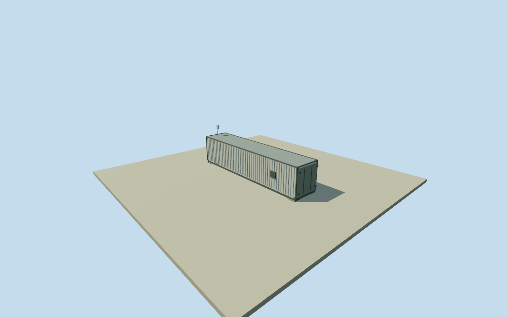

# AERA central radio station

Whole independently published40ft CRS shipping-container housing, all walls/roof/underframe/closed cargo and service entries, plus one known rooftop CS110. Other weather instruments and the unlocated solar array remain separate; not a whole-CRS-compound or observatory proxy. Original WGS84roof reference fixes point/frame before field and floors. Nominal40ft rectangle is estimated, not a mapped/surveyed footprint. Standard width/height, body offset, heading, supports, door/vent/rib details and finish are explicit estimates. Source2011shell class plus2018survey/2025sensor records approximate2023phase; unchanged housing not established. All images/figures/plans/diagrams unused. The2018roof point and2025sensor point are separate observations approximately14.144m apart; this does not establish relocation, exact same device mount or surveyed container corners. No averaging, fitting, projection or adjustment of either point. Original schematic estimates: nominal standard-width2.438m and standard-height2.591m container, 0.2m level support top,0.35m casing bottom,2.941m roof, four concrete piers/underframe/castings, personnel door/cargo doors/vent/rib positions, steel finish and exact condition. 40ft class gives nominal12.192m length, not surveyed modified shell dimensions or high-cube exclusion. Original2018rooftop survey point is retained as anchor. Exact container centroid/axis and source2011to2023shell continuity unknown. Nominal body extends east from x=-.23 to11.962m as a declared15m/180degree registration estimate; no native building corners or image fit claimed. The2025rounded CRSsensor coordinate lies14.144m from the2018roof reference. These are separate observations; neither point is averaged, shifted, projected or fitted. The3.62m reported sensor height is used in an explicitly estimated rooftop placement, not a surveyed device pose at the2018rod. CS110 nominal.152x.152x.432m envelope is arranged vertically by original schematic estimate; exact sensor casing orientation, downward plate, mast and brackets are unverified. Known height3.62m over the model datum; exact local historic ground tie unverified. Other weather sensors and the large unlocated solar array are separate unresolved physical scope. No solar panel is invented on this roof and no full compound/observatory completion claimed. All source photographs, figures, plans, map imagery and image-derived descriptions unused. Original field/frame/floor/sections preserved without masks, cutouts or fitting.

Authoring state: **review-in-qa.json**. Current completion evidence is in [qa.json](qa.json) and the [completion ledger](../../../../qualla-structures/batches/qualla-002.PROGRESS.md).

- [Pierre Auger Observatory](https://qualla.com/pierre-auger-observatory/)

Whole independently published40ft CRS shipping-container housing, all walls/roof/underframe/closed cargo and service entries, plus one known rooftop CS110. Other weather instruments and the unlocated solar array remain separate; not a whole-CRS-compound or observatory proxy. Original WGS84roof reference fixes point/frame before field and floors. Nominal40ft rectangle is estimated, not a mapped/surveyed footprint. Standard width/height, body offset, heading, supports, door/vent/rib details and finish are explicit estimates. Source2011shell class plus2018survey/2025sensor records approximate2023phase; unchanged housing not established. All images/figures/plans/diagrams unused. The2018roof point and2025sensor point are separate observations approximately14.144m apart; this does not establish relocation, exact same device mount or surveyed container corners. No averaging, fitting, projection or adjustment of either point.

Original schematic estimates: nominal standard-width2.438m and standard-height2.591m container, 0.2m level support top,0.35m casing bottom,2.941m roof, four concrete piers/underframe/castings, personnel door/cargo doors/vent/rib positions, steel finish and exact condition. 40ft class gives nominal12.192m length, not surveyed modified shell dimensions or high-cube exclusion.

Original2018rooftop survey point is retained as anchor. Exact container centroid/axis and source2011to2023shell continuity unknown. Nominal body extends east from x=-.23 to11.962m as a declared15m/180degree registration estimate; no native building corners or image fit claimed.

The2025rounded CRSsensor coordinate lies14.144m from the2018roof reference. These are separate observations; neither point is averaged, shifted, projected or fitted. The3.62m reported sensor height is used in an explicitly estimated rooftop placement, not a surveyed device pose at the2018rod.

CS110 nominal.152x.152x.432m envelope is arranged vertically by original schematic estimate; exact sensor casing orientation, downward plate, mast and brackets are unverified. Known height3.62m over the model datum; exact local historic ground tie unverified.

Other weather sensors and the large unlocated solar array are separate unresolved physical scope. No solar panel is invented on this roof and no full compound/observatory completion claimed. All source photographs, figures, plans, map imagery and image-derived descriptions unused. Original field/frame/floor/sections preserved without masks, cutouts or fitting.

Build: `node content/worldgen/source/places/63/63y/aera_central_radio_station/models/generate-house.mjs`. Add `--check` to verify exact regeneration. 1880 triangles; 4 materials; no embedded photographs.
