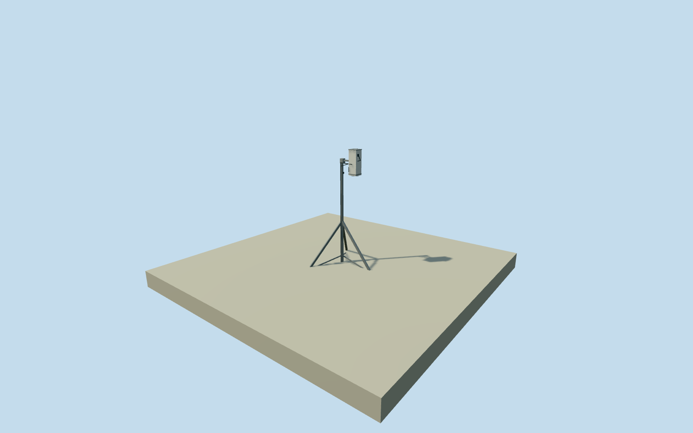

# AERA weather-site electric field meter

Whole independently identifiedCS110serial1061 at AERAWS, with an explicitly estimated support and ground anchoring. Other weather sensors, power/radio apparatus and fence remain separate unresolved equipment; this is not the whole weather station or observatory. Original published point fixed before acquiring its own source field and selecting floor/sections. Sensor face1.75m and overall manufacturer dimensions retained. All source photographs/figures/diagrams/plans unused. The support is an original estimate: a0.65m-radius three-leg stand,0.05m mast, bracket and footplates, with a nominal0.152x0.152x0.432m sensor envelope arranged vertically. Neither the stand type nor this body orientation is independently verified. It is not asserted to be a CM106BE copy. Only the published station point, serial1061,1.75m downward-facing sensor height and nominal manufacturer envelope are bound facts. Absolute yaw, lateral offsets, finish, conduit and grounding-rod pose are schematic estimates.10m anchor and180degree yaw uncertainty are nominal allowances. Other weather sensors, power/radio apparatus and site fencing are separate unresolved scope. No solar rack, dish, claimed full weather-station census or whole-observatory proxy is supplied by this instrument model. Approximate November2023 historical placement. All source images/figures/diagrams/plans unused; current physical condition unverified. Own unmodified source field fixed before this nominalY0floor and all sections. No cutout, masking, flattening or ground fit.

Authoring state: **review-in-qa.json**. Current completion evidence is in [qa.json](qa.json) and the [completion ledger](../../../../qualla-structures/batches/qualla-002.PROGRESS.md).

- [Pierre Auger Observatory](https://qualla.com/pierre-auger-observatory/)

Whole independently identifiedCS110serial1061 at AERAWS, with an explicitly estimated support and ground anchoring. Other weather sensors, power/radio apparatus and fence remain separate unresolved equipment; this is not the whole weather station or observatory. Original published point fixed before acquiring its own source field and selecting floor/sections. Sensor face1.75m and overall manufacturer dimensions retained. All source photographs/figures/diagrams/plans unused.

The support is an original estimate: a0.65m-radius three-leg stand,0.05m mast, bracket and footplates, with a nominal0.152x0.152x0.432m sensor envelope arranged vertically. Neither the stand type nor this body orientation is independently verified. It is not asserted to be a CM106BE copy.

Only the published station point, serial1061,1.75m downward-facing sensor height and nominal manufacturer envelope are bound facts. Absolute yaw, lateral offsets, finish, conduit and grounding-rod pose are schematic estimates.10m anchor and180degree yaw uncertainty are nominal allowances.

Other weather sensors, power/radio apparatus and site fencing are separate unresolved scope. No solar rack, dish, claimed full weather-station census or whole-observatory proxy is supplied by this instrument model.

Approximate November2023 historical placement. All source images/figures/diagrams/plans unused; current physical condition unverified. Own unmodified source field fixed before this nominalY0floor and all sections. No cutout, masking, flattening or ground fit.

Build: `node content/worldgen/source/places/63/63y/aera_weather_site_electric_field_meter/models/generate-house.mjs`. Add `--check` to verify exact regeneration. 588 triangles; 4 materials; no embedded photographs.
