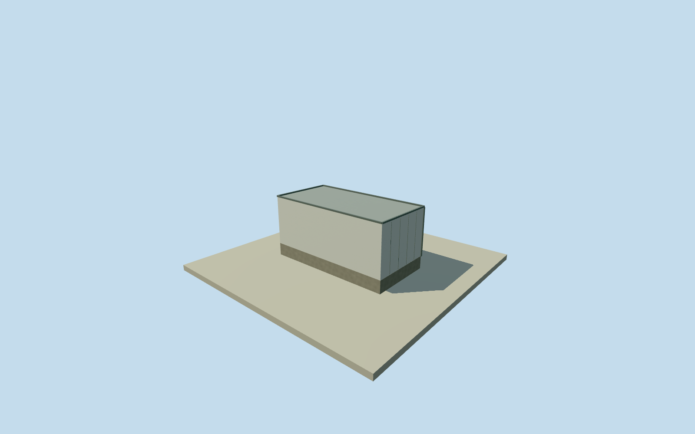

# Coihueco HEAT service container

Whole independent native HEAT enclosure or service container. Level parked telescope/closed shutters, complete steel housing/roof/base, estimated hydraulic/pivot support or closed service entry/ventilation. Written construction facts and numerical original footprint; every image unused.

Authoring state: **review-in-qa.json**. Current completion evidence is in [qa.json](qa.json) and the [completion ledger](../../../../qualla-structures/batches/qualla-002.PROGRESS.md).

- [Pierre Auger Observatory](https://qualla.com/pierre-auger-observatory/)

Whole independent Coihueco HEAT service container/all4originalcorners/full roof/all walls/base. Closed steel service container with roof/base/entry and exterior ventilation; exact DAQ/slow-control interior association unverified. Heights/mechanical detail/facade/finish are estimates; all imagery unused. No compositeHEAT/wholeobservatory proxy.

Whole native four-corner outline/all walls/full roof/base retained. Original mapped2013 registration used for approximate2018phase. Telescope enclosures illustrated in published level parked pose/closed shutters. Exact height/roof profile/steel panel census/hydraulic/pivot mechanics/shutter/door dimensions/finish and optical facing are estimates, height/component uncertainty1.5m. Native4corners are not a surveyed foundation/pivot drawing.

Independent256m129x129original field16641heights/2rawtiles/datum1683.8473m/range1652.4081..1690m fixed before floor/sections/geometry. Floor.2m/foundation-.6m and original sections chosen once after field; no cut/mask/flatten/refetch/reframe/refit. Host vertical registration remains approximate; no surveyed contact claimed.

Whole adjacent unnamed container footprint, estimated2.8m roof/closed entry/ventilation/rear service unit. Its location behind HEAT2 agrees with operator single-service-container description, but exact interior DAQ/calibration function unverified. Do not invent official name or additional independent rooms.

Qualla first27families/0conflicts; every photo/figure/diagram/plan unused. Questionable PD-self tank photograph skipped without questions or metadata repairs. ODbL original native numerical outlines and primary written facts only, no imagery approval claimed.

Four detail levels retain whole enclosure/roof/base/closed entry and telescope shutter/hydraulic support where applicable. Panel joints/vents/hinges/ram curvature/handles simplify with distance. Independent asset and placement, no compositeHEAT or wholeobservatory proxy; parent still unfinished.

Build: `node content/worldgen/source/places/63/63y/coihueco_heat_service_container/models/generate-house.mjs`. Add `--check` to verify exact regeneration. 240 triangles; 4 materials; no embedded photographs.
