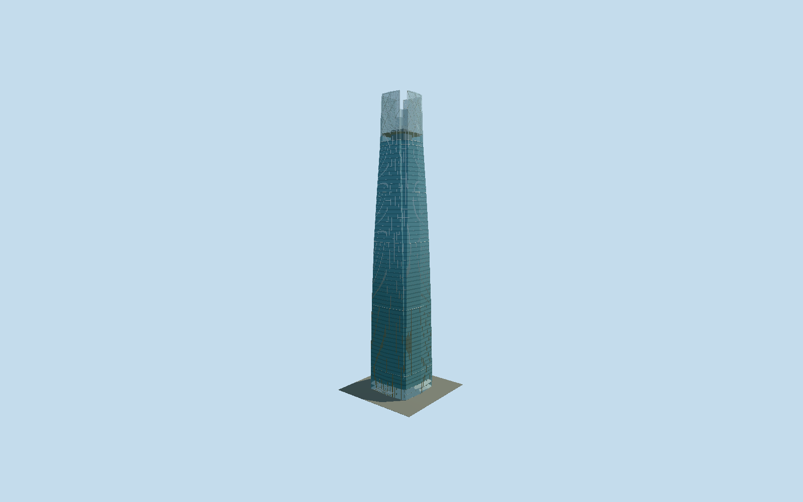

# Gran Torre Costanera

Four folded and tapering blue glass walls; deep recessed corner strips; four projecting clear crown screens with exposed diagonal steel lattice; enclosed and open observatory levels; repeated curtain-wall bays; rod-supported glass entrance canopy and doors.

## Evidence and reconstruction

Published dimensions and reconstructed details are separated in spec.json. Primary references:

- [Reference](https://pcparch.com/work/gran-torre-santiago)
- [Reference](https://www.abwb.cl/proyecto/costanera-center/)
- [Reference](https://officehubcostanera.cl/sites/hubcostanera/files/master_plan/costanera/planos/ficha_oficina_TC_6000.pdf)
- [Reference](https://officehubcostanera.cl/sites/default/files/2024-01/Brochure%20Pisos%20Habilitados%20copia.pdf)
- [Reference](https://skycostanera.cl/en/rates-and-schedules)

No third-party geometry, photograph or bitmap texture is embedded. Shared surface graphs come from the central library; vertex tints carry model colors. Glazing uses PBR materials; transparent surfaces are declared per model.

## Model and axes

14,106 triangles; 28,548 vertices; 6 material groups; 1,200,508 bytes. Native bounds: -25.745, 0.000, -32.931 to 25.745, 300.002, 25.745. Source hash: `sha256:6d23d9efb2515c9efa2bf14b8d5cf7a8de5c59a5927d54bb2a9f27cb9e80ef78`.

{"up":"+Y","longitudinal":"+X northeast along signed tower axis","front":"-Z northwest Andrés Bello reconstructed office frontage","origin":"Centered exact tower footprint at approximate pavement"}

The geographic proposal uses exact-QID OpenStreetMap evidence. Map-derived orientation and estimated architectural details require real-site visual review; preview eligibility is distinct from geographic/fidelity approval. Map attribution: © OpenStreetMap contributors, ODbL-1.0.

## Reproduce

Run `node packages/worldgen/scripts/generate-signature-towers.mjs --ids=gran_torre_costanera` (or add `--check`). The generator preserves manually edited masters by checking their baseline hashes. Import through the standard authored-model workflow with optimization disabled; then capture all QA cameras, including shared-surface views.

## Pending work

- The original granTorreCostaneraStudy.encodeAssembly remains byte-reconstitutable: 1959180 bytes, hash sha256:88a6c0bc5bc218fb7a4a933637b782f5ce976a37cb49c9ba646421a3f534c340, 83912 expanded triangles /23066 stored triangles in four parts and ten placements. The reviewed flattened source and four authored levels retain the original folded taper, recessed corners, separate open upper glass fins and exposed diagonal lattice, two working observatory floors, exposed viewing floor, service core and rod-supported northwest entrance canopy. Facade glass and darker spandrel occupy adjacent regions instead of overlapping coplanar panels. Close adds flat full-height mullion strips segmented at taper datums, repeated floor transoms and crown frit; street coarsens vertical spacing and frit; district groups floors; skyline keeps folded silhouette/open corner gaps/coarse diagonal crown framing in one opaque draw. Three canonical graphs (stainless metal, concrete and wood) are shared, with opaque glass, 52-percent clear glass and recess palette: six near groups and no embedded images. Original granite lobby core becomes shared concrete; invisible office fitout and facade bolts are not authored. Ground floor and 253.7/261.8 m viewing datums, 282.7 m lower corner closure, intermediate taper, bay counts, rod/member dimensions, small rooftop equipment and centered canopy 22.4 m width/32.9 m front are working reconstructions. Owner floor 60 is 249.60 m with 4.10 m slab interval; operator floor labels 61/62 and marketed 300 m are not measured floor elevations. Architect-of-record/OSM 64 levels and current owner 62-floor marketing remain distinct. Primary floor plan explicitly says illustrative. Canonical references are not copied as textures. Phone/laptop dense-scene measurements remain pending.

This bundle follows the medium-fi standard. Medium-fi appearance and geographic fit are reviewed separately. Hash-bound visual acceptance is recorded separately after capture inspection.
