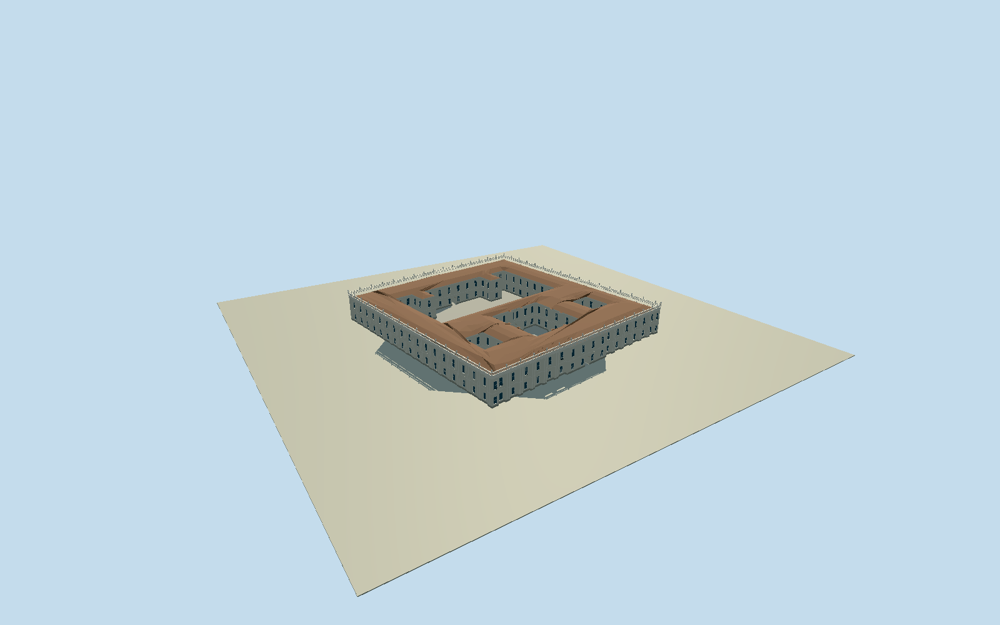

# La Moneda Palace

Whole surviving LaMoneda presidential palace exterior in actual relation394238/Q1146881: full208-node outer envelope with native front/side/rear setbacks and all four mapped open inner courts, pale neoclassical facade/pilaster rhythm/paired central entrance/belts/cornice/pierced roof balustrade and bounded finial silhouettes, lower roof and courtyard-wing masses. Preserve each actual inner void; no single closed full-block box or north-facade-only replacement. Exclude whole Constitution/Citizenship plazas, independent monuments/flagpole, underground cultural center/other neighboring offices, trees/people/protest props/text/interior rooms. Precise roof partitions/heights/current hidden finishes and detailed courts are bounded original interpretations from mapped plan and cleared2007 facade character.

Authoring state: **review-in-qa.json**. Current completion evidence is in [qa.json](qa.json) and the [completion ledger](../../../../qualla-structures/batches/qualla-002.PROGRESS.md).

- [La Moneda Palace](https://qualla.com/la-moneda-palace/)

Whole surviving palace uses actual207-unique-vertex outer native envelope/four true open inner courts, all exterior/court wings, two-storey north and three-storey south rhythm, repeated native pilaster projections/belts/cornice/pierced roof balustrade/original vase finials and three covered axial passages from six actual entrance nodes. No facade-only or closed full-block substitute.

Exact640x480 cleared Qualla TomasVivanco2007 own/PD-self facade original individually inspected/nativeSHA1matched; primary government/2022 original architectural study text only. No attribution-only/uncertain imagery, protected figure/plan/photo-gallery pixels, generated bitmap/borrowed mesh or licensing-policy changes. Foreground event and neighboring buildings excluded.

Body/cornice/parapet/finial sections, low hidden hipped roof ridges/materials, facade window/rail/vase census, courtyard-side details and portal/vault widths/heights are bounded original medium-fi estimates. Current hidden maintenance details/precise private rooms/structural survey not claimed. Actual native door positions and four courtyard voids retained; no public-gallery/room interior reconstruction.

Original400m/16641-value independent urban field/two raw tiles/PNG frozen before floor/geometry, unchanged. Floor+.05 independent; building/urban source artifacts may disagree with threshold/court/foundation levels. Default isolated/shared-flat appearance and separate unchanged source-field evidence; exact host contact unverified/replacementfalse. No terrain fitting/flattening/reacquisition, full-plaza floor, independent monuments/61mflagpole/underground cultural center/city/trees/events/people/text.

Build: `node packages/worldgen/scripts/generate-authored-places.mjs --ids=la_moneda_palace`. Add `--check` to verify exact regeneration. 55771 triangles; 6 materials; no embedded photographs.
