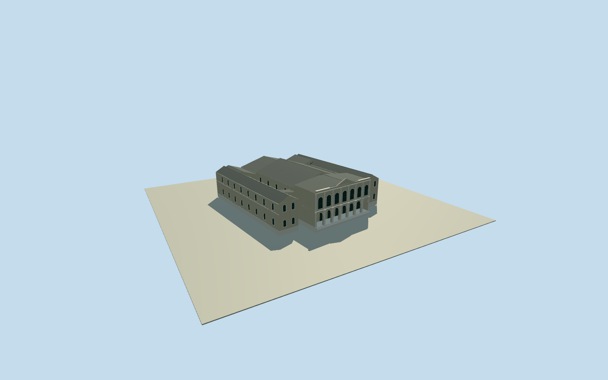

# Municipal Theatre, Santiago (original1857–1870)

Complete original1857–1870MunicipalTheatre on its Santiago site: whole central auditorium/proscenium-stage volume and closed roofs/rear/side service wings, two-storey classical streetfront, open arched portico/12columns/16pilasters, upper arched windows/central pediment/parapet and full intrinsic vestibule envelope. Original1872publication clearly depicts/describes the destroyed pre1870theatre, not surviving1873rebuild or its proposed newplan. Old occupiedplot56mfront×63mdepth/portico30m/vestibule23×10m are primary old-phase facts; exact old body/courts/heights/roof/rear are bounded estimates. Exclude adjacentstreet houses, people/flags/trees/art/sculpture/signs, proposednew19m/17mheights or24×6mcourts as measuredoldcontrols and later1906/1924alterations. Retain whole original physical theatre, not facade-only.

Authoring state: **review-in-qa.json**. Current completion evidence is in [qa.json](qa.json) and the [completion ledger](../../../../qualla-structures/batches/qualla-002.PROGRESS.md).

- [Municipal Theatre of Santiago](https://qualla.com/municipal-theatre-of-santiago/)

Actual current theatreway112317702/Q6936293/32controls supplies same historicalsite context only, not surveyed1857walls. Old theatre burned1870andrebuilt1873; full original56×63moccupiedlot and30mportico belongpasttenseprimarytext, not current native14.5mheight. Historical body/roof/rear layout and registration±10m/bearing±10degrees will be explicit estimates.

Book engraving is explicit pre1870original, not a current1873or proposednewplanimage. Do not claim19mfront/17mroof/24×6mcourts from nextparagraph as measuredoriginaltheatre geometry.

Whole occupiedplot56×63does not measure every oldwing wall; hidden plan/body/courts/roof/sections are bounded estimates, not exacthistoric survey. Preserve entire old physicaltheatre scope.

Book authorTornero1842–1902is not assumed to be uncredited woodengraver. Exact1872publication/nativePD-old100andbytes establishclear expiredsource, not a guessed photographcreator.

Original independentfield/frame before all main parameters/geometry; never flatten/reacquire/reframe or fitfloors/mainsections to renders.

Original old occupiedplot56×63m is primary, while complete building disposition/side wings/two5×29m courts/roof back sections are architectural estimates. Do not claim current32nativecontrols or proposednew24×6m courts as old measuredwalls.

Twelve paired ground columns and sixteen facadepilasters preserve primary census; precise capitals/profiles/column placement per level are simplified engraving-led estimates. Seven open groundarches and seven upperarched bays follow original plate; upper room over23×10mvestibule retained in complete front envelope.

Full physical old theatre exterior retained: central front/auditorium/stage/side and rear service wings/closed roofs/open intrinsic courts. Adjacent depicted houses, flags/sculpture/signs/figures are excluded, not modeled as theatre wings.

Main heights/roof material and fine ornament are bounded estimates from uncolored original engraving. No proposednewplanheight transfer, current1873state claim, source terrain cutout or artificial broad sitepad.

Build: `node content/worldgen/source/places/66/66j/municipal_theatre_of_santiago/models/generate-house.mjs`. Add `--check` to verify exact regeneration. 29932 triangles; 6 materials; no embedded photographs.
