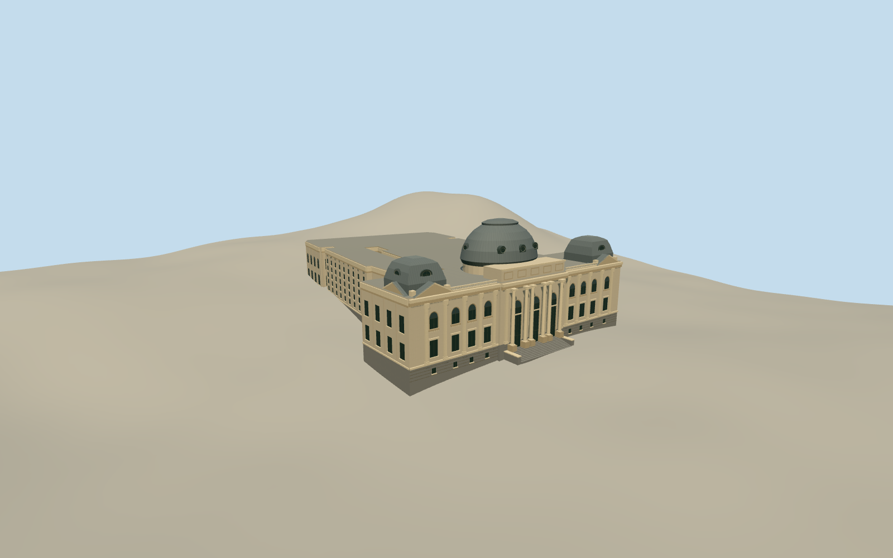

# National Library of Chile

The standing National Library of Chile at Santiago’s Alameda, with its columned entrance, broad central cupola, symmetrical corner mansards and long library wings.

Authoring state: **review-in-qa.json**. Current completion evidence is in [qa.json](qa.json) and the [completion ledger](../../../../qualla-structures/batches/qualla-003.PROGRESS.md).

- [National Library of Chile](https://qualla.com/national-library-of-chile/)

The standing library includes the main Alameda pavilion and as-built wings with the mapped light wells. The adjoining separately mapped Archivo Nacional and its original, partially unbuilt proposals remain outside the library geometry.

The contemporary footprint sets the horizontal envelope. Original archive views and published architectural descriptions control the entrance bay, roofs and major facades. Exact facade and roof heights, window frames, roof colors and minor ornament are estimates.

Alameda entrance grade follows the frozen open elevation field. The source also preserves the slope toward Cerro Santa Lucía and urban height artifacts. Rear and courtyard grades are approximate.

Build: `node content/worldgen/source/places/66/66j/national_library_of_chile/models/generate-national-library-of-chile.mjs`. Add `--check` to verify exact regeneration. 17006 triangles; 6 materials; no embedded photographs.
