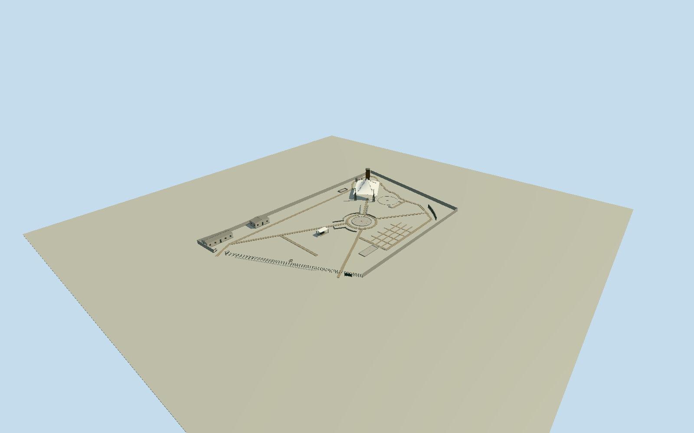

# Villa Grimaldi

Whole surviving VillaGrimaldi memory-park architectural complex/Q2301496 on actual7-corner siteway111293916, not the demolished original estate: current reconstructed water/cell towerway1205370100, Sala de la Memoria1205370099, information/workshop building1211121810,2011CentrodeDocumentacion1211121818 and open model-display shelter1211121812; full Teatro por la Vida tensile pavilion1205370102 with open underside/supports/two tall flanking block piers, actualpool1204054446, Fuente de la Esperanza1211121811/other small fountain controls, curved Muro de los Nombres/node11170906082/low solidarity-wall control/old gate and actual boundary/retaining lines plus intrinsic bounded cross/brick paths/stairs/open courts. No single villa house/facade-only substitute or fullsite solid slab. Current tower/hidden building roof-window-height/canopy/fountain/terrace/boundary sections original bounded estimates from four clear2006 creatorPD originals/current native footprints and primary museum text. Exclude reconstructed torture/private interiors, destroyed villa/cell compound rebuilt as if still surviving, copied pictorial mosaic/murals/portraits/inscriptions/independent sculptures, whole landscape/trees/people/neighborhood.

Authoring state: **review-in-qa.json**. Current completion evidence is in [qa.json](qa.json) and the [completion ledger](../../../../qualla-structures/batches/qualla-002.PROGRESS.md).

- [Villa Grimaldi](https://qualla.com/villa-grimaldi/)

Whole current memory-park architectural ensemble/Q2301496 uses actual7-corner open siteway111293916, five native building/roof footprints including reconstructed timber tower/SalaMemoria/service buildings/display shelter, separate Teatro por la Vida tensile pavilion/open underside/A-frame/stays/tall flanking stepped piers/platform, actual pool/fountain/court/wall/gate/retaining and bounded path/stair controls. No destroyed original villa presented as surviving, facade-only panel or whole-site solid slab.

Exact cleared Qualla LionHirth2006 Own/PD-self2048x1536 wall original plus three exact same-creatorPD court/garden/pavilion originals individually inspected/nativeSHA1matched. Primary owner/CMN text only resolves demolition and tower reconstruction/restoration; no protected gallery/plan pixels. Abstract plaque/neutral pier tile/basin divisions only; no copied names/lettering/portraits/pictorial mosaic/murals/independent sculpture/photo textures/borrowed meshes/generated bitmaps/policy-verifier changes.

Cleared photographs are partial2006 views and do not show current tower/modern service rear roofs or2019 tower changes. Tower height/cap/lookout/board census, service gables/window rhythm/current finishes, tensile roof extent/shape/supports/stepped pier/terrace and wall/plaques/fountain/bench sections are bounded original medium-fi estimates using actual native component plans and primary text; no as-built/private or torture interior reconstruction claimed. Pool/fountain dry linings remain visible in genuine open bowls above appearance-stage height; vertical excavation/water state/thresholds estimated.

Original400m/129x129/16641-value independent field/two raw tiles/PNG frozen before geometry/floor/component choices unchanged. Independent flat appearance floors/paths/component levels; source urban relief may bury/raise structures or disagree with foundations/terraces. Separate unchanged original-field evidence; exact source/host terrain contact unresolved/replacementfalse. No source flattening/fitting/reacquisition, full-site floor/vegetation/neighborhood/people/vehicles/private rooms.

Build: `node packages/worldgen/scripts/generate-authored-places.mjs --ids=villa_grimaldi`. Add `--check` to verify exact regeneration. 19585 triangles; 6 materials; no embedded photographs.
