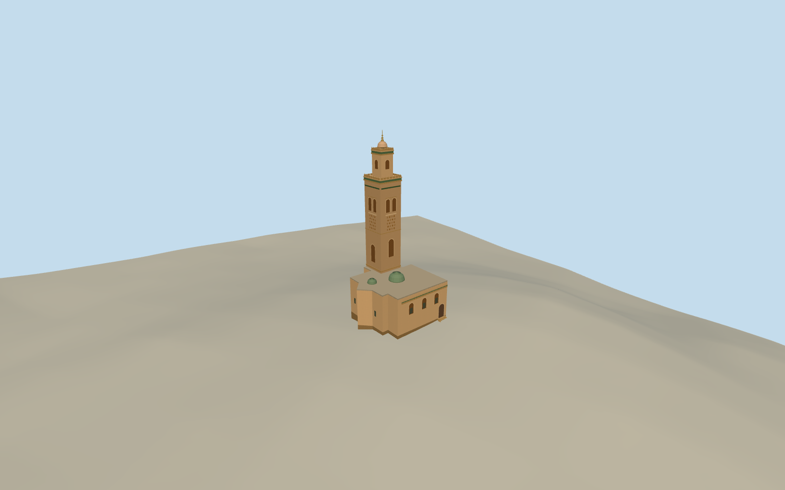

# Mohammed VI Mosque, Coquimbo

The Coquimbo mosque and cultural center on Cerro Dominante, with its pale hall and tall square Koutoubia-style minaret.

Authoring state: **review-in-qa.json**. Current completion evidence is in [qa.json](qa.json) and the [completion ledger](../../../../qualla-structures/batches/qualla-003.PROGRESS.md).

- [Mohammed VI Mosque (Coquimbo)](https://qualla.com/mohammed-vi-mosque-coquimbo/)

The current mapped outline sets the footprint. The tower base position is inferred from the west square projection. The hall roof, window groupings and entrance detail are estimated.

The operator lists 43 metres for the total tower height and ONAR lists a 40-metre minaret. The model treats 43 as the finial top, while the highest masonry course is approximately 40 metres.

The tower decoration represents the documented Koutoubia design family. Exact ornament, roof cupola visibility and external masonry sections remain approximate.

The original hill has not been reshaped. Surrounding park facilities, artwork, library and prayer hall interiors are outside the exterior scope.

Build: `node content/worldgen/source/places/66/66t/mohammed_vi_mosque_coquimbo/models/generate-mohammed-vi-mosque-coquimbo.mjs`. Add `--check` to verify exact regeneration. 2983 triangles; 6 materials; no embedded photographs.
