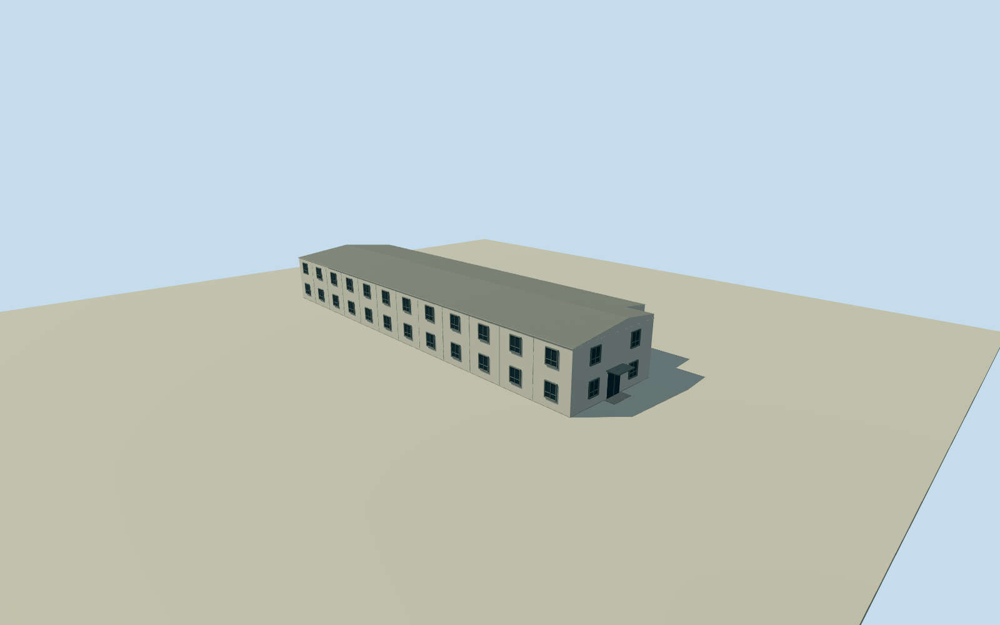

# Giant Magellan southern support building

Whole independent original 6-corner south building at the inferred GMTpersonnel support site. Exact room/function/floor census and historical surface detail are estimates. Other buildings, support sites and actual summit works remain separate; no operating-enclosure or whole-project proxy. Full original Google-via-OvertureWKB outline fixed before own source field/floor/sections. 22 qualified original2023height observations, median6m; learned relative height, not survey. Provider score is not a probability. Every appearance image unused after Qualla-first screening. Individual function, room census, 2 storeys, all door/window positions, shallow pitched metal roof, white panel finish and minor fittings are original visualization estimates. The precise68-room/24-room/operator-named identity is not assigned from size or a photograph. SS2 membership is inferred from the published relative site location and original spatial cluster. Original Google full source outline and 22 original2023 qualified height observations, median6m retained. Relative heights are learned effective4m estimates, not a physical survey or floor census. At least3m height/10m horizontal/15degree yaw allowances are nominal estimates, not measured confidence bounds; no Chile-specific model performance claimed. Original low/upper native corner source grade selected a first-pass floor1.7794m and foundation bottom-2.7556m before geometry. This is a nominal terrace/retaining-base reconstruction from coarse source ground, not an observed historic floor. The actual engineered cut/fill and exact ground datum are unavailable. Own original256m129x129source field and rawtiles frozen before floors/mainsections. No masking, flattening, ground cutout, render-based height change, relocation or source-field/frame refit. Other buildings, the full personnel/technical sites, actual summit construction and the unbuilt telescope/enclosure remain separate scope. This whole independent support body is not a whole-project proxy. Approximate2023appearance based on original numerical observations and later written support-site operational status. Every source photograph/diagram/plan/map image/image-derived description unused; the one Qualla metadata conflict is excluded with all appearance references.

Authoring state: **review-in-qa.json**. Current completion evidence is in [qa.json](qa.json) and the [completion ledger](../../../../qualla-structures/batches/qualla-002.PROGRESS.md).

- [Giant Magellan Telescope](https://qualla.com/giant-magellan-telescope/)

Whole independent original 6-corner south building at the inferred GMTpersonnel support site. Exact room/function/floor census and historical surface detail are estimates. Other buildings, support sites and actual summit works remain separate; no operating-enclosure or whole-project proxy. Full original Google-via-OvertureWKB outline fixed before own source field/floor/sections. 22 qualified original2023height observations, median6m; learned relative height, not survey. Provider score is not a probability. Every appearance image unused after Qualla-first screening.

Individual function, room census, 2 storeys, all door/window positions, shallow pitched metal roof, white panel finish and minor fittings are original visualization estimates. The precise68-room/24-room/operator-named identity is not assigned from size or a photograph. SS2 membership is inferred from the published relative site location and original spatial cluster.

Original Google full source outline and 22 original2023 qualified height observations, median6m retained. Relative heights are learned effective4m estimates, not a physical survey or floor census. At least3m height/10m horizontal/15degree yaw allowances are nominal estimates, not measured confidence bounds; no Chile-specific model performance claimed.

Original low/upper native corner source grade selected a first-pass floor1.7794m and foundation bottom-2.7556m before geometry. This is a nominal terrace/retaining-base reconstruction from coarse source ground, not an observed historic floor. The actual engineered cut/fill and exact ground datum are unavailable.

Own original256m129x129source field and rawtiles frozen before floors/mainsections. No masking, flattening, ground cutout, render-based height change, relocation or source-field/frame refit.

Other buildings, the full personnel/technical sites, actual summit construction and the unbuilt telescope/enclosure remain separate scope. This whole independent support body is not a whole-project proxy.

Approximate2023appearance based on original numerical observations and later written support-site operational status. Every source photograph/diagram/plan/map image/image-derived description unused; the one Qualla metadata conflict is excluded with all appearance references.

Build: `node content/worldgen/source/places/66/66v/giant_magellan_southern_support_building/models/generate-house.mjs`. Add `--check` to verify exact regeneration. 5468 triangles; 4 materials; no embedded photographs.
