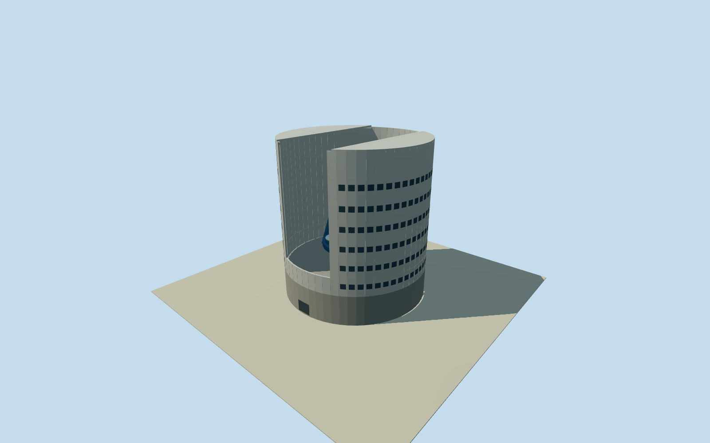

# Giant Magellan planned summit enclosure

Planned2024enclosure design interpretation at the actual summit context: cylindrical65m enclosure,12m fixed base, two L-shaped observing shutters, open observing aperture and seven8.4m mirrors. This is explicitly an unbuilt design visualization, not an operating or as-built current telescope. Footprint, exact summit position, shutter pose, sections, colour and telescope framing remain original estimates. Original GMTO/IDOM2024text: cylindrical rotating upper enclosure, approximately12m fixed lower portion, approximately52m upper portion,65m overall design height, double rails27.675/29.525m radii,46m tall main-text bi-parting L-shaped shutters and more than300wind vents. Seven8.4m primary segments/25.4m aperture are written numeric facts. Nominal60m outer diameter, exact panel distribution, open shutter pose/width, roof sections, colours, telescope yoke/trusses, pier and instrument details are original estimates; no author rendering or engineering figure pixels used. Representation is the2024planned design document, not a claim of a physically finished enclosure in2024or today. No arbitrary future completion date. All current-world activation disabled. An open illustrative observing pose is estimated, with all seven primary segments visible through the opening. Existing eleven actual support-building models remain separately approved and unchanged. Own original256m129x129 terrain field precedes chosen floor0.5m/foundation-3.5m and all design sections. Original story summit coordinate is approximate, not a surveyed enclosure point. Coarse modern relief is not a constructed or planned summit bench; intersections/exposed foundation remain approximate and no flattening, cutout, terrain mask or ring fitting is applied. Four authored levels retain the whole cylindrical lower/upper structure, actual front/roof opening, both estimated L-shutter edge assemblies, mount/pier and seven individual nominal8.4m mirror segments. Distant levels abstract curved sections/vent arrays; closer levels add repeated vent panels and structural bracing. No operational engineering, exact module census, fine mirrors optics or as-built geometry claimed.

Authoring state: **review-in-qa.json**. Current completion evidence is in [qa.json](qa.json) and the [completion ledger](../../../../qualla-structures/batches/qualla-002.PROGRESS.md).

- [Giant Magellan Telescope](https://qualla.com/giant-magellan-telescope/)

Planned2024enclosure design interpretation at the actual summit context: cylindrical65m enclosure,12m fixed base, two L-shaped observing shutters, open observing aperture and seven8.4m mirrors. This is explicitly an unbuilt design visualization, not an operating or as-built current telescope. Footprint, exact summit position, shutter pose, sections, colour and telescope framing remain original estimates.

Original GMTO/IDOM2024text: cylindrical rotating upper enclosure, approximately12m fixed lower portion, approximately52m upper portion,65m overall design height, double rails27.675/29.525m radii,46m tall main-text bi-parting L-shaped shutters and more than300wind vents. Seven8.4m primary segments/25.4m aperture are written numeric facts. Nominal60m outer diameter, exact panel distribution, open shutter pose/width, roof sections, colours, telescope yoke/trusses, pier and instrument details are original estimates; no author rendering or engineering figure pixels used.

Representation is the2024planned design document, not a claim of a physically finished enclosure in2024or today. No arbitrary future completion date. All current-world activation disabled. An open illustrative observing pose is estimated, with all seven primary segments visible through the opening. Existing eleven actual support-building models remain separately approved and unchanged.

Own original256m129x129 terrain field precedes chosen floor0.5m/foundation-3.5m and all design sections. Original story summit coordinate is approximate, not a surveyed enclosure point. Coarse modern relief is not a constructed or planned summit bench; intersections/exposed foundation remain approximate and no flattening, cutout, terrain mask or ring fitting is applied.

Four authored levels retain the whole cylindrical lower/upper structure, actual front/roof opening, both estimated L-shutter edge assemblies, mount/pier and seven individual nominal8.4m mirror segments. Distant levels abstract curved sections/vent arrays; closer levels add repeated vent panels and structural bracing. No operational engineering, exact module census, fine mirrors optics or as-built geometry claimed.

Build: `node content/worldgen/source/places/66/66v/giant_magellan_summit_enclosure/models/generate-house.mjs`. Add `--check` to verify exact regeneration. 4364 triangles; 4 materials; no embedded photographs.
