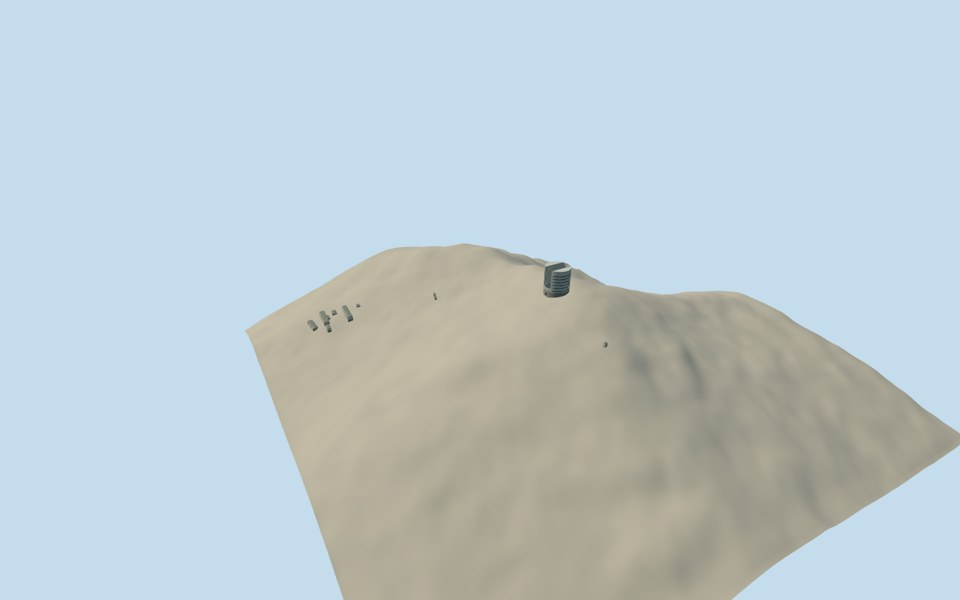

# Giant Magellan Telescope

A bounded project visualization comprising eleven independently approved existing support buildings and one new explicit planned2024summit enclosure with seven individual primary mirrors.

The planned enclosure uses GMTO/IDOM numerical design facts: a65m overall cylindrical structure, approximately12m fixed lower portion, tall bi-parting L-shaped shutters, wind-vent cladding and seven8.4m primary segments. Roof/shutter pose, panels, colours, mount details, sections and exact summit registration remain original estimates. No photograph, design rendering or figure geometry was used.

This is a planned-design interpretation, not an as-built or operating current telescope and not a prediction of completion date. Existing independently dated support structures are preserved. Minor unassigned sheds, temporary site works and an exhaustive engineering/excavation census are outside this bounded structure scope.

The assembly has its own original1280m terrain field from four original Terrarium tiles. Every member retains its original local source field, frame, floor, sections and QA. Coarse terrain does not survey modern or planned engineered benches.

[Qualla story](https://qualla.com/giant-magellan-telescope/)
