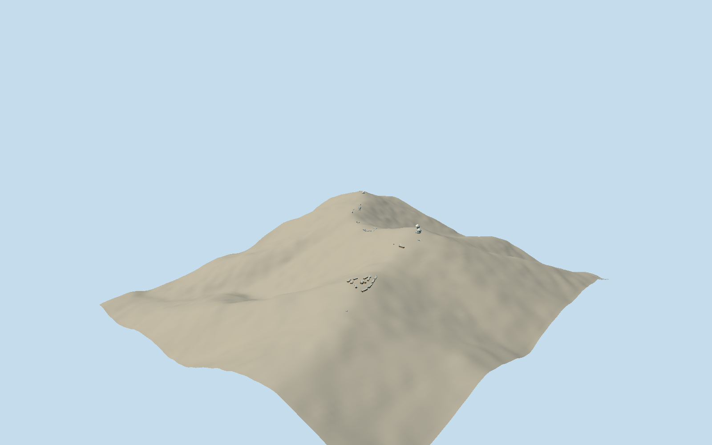

# Las Campanas Observatory

Whole operating Las Campanas Observatory architectural group across its mapped telescope, service and accommodation ridges: twin Magellan enclosures/connecting building, HenriettaSwope, IrénéeDuPont, Warsaw/OGLE enclosure, Pagoda and mapped smaller instrument/service/accommodation buildings. Retain every selected intrinsic native building envelope/position, including the whole27-corner combined Magellan way136126240; no single generic telescope substitution. Exclude separately named future GiantMagellanTelescope construction project and southern construction support ways136126248/136126273/136126275, whole mountains/roads/landscape/snow/cars/people/sky/interior optics/text. Current newer minor-instrument shells/hidden faces remain bounded estimates; old cleared2008 photo does not certify later surface details.

Authoring state: **review-in-qa.json**. Current completion evidence is in [qa.json](qa.json) and the [completion ledger](../../../../qualla-structures/batches/qualla-002.PROGRESS.md).

- [Las Campanas Observatory](https://qualla.com/las-campanas-observatory/)

Whole38-building operating observatory group retains actual native footprints and positions, both individually mapped Magellan enclosures/low connector, Swope/duPont/Warsaw domes, Pagoda, CHAT/TMMT and named minor roll-off instruments, service and accommodation wings. Separate futureGMT construction/three support ways excluded; no whole mountain/campus floor, roads, landscape, snow, people, optics/interiors/text.

One exact2288x1712 cleared Qualla GeneralEpitaph2008 own/PD-self original first, individually inspected/nativeSHA1matched. Primary institution text confirms principal operating instruments; no protected galleries/PDF pixels, attribution-only or uncertain imagery, generated bitmap/borrowed mesh or policy changes. Photo does not survey later small-instrument roofs/hidden faces or current fixtures.

Original bounded medium-fi sections: twin faceted enclosure heights/radii/closed shutter seams/vent panels, older dome proportions/native duPont annex, low service bar/brown accommodation roofs, smaller instrument enclosures, window/door census and hidden faces. Actual footprint/position controls retained; per-building floor estimates rounded from previously frozen independent coarse source field do not certify separately surveyed terrace/threshold/contact.

Original2500m independent16641-value field/twelve raw tiles/PNG frozen before geometry and per-building levels, unchanged. Rugged site includes many separate floors; per-building source-center estimates/footing depths do not establish exact source or host contact, especially two steep lower service footprints. No field flattening/fitting/reacquisition; geographic preview approximate/replacementfalse.

Build: `node packages/worldgen/scripts/generate-authored-places.mjs --ids=las_campanas_observatory`. Add `--check` to verify exact regeneration. 15363 triangles; 6 materials; no embedded photographs.
