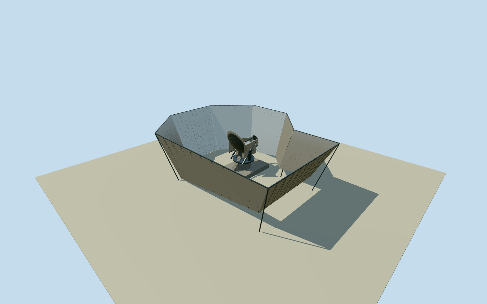

# Atacama Cosmology Telescope — Cerro Toco

Whole Atacama Cosmology Telescope instrument and its enclosing stationary ground screen: original eight-control ACT envelope, complete13m outer screen enclosure with no roof, full12m off-axis Gregorian telescope/mount,6m primary plus0.5m guard ring,2m secondary, connecting co-moving inner ground-screen sides, climate-controlled receiver cabin and integral service access. Primary instrument publication specifies heights/mirror sizes/71and11optical panels, and designer paper Table2/Equation1 specifies off-axis conic mirror shapes. Native envelope is exact horizontal context, its role as upper screen edge and all wall taper/profile, mount/cabin/support dimensions/bearings/panel arrangement/finish and static50.5degree pose are explicit reconstruction estimates. Optics and surrounding screen remain complete; not a generic dish or single facade. Nearby Simons/POLARBEAR, detached service containers, generators, fuel tank, landuse parcel, scientific sky maps and interiors are separate excluded objects. No imagery used or photographic fidelity/optical accuracy claimed.

Authoring state: **review-in-qa.json**. Current completion evidence is in [qa.json](qa.json) and the [completion ledger](../../../../qualla-structures/batches/qualla-002.PROGRESS.md).

- [Atacama Cosmology Telescope](https://qualla.com/atacama-cosmology-telescope/)

Whole Atacama Cosmology Telescope instrument and its enclosing stationary ground screen: original eight-control ACT envelope, complete13m outer screen enclosure with no roof, full12m off-axis Gregorian telescope/mount,6m primary plus0.5m guard ring,2m secondary, connecting co-moving inner ground-screen sides, climate-controlled receiver cabin and integral service access. Primary instrument publication specifies heights/mirror sizes/71and11optical panels, and designer paper Table2/Equation1 specifies off-axis conic mirror shapes. Native envelope is exact horizontal context, its role as upper screen edge and all wall taper/profile, mount/cabin/support dimensions/bearings/panel arrangement/finish and static50.5degree pose are explicit reconstruction estimates. Optics and surrounding screen remain complete; not a generic dish or single facade. Nearby Simons/POLARBEAR, detached service containers, generators, fuel tank, landuse parcel, scientific sky maps and interiors are separate excluded objects. No imagery used or photographic fidelity/optical accuracy claimed.

Instrument publication Table1 gives12m telescope,13m ground screen,6m primary and2m secondary/71and11panels; its text gives receiver-cabin width3.3m. Designer Table2/Equation1 gives both off-axis ellipsoidal mirror patches; these numerical conic surfaces are modeled directly, with tessellation and unspecified panel seams estimated. Guard-ring width0.5m is textual. Neither source figure/drawing nor any photographic pixels are used. No optical metrology or instrument operability claimed.

Original exact eight-control native enclosure is interpreted as the upper stationary-screen envelope. Whether each mapped edge coincides with the screen itself versus access enclosure is not surveyed. Lower wall taper, edge roles, screen-panel profiles/bearings, base/access details, structural member count, rotating mount geometry and receiver height/depth are bounded estimates. Full screen and full telescope with connecting inner side baffles/cabin remain present, not a generic dish or isolated facade.

Native ring and original128m/16641height field fixed before this floor and main sections. Provider-relative floor0.35m, upper screen13.35m, bottom edge control samples follow original source field; panel bottom inset grade samples remain approximate. Full telescope12m height fixes optical assembly translation without rescaling its six-metre mirror. Nominal50.5degree observing pose is a static illustrative reconstruction; internal bearing/installation centre are estimates. Published5190m altitude and rounded coordinates are not used to vertically refit the original provider field.

Receiver width3.3m is reported; cabin5m depth/2.65m height, foundation/pad/mount/supports, lower enclosure taper, service access, guard ring profile, shield shapes and silver/white paint/age are estimates. Exact panel boundaries, optical finish, cables, actuators, original text/artwork and figure graphics not copied. Detached service containers/generators/fuel tank, wider landuse parcel and nearby Simons Array/POLARBEAR excluded as separate objects.

Approximate historical2011preview from primary design/instrument facts, no exact2011configuration or current2026condition proof. Original coarse DEM relief/contact uncertainty explicit, no field/frame/floor/main-section refit, mask, flattening, cutout or re-acquisition. No photographic fidelity or automatic current-world replacement.

Build: `node content/worldgen/source/places/67/67z/atacama_cosmology_telescope/models/generate-house.mjs`. Add `--check` to verify exact regeneration. 19200 triangles; 4 materials; no embedded photographs.
