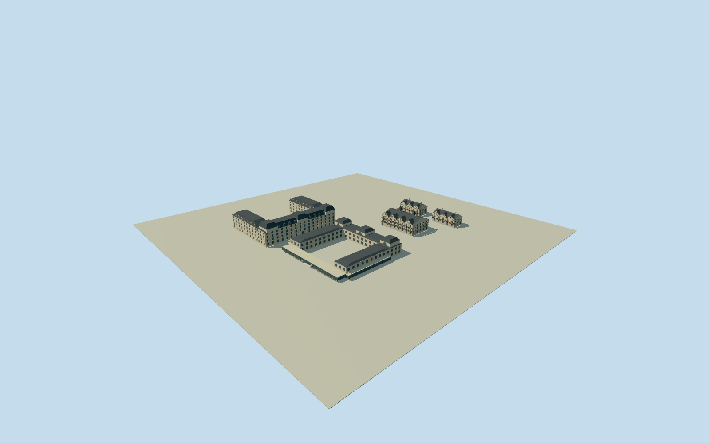

# Bristol Hotel, Mar del Plata

Full historical1913three-block hotel ensemble: original four-gable timber-grid lodging house/two pyramidal turrets/open balconies and related lodging wings; separate ItalianateUpublic halls/real open high courtyard/low glazed veranda/pavilions; separate four-floor academicistUguest annex/mansard/three frontal pavilions. Three exact published Qualla1899/1913PDoriginals, current street-vector registration and archival text; counterpart wings/annex details and metric positions/section approximate.

Authoring state: **review-in-qa.json**. Current completion evidence is in [qa.json](qa.json) and the [completion ledger](../../../../qualla-structures/batches/qualla-002.PROGRESS.md).

- [Bristol Hotel, Mar del Plata](https://qualla.com/bristol-hotel-mar-del-plata/)

Historical1913only; no default current eligibility. Full three-block scope retained: original mainTudorhouse/related1904and1908lodging wings, separate pre1920sUpublic/dining block and separate post1910four-floor academicist guest annex. No modern Bristol Center or same-name modern hotel. Exact additional-wing/annex details/census are bounded reconstructions, not photographically verified replicas.

Three exact already-published Qualla mechanical originals inspected:1899Carnaghi y Moodypublic overview/terrace, and uncredited original-house plate in WJHolland1913NewYorkbook. Exact nativeSHA1s, named periodical/BNEissue/PD-AR-Photo/PD-US-expired grants and UC-library1913USNOT_IN_COPYRIGHTbook metadata/plate caption bound. No creator invented, media metadata untouched, questionable circa1930Kohlmann/anonymous web photos unused, no supplemental photo/copied pixels/generated bitmap.

Photo-established main-house four front gables, timber grid/representative geometric tracery, three floors over arched masonry base, upper projecting balconies, steep slate roofs/two text-documented pyramidal turrets retained. Main45x28mcomes from secondary description; exact floor heights, turret positions, return roof junctions, exposed back/extra lodging houses and neutral historic colors estimated.

PublicUblock preserves clear high courtyard, long low glazed own terrace/verandas and distinct pale Italianate two-level halls/roof pavilions. Selected1899form represents pre1920sinfill;1909minor alterations not individually surveyed. Annex French academicist facade, four guest floors after1910, mansard and three principal pavilion masses follow historical text; its own photographic exterior and metric corners unavailable. No claim of full-period photographic coverage.

Current original native lodging-block intersections and EntreRios vector set signed placement frame; modern roads/shoreline cannot certify historic demolished footprints. Dining/annex block geometry, native text conflicts about triangular third block, component separations and exact1913relative floors explicit estimates. No parcel extrusion, streets/plaza/beach/terrain scenery or underground tunnel interiors.

Independent raw terrain/approach remain unchanged without clipping, fitting or flattening. Composite urban heights do not certify historic sidewalk/basement/threshold contact;1mdeep intrinsic bases/short own steps approximate. Review ground/synthetic context are fixtures. No flags/signs/logos, people/carriages/cars/trees/fences or site platforms.

Build: `node packages/worldgen/scripts/generate-authored-places.mjs --ids=bristol_hotel_mar_del_plata`. Add `--check` to verify exact regeneration. 31237 triangles; 6 materials; no embedded photographs.
