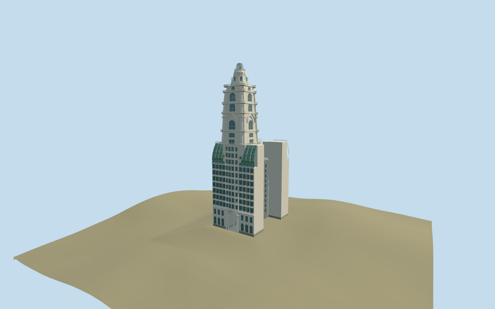

# Palacio Barolo

H-plan palace with a through passage, repeated projecting bow windows, three-level green mansards, central bays and circular balconies, pointed tower arches, layered cornices, ribbed crown and glazed lighthouse.

## Evidence and reconstruction

Published dimensions and reconstructed details are separated in spec.json. Primary references:

- [Reference](https://palaciobarolo.com.ar/palacio-barolo/resena-historica/)
- [Reference](https://palaciobarolo.com.ar/palacio-barolo/arquitectura/)
- [Reference](https://palaciobarolo.com.ar/multimedia/)
- [Reference](https://buenosaires.gob.ar/areas/cultura/cpphc/archivos/libros/temas_15.pdf)
- [Reference](https://www.argentina.gob.ar/node/439660)
- [Reference](https://documentosboletinoficial.buenosaires.gob.ar/publico/PE-DIS-MJGGC-DGIUR-663-26-ANX.pdf)
- [Reference](https://commons.wikimedia.org/wiki/File:Palacio_Barolo_(desde_calle_Yrigoyen).JPG)
- [Reference](https://elojodelarte.com/patrimonio/el-palacio-barolo)

No third-party geometry, photograph or bitmap texture is embedded. Shared surface graphs come from the central library; vertex tints carry model colors. Glazing uses PBR materials; transparent surfaces are declared per model.

## Model and axes

62,940 triangles; 127,964 vertices; 5 material groups; 5,365,120 bytes. Native bounds: -15.500, 0.000, -23.866 to 15.500, 100.000, 23.866. Source hash: `sha256:fcb0a63abd36b33013ce8513ccd3d73b0e751e39956523368f0e595ce0f3881d`.

{"up":"+Y","longitudinal":"+Z toward Hipólito Yrigoyen","front":"Native-Z toward Avenida de Mayo north of the model; native+Z toward Hipólito Yrigoyen.","origin":"Approximate PMTiles named-place center at terrain contact; exact cadastral parcel remains unverified."}

Owner-directed picture/standard viewer PMTiles approximate fit. PMTiles named Palacio Barolo point[-58.38572770357132,-34.60966313520602] agrees within about0.5m with retained anchor[-58.38572525,-34.60965975]. Retain heading0.086139560133: native-Z faces Avenida de Mayo to the north, native+Z Hipólito Yrigoyen to the south. Existing100m tower,30.88x44.21m H-plan and7.5x13.5m through passage remain. Inspected aerial front picture supports tower, green mansards, bow windows and crowned lantern. The underlying60m mapped envelope contradicts the source width; accept approximate center/street fit, do not stretch source or suppress neighboring map buildings. Exact parcel sides, party walls, tower-to-parcel offset, doorway thresholds and elevations remain uncertain. Approximate PMTiles[-70,0] ground and bounded preview correction are separate from raw elevations.

## Reproduce

Run `node packages/worldgen/scripts/generate-signature-towers.mjs --ids=barolo_palace` (or add `--check`). The generator preserves manually edited masters by checking their baseline hashes. Import through the standard authored-model workflow with optimization disabled; then capture all QA cameras, including shared-surface views.

## Pending work

- Owner-directed picture/standard viewer PMTiles approximate fit. PMTiles named Palacio Barolo point[-58.38572770357132,-34.60966313520602] agrees within about0.5m with retained anchor[-58.38572525,-34.60965975]. Retain heading0.086139560133: native-Z faces Avenida de Mayo to the north, native+Z Hipólito Yrigoyen to the south. Existing100m tower,30.88x44.21m H-plan and7.5x13.5m through passage remain. Inspected aerial front picture supports tower, green mansards, bow windows and crowned lantern. The underlying60m mapped envelope contradicts the source width; accept approximate center/street fit, do not stretch source or suppress neighboring map buildings. Exact parcel sides, party walls, tower-to-parcel offset, doorway thresholds and elevations remain uncertain. Approximate PMTiles[-70,0] ground and bounded preview correction are separate from raw elevations.

This bundle follows the medium-fi standard. Medium-fi appearance and geographic fit are reviewed separately. Hash-bound visual acceptance is recorded separately after capture inspection.
