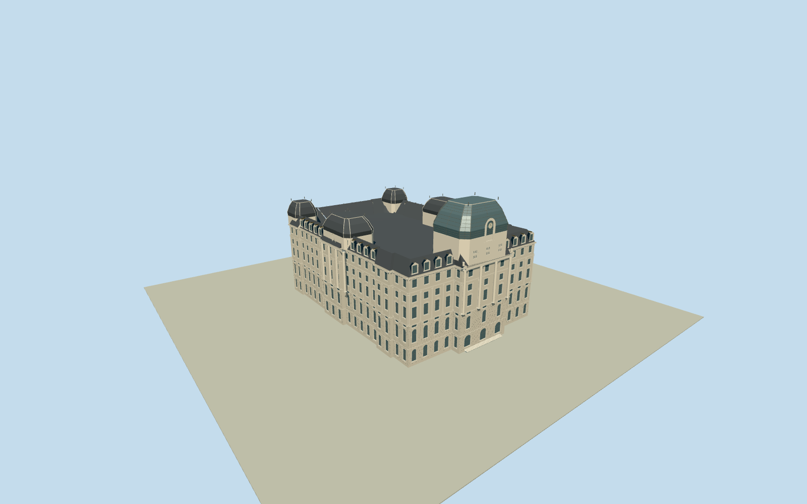

# Buenos Aires Central Post Office

Complete native postal palace envelope: arched entrances, rusticated lower stages, giant columned pavilions, cornices/recessed windows, perimeter mansard/dormers, northern corner cupolas, side cupolas and large south clock/glazed main cupola. Qualla-first exact public-domain originals and current primary operator facts; hidden roof sections and facade census approximate.

Authoring state: **review-in-qa.json**. Current completion evidence is in [qa.json](qa.json) and the [completion ledger](../../../../qualla-structures/batches/qualla-002.PROGRESS.md).

- [Buenos Aires Central Post Office](https://qualla.com/buenos-aires-central-post-office/)

Original46-vertex named nativeway17444532/Q19960845controls full envelope, south projection, small side offsets and rounded north corners without scaling. Original south edge/bounding midpoint set heading/anchor. Approximate vertical section reaches62m main cupola; native50mheight is ambiguous and retained as original metadata, not presented as a certified full roof bound.

Exact Qualla2010ElsapucaiPD-user original inspected first; two supplemental2008south/west originals byClaudioElias have exact nativeSHA1and explicit own-workPD-self grants. Photographs establish preserved exterior/roof form, not a current unscaffolded image. Main-cupola faceted glass covering follows primary operator/city tourism restoration text. No non-PDphotograph/drawing/artwork, copied pixels or generated texture.

Roof layout uses photo-controlled large south main cupola, west central pavilion and rounded north-corner forms; corresponding east/north roof details, counts/precise sections, modern glass tint/panel census and unobserved inner roof/service arrangement are bounded estimates. Main glass follows historic curved truncated roof form; no interior/concert hall/art installation or engineering survey claim.

Pale Beaux-Arts facade includes true inset glazed apertures, representative arched entrances, rusticated lower stages, central columns/giant pilasters, cornice hierarchy, mansard dormers and clock dormer. Exact ornament/capital/window/baluster census and restored surface color estimated; simplified far levels retain dominant roof/pavilion arrangement and full envelope.

Fixed dry south approach and raw independent Terrarium field remain unchanged. Composite urban DEM does not certify sidewalk/basement/threshold contact.1.2mdeep base and short own entrance steps are approximate. Exclude whole plaza, street, neighboring buildings, scenery/landscape, construction scaffolds/equipment, lettering/logos, antennas, vehicles and people.

Build: `node packages/worldgen/scripts/generate-authored-places.mjs --ids=buenos_aires_central_post_office`. Add `--check` to verify exact regeneration. 51322 triangles; 6 materials; no embedded photographs.
