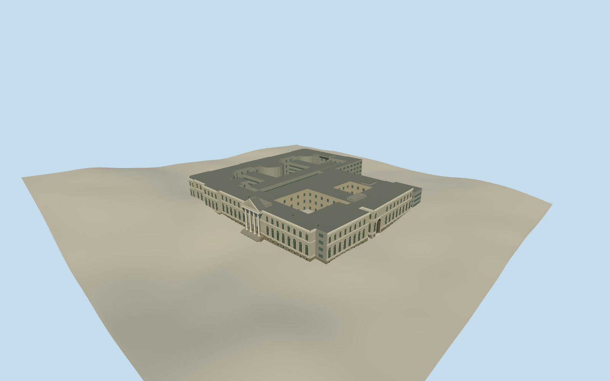

# Faculty of Economic Sciences, University of Buenos Aires

The UBA Faculty of Economic Sciences has a stone-trimmed Córdoba entrance and an arched Uriburu portal for the cultural center, with courts and connected annexes.

Authoring state: **review-in-qa.json**. Current completion evidence is in [qa.json](qa.json) and the [completion ledger](../../../../qualla-structures/batches/qualla-003.PROGRESS.md).

- [Museum of Foreign Debt](https://qualla.com/museum-of-foreign-debt/)

The 2010 west elevation is directly supported. Córdoba details, smaller court sections and most annex heights are estimates.

The university’s attached volumes are modeled as one exterior asset. The museum galleries are below street level, and the story anchor identifies them within the building.

Build: `node content/worldgen/source/places/69/69y/buenos_aires_faculty_of_economic_sciences/models/generate-buenos-aires-faculty-of-economic-sciences.mjs`. Add `--check` to verify exact regeneration. 25140 triangles; 7 materials; no embedded photographs.
