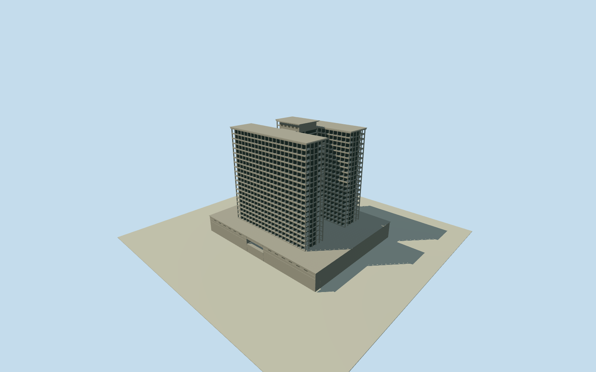

# Caseros Prison (construction1969)

Whole Caseros Prison in the explicit1969 construction appearance: both tall concrete-framed towers with deep repetitive bay recesses/slabs/bands, entire connecting H-core, complete two-level podium/below-grade structural volume/recessed entry and rooftop crown/plant. Full hidden plan, horizontal sizes, sections, bay census and historic registration are bounded architectural estimates within unchanged original parameters. Separate old prison/neighbors, current replacement building and unbuilt judicial maquette excluded.

Authoring state: **review-in-qa.json**. Current completion evidence is in [qa.json](qa.json) and the [completion ledger](../../../../qualla-structures/batches/qualla-002.PROGRESS.md).

- [Caseros Prison](https://qualla.com/caseros-prison/)

Personally inspected exact already-cleared published845x485original1969 construction photograph. Both raised structural wings/core/podium/open grid/crown are present; construction phase is the intended historical model. Final1979 facade cladding is outside represented phase and is not a completion requirement. Original P numerical sections, all floors, complete outlines, original source frame and original independent field preserved byte-for-byte. Supersedes initial draft-only approval notes for1969 phase only, no assertion that exact plan was measured.

Original256m129x129 field/16641heights/two raw Terrarium tiles frozen before this independent floor and draft sections. Floor follows one south approach sample; no field normalization or fitting. Main estimated dimensions stay fixed during draft geometry/render inspection. Original source may contain urban roof/canopy artifacts and is not a historic ground survey.

Whole construction-state1969appearance, not final1979 cladding or current demolished-site replacement.

Horizontal sizes/room-depth voids/column and slab census/podiumentry/roofplant/hiddenrear/registration and historical grade are bounded estimates; fixed main parameters retained.

Sitepoint Q5048422 and neighborhood bearing give approximate registration, no contemporary measured historic footprint. Currentway878927699 and olderprisonrelation19191978 excluded.

Original independent256m129²field/16641heights/two rawtiles/sourceframe/floor+.3301/storeyheight3.2/podium6/Hwings64x16/connector12x24 preserved. Modern surface heights cannot certify1969grade. No field flattening/refit/reacquisition; review unmasked field.

Unrecorded author in original archival construction photograph preserved. Exact nativePD-AR-Photo/revision872588548/nativeSHA19eca940c8d038c78f2ce4aab4088d55ccb72df4b/original845x485 bytes; no modern attribution sources or questionable imagery used.

Build: `node content/worldgen/source/places/69/69y/caseros_prison/models/generate-caseros.mjs`. Add `--check` to verify exact regeneration. 5052 triangles; 1 materials; no embedded photographs.
