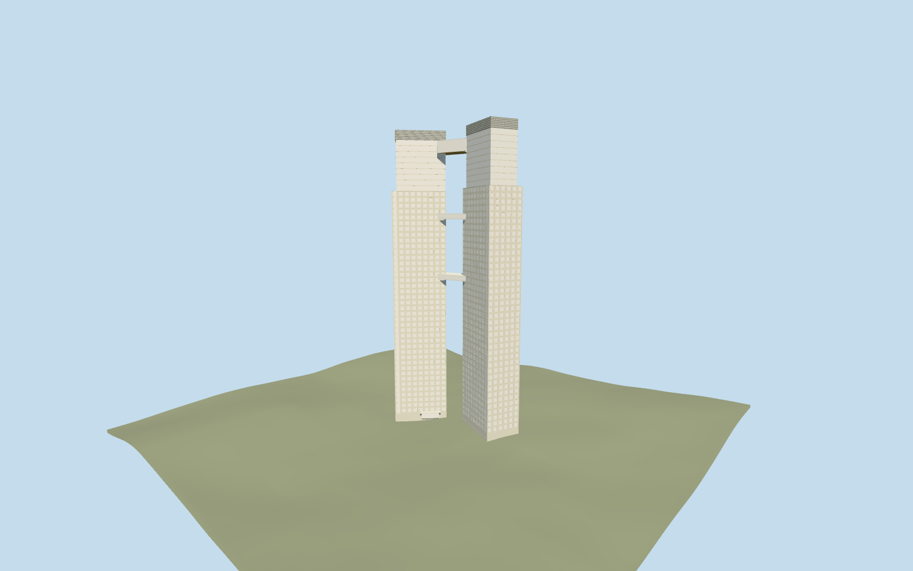

# El Faro Towers

Specific connected El Faro compound: both individually angled mapped 160m shafts, pale punched-window concrete frames, dark glazed inner strips/stepped upper storeys, closed roofs and pale louvered crowns, mapped high connector and two picture-led intermediate bridges, bounded entry canopies. Four existing shared concrete/window-grid/paint/membrane graphs. No neighboring high-rises, whole-block podium, ground-covering platform, copied signs/photo atlas, furnished interiors or construction cranes.

## Evidence and reconstruction

Published dimensions and reconstructed details are separated in spec.json. Primary references:

- [Reference](https://commons.wikimedia.org/wiki/File:Torres_El_Faro_en_Puerto_Madero.jpg)
- [Reference](https://commons.wikimedia.org/wiki/File:Reserva_ecol%C3%B3gica_Torres_el_faro_Buenos_Aires.jpg)

Specific connected El Faro compound: both individually angled mapped 160m shafts, pale punched-window concrete frames, dark glazed inner strips/stepped upper storeys, closed roofs and pale louvered crowns, mapped high connector and two picture-led intermediate bridges, bounded entry canopies. Four existing shared concrete/window-grid/paint/membrane graphs. No neighboring high-rises, whole-block podium, ground-covering platform, copied signs/photo atlas, furnished interiors or construction cranes.

## Model and axes

36,068 triangles; 108,204 vertices; 4 material groups; 4,331,108 bytes. Native bounds: -14.028, -1.008, -34.968 to 26.816, 162.310, 43.717. Source hash: `sha256:a8c06f3c6044c723560fc2bed60439a18b4ddf12c4fd7bbb74f493756070553b`.

{"x":"east","y":"up","z":"south"}

The geographic proposal uses exact-QID OpenStreetMap evidence. Map-derived orientation and estimated architectural details require real-site visual review; preview eligibility is distinct from geographic/fidelity approval. Map attribution: © OpenStreetMap contributors, ODbL-1.0.

## Reproduce

Run `node packages/worldgen/scripts/generate-additional-landmarks.mjs --ids=el_faro_towers` (or add `--check`). The generator preserves manually edited masters by checking their baseline hashes. Import through the standard authored-model workflow with optimization disabled; then capture all QA cameras, including shared-surface views.

## Pending work

- Specific connected El Faro compound: both individually angled mapped 160m shafts, pale punched-window concrete frames, dark glazed inner strips/stepped upper storeys, closed roofs and pale louvered crowns, mapped high connector and two picture-led intermediate bridges, bounded entry canopies. Four existing shared concrete/window-grid/paint/membrane graphs. No neighboring high-rises, whole-block podium, ground-covering platform, copied signs/photo atlas, furnished interiors or construction cranes.
- Q526622 retained reference lies within the distinctive pair. Standard Protomaps20261014 buildings35184495506605/35184628893115 (OSMways123417773/256804283) have separate rotated rectangles and160m values, connected by building_part35184628893116 (way256804284) at min_height147/height153. Ordinary front/reverse pictures identify this connected pair. These native geometries control the two separate orientations and bridge, not a generic twin box. Live OSM tags were rate limited and no exact live Wikidata-tag check is claimed. Fine facade allocation retains20degree/2m approximation.
- Both native shafts are160m; the mapped upper connector spans147..153m. Native height provenance is unqualified, not a survey. Picture-led main concrete elevation128m, upper glazing155m, louvered crowns160m, fine windows/floor pitch3.1m and two lower links at79..81.4m/112..114.4m are visualization estimates. Lower connector inventory/heights and hidden reverse facade details remain explicitly approximate; no surveyed floor count or interior circulation is claimed.
- Retain original6m standard Mapzen ground/native roads/water and every independent surrounding building. Replace only the two native El Faro shafts and their mapped high connector. Own bounded buried feet meet coarse grade with separate tower floor datums; narrow entry canopies stay attached to their own shafts. No whole-block podium, broad slab, flattening or ground/water cutout. Native terrain/water levels are not surveyed foundation/flood measurements.
- Two ordinary front/reverse pictures were inspected. PMTiles160m/147..153m values have unqualified height provenance; lower bridge levels, floor rhythm, crowns and hidden reverse details are visualization estimates. Live OSM tags were rate limited. No exact-tag or surveyed height claim, copied photo atlas, neighboring tower or whole-block podium.

This bundle follows the medium-fi standard. Medium-fi appearance and geographic fit are reviewed separately. Hash-bound visual acceptance is recorded separately after capture inspection.
