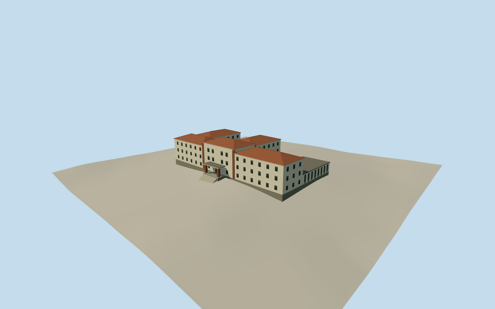

# ESMA Museum and Site of Memory

The former ESMA Officers’ Quarters in July 2013, with brick-pier porch, tile roofs and open courts.

Authoring state: **review-in-qa.json**. Current completion evidence is in [qa.json](qa.json) and the [completion ledger](../../../../qualla-structures/batches/qualla-003.PROGRESS.md).

- [ESMA Museum and Site of Memory](https://qualla.com/navy-petty-officers-school/)

The modern mapped main-building envelope is used for the July 2013 exterior. The entrance porch projection, roof sections, wing heights, bay spacing and southeast assignment of the low rear arm are visual estimates.

The two 2013 photographs establish the material palette and the distinction between the low arm and the three-storey wings. Main avenue elevation details are reconstructed from the written record.

The original 128-meter elevation field remains unchanged. Ground contact, the approach steps and the exposure of the textured base are estimates at the original provider resolution.

The model depicts the exterior before the 2014–2015 exhibit works. Its date range applies to the represented 2013 state.

Build: `node content/worldgen/source/places/69/69y/esma_museum_and_site_of_memory/models/generate-esma.mjs`. Add `--check` to verify exact regeneration. 4742 triangles; 6 materials; no embedded photographs.
