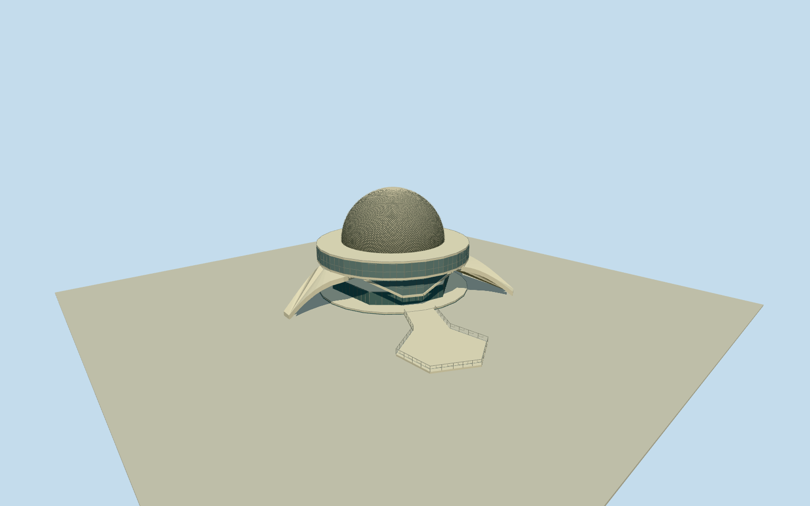

# Galileo Galilei Planetarium

Whole Galileo Galilei Planetarium exterior: exact circular upper glazed gallery and roof/dome, three broad curved tapered concrete legs and open undercroft, lower glazed V-stair/foyer structure and visible basement shell, intrinsic short polygonal entrance bridge with bounded rail/steps. Recreate perforated diamond metal dome over opaque inner projection shell using geometry and shared procedural materials. Exclude lake, grounds/landscaping/publicpaths, detachedservicebuildings, sculptures/exhibits/meteorites/interiors, people/vehicles/fences/temporarybanners/signage/oldroofdevices. Maintain allnativepartspositions/rings without whole-sitepad orsimplefilledcylinderunderuppergallery. Realopenvoidsbetweenthreelegs, lowerverticalglassVbays/staircases, mainringunderfloor andentrancebridge. Use source2007perforateddiamondlatticedomeoverdarkinneropaqueprojectionhemisphere; geometricdiamondstrips approximatedatlowerLODs,notbakedphotopixels. Keep allsourcegroundunchanged. HiddenVstairs/groundcore/ownbridge support andcurrentneutralfinish estimates.

Authoring state: **review-in-qa.json**. Current completion evidence is in [qa.json](qa.json) and the [completion ledger](../../../../qualla-structures/batches/qualla-002.PROGRESS.md).

- [Galileo Galilei Planetarium](https://qualla.com/galileo-galilei-planetarium/)

Exactoriginalnamedway1224777740/Q606675 supplies all28uppergalleryvertices, associateddomeway1224777739all26vertices, lowerglasspart1225006821all18vertices, three19/18nodecurvedlegroofs and intrinsic13vertexentrybridge1224777736. Domeoriginalvertexmeananchor; heading0east/southnativeaxespreserveworldpositions without fitting. Nativebodyheight10/min7 andlegroofheight8 are coarsesectiontags; photographguides3.4mglassgallery/underfloorandcurvedlegsections. Nativedometag24/roofheight13.8notperfectlyconsistentwith~11.75mradius/photohemisphere; retain tagsraw, usehemisphere11.75mabove10.4mroofasboundedphotographicsection. Basement/exactfloors/ownbridgegrade/hiddenbackwallsunverified. No lake/landscape/parcel extrusion.

Four exact2816x2112ClaudioElias2007ownphotographPDself originals individually inspected; currentpreservedform controlledbytheseviews andexactnativeparts. No bitmap/copiedpixels or generatedimages. CurrentLEDinstallation/finish/hiddenrenovationsunverified; oldbanners/fences/spotlights/antenna omitted.

Outer gallery native28vertexplan,26vertexdomecontrol, lower18vertexglasspart, fullthreecurvedlegplans and13vertexintrinsicentrancebridge retained atnormaldetail. Skyline simplifiescircleandlegs within stated1.1merror. Coarseheighttags preservedraw; hemisphere22.15mtop/10.4mspring/~11.75mradius andlegcurve/section/Vglazedstairs/groundcore/basementsection approximate. Interiorprojectiondiameter20m is notoutergallerydiameter.

Visible lowerVglazing is vertical in its original nativeplan, with photo-basedlowedgeprofiles anddiagonalconcreteframes. Groundfoyerwalls set15percentinsideandbasement/ownentryflooruseuppergalleryprojectiontojoinnativebridge; hiddenplan/sectionestimates,notasurveyofallfloorplans. No interiors/exhibits/meteorites/statues/gardens/lake/externalpublicpaths/otherbuildings orwhole-siteslab. Ownentrybridge footprintisnative; exactlevel/railmotif/supports andconcealedrearentrydetails estimated.

Diamondouterdome rebuilt as intersecting thinmetalstripgeometry withrealapertures over a separateopaqueinnerhemisphere. It is an architectural mediumfi approximation, not exact panel/fastener/LEDcensus. Closeup144stripfamilieseachway, lowerlevelsreducepattern; skylineaverageclosedoutertone preservesradius/silhouette.

Original160m81x81Terrariumfield/6561values/2tiles/heightPNGfrozenbeforegeometry atnativeouterbridgepoint. RawDEMmayblurvegetation/buildingorvoids; no flattening/earthcut/fittedslab. Exactownbasement/legcontactcompatiblelivehostterrainnotverified; previewonly,replaceFootprint=false.

Build: `node packages/worldgen/scripts/generate-authored-places.mjs --ids=galileo_galilei_planetarium`. Add `--check` to verify exact regeneration. 37774 triangles; 5 materials; no embedded photographs.
