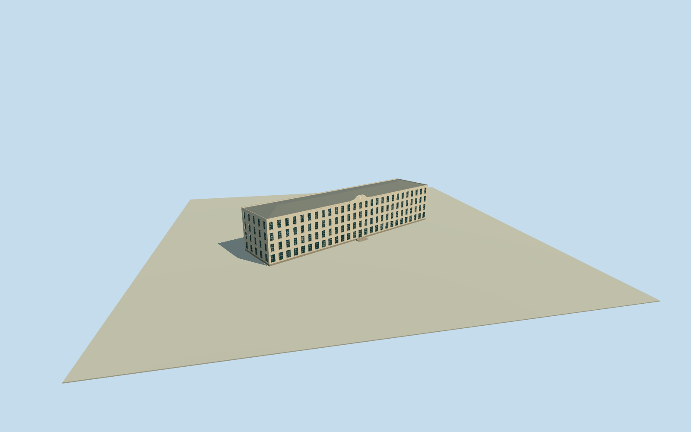

# Hotel de Inmigrantes, Buenos Aires (circa1915)

Whole surviving1911 Hotel de Inmigrantes main building in approximate circa1915 form: complete native six-control four-storey hotel/dining/dormitory structure, both long facades, end walls, concealed four-sided metal roof, parapet, central clock crown, original large ground openings and upper dormitory windows. Exclude former1880Rotonda hotel and detached immigration administration/customs/hospital/embarkation buildings, gardens, later museum exhibits, statues/people/signage and the whole historical property parcel. No facade-only model.

Authoring state: **review-in-qa.json**. Current completion evidence is in [qa.json](qa.json) and the [completion ledger](../../../../qualla-structures/batches/qualla-002.PROGRESS.md).

- [Hotel de Inmigrantes](https://qualla.com/hotel-de-inmigrantes/)

Whole surviving1911 Hotel de Inmigrantes main building in approximate circa1915 form: complete native six-control four-storey hotel/dining/dormitory structure, both long facades, end walls, concealed four-sided metal roof, parapet, central clock crown, original large ground openings and upper dormitory windows. Exclude former1880Rotonda hotel and detached immigration administration/customs/hospital/embarkation buildings, gardens, later museum exhibits, statues/people/signage and the whole historical property parcel. No facade-only model.

Only exact native expired Carpenter original used as imagery; historical facade visible, rear/roof/dimensions/finish and exact date are bounded estimates.

Primary1990heritage decree describes four floors, reinforced concrete beam/slab/column rhythm, hipped metal roof and raised central crown. Native building:levels=6 conflicts with primary and actual photo four floors and is not adopted.

Exact mainhotel building at native[-58.368...,-34.592...] differs from old story/Wikidata marker; article/reference content unchanged, actual native outline used for approximate historical placement.

Choose independent original terrain before all numeric floors/roof/main sections and preserve thereafter. No hidden-photo/measured-grade gate; no full property parcel/neighbor proxy.

Circa1915 represents the entire completed1911mainhotel physical building, not exact photograph date or current2026museum. Primary decree describes fourfloors and four-sidedmetal roof. All native6outercontrols retained; detached administrative/hospital/customs/embarkation/garden pavilions and property grounds excluded.

Floor/eave/roof/crown/stair heights, hidden roof shape/ridge, rear/end fenestration,27long/5endbay census, frames/pilasters/cornices and grade are bounded reconstruction estimates. Front central clock crown and tall/arched sash window type derive from exact original; no requirement for an independent photo of every rear bay.

Only monochrome original, so warm offwhiteplaster/lightpainted timber frames/grey metal roof/dark opaque glazing and limestone plinth are declared finish approximations, not calibrated colour or phototextures. Clock face uses simple geometric dial/hands, no signage/art/statue/people/garden model.

Coarse original urban coastal field range-1.5828..22m at9.3903m datum may locally obscure lowerhotel; historical grade/shoreline/registration not surveyed or ground-contact certified. Never flatten/mask/move the field or refit floors/roof after renders.

Four authoredLODs retain all four floors/full native footprint/complete hipped roof/parapet/clockcrown, with reduced windows/trim/tessellation at distance. No separate finalization/review of prior accepted models.

Build: `node content/worldgen/source/places/69/69y/hotel_de_inmigrantes/models/generate-house.mjs`. Add `--check` to verify exact regeneration. 10555 triangles; 7 materials; no embedded photographs.
