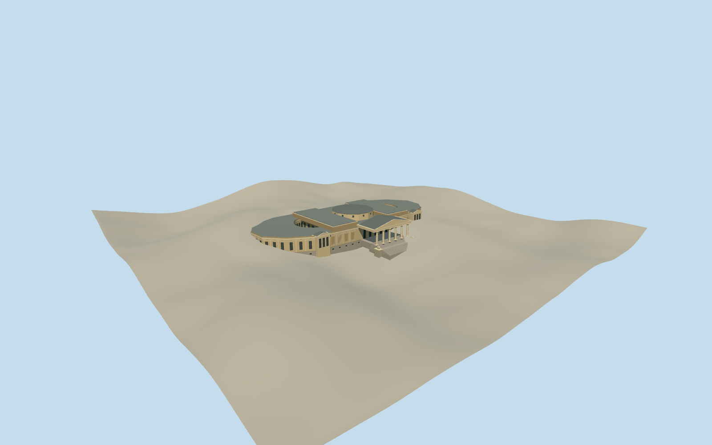

# La Plata Museum

La Plata Museum’s six-column portico and paired stone cats, curved gallery wings, original open courts and central rotunda in 1912.

Authoring state: **review-in-qa.json**. Current completion evidence is in [qa.json](qa.json) and the [completion ledger](../../../../qualla-structures/batches/qualla-003.PROGRESS.md).

- [La Plata Museum](https://qualla.com/la-plata-museum/)

The building represents the 1912 museum before the library filled one original court. The historic court shapes, roofs, concealed elevations and individual ornaments are approximated.

The original terrain field is preserved. Local Terrarium relief rises behind the frontage and covers some lower rear exterior detail in the terrain view. Precise historic grade and paving are approximate.

The black-and-white original controls architectural forms. The warm exterior palette and roof colors are estimates.

Build: `node content/worldgen/source/places/69/69y/la_plata_museum/models/generate-la-plata-museum.mjs`. Add `--check` to verify exact regeneration. 10496 triangles; 5 materials; no embedded photographs.
