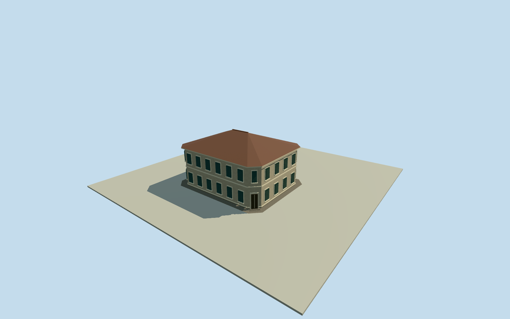

# Mansión Seré — complete original house, approximate1977

Complete original1900French-style two-storeyMansionSere, whole hippedtile roof/chamferedcorners/tallclosedshutters/cornerentry/three steps/basementbase/perimeterpaving/fullS-SEannex andconnectinglink. Writtennational/provincial/archaeologist/testimonyfacts only; everyimageunused. Wholeplan/sizes/finish/roofandsections/siteposition explicitly estimated; no modernchalet/sportshall/canopyproxy.

Authoring state: **review-in-qa.json**. Current completion evidence is in [qa.json](qa.json) and the [completion ledger](../../../../qualla-structures/batches/qualla-002.PROGRESS.md).

- [Mansión Seré](https://qualla.com/mansion-sere/)

Whole original MansionSere house in intact1977phase: two-storey French-style rectangular/chamfered-corner mainbody, complete hipped roof/allfour elevations, basal/basement exterior, diagonal mainentry/steps, perimeter tiled paving and full intrinsic S-SEgroundfloorannex/connectingcorridor. Everyimageunused. Current1997CasaMemoria chalet, sports hall,2013excavationcanopy and grounds not proxies. Originalhouse plan/size/heading/placement within grounds explicitly estimated from primarywrittenfacts and originalcontextstreetcontrols; no nativehouseoutline or exactsurvey claimed.

Original1900French-style two-storey house with basement and hipped roof, complete mainbody/chamferedcorners/entry/steps/perimeter paving and full S-SEannex/connectingpassage. Exact mainplan20x16m, annex7x8m/link4x4m, chamfer1.8m, openingcounts, roofandfloorsections/finish/position are original estimates.6mplan/height uncertainty;50msiteposition uncertainty. No current cadastral originalhouse outline exists in these inputs. All actual originalBlasParera numericstreetcontrols retained ascontext only; not borrowed as a building footprint or identity.

Original estimated originalhouse position40mSWof separate1997CasaMemoria contextpoint, within named historicgrounds. This is approximate registration from known nearby original/demolished and modernsite relationship, not a measured housepoint, tracedplan, excavationsurvey or currentbuilding replacement. Actual currentmodernhouse/sportshall/2013canopy excluded. Native Quallastorypin/content untouched. Heading0 plus45degree uncertainty; absolute position/roof/footprint could differ materially from original.

Independent original256m129x129field,16641values/1rawtile,datum32.9431m/range26.0367..40.3032m frozen before floors/sections/geometry. Floor.2m,foundation-.65m,twostoreys4.2meach/roofeaves8.6m/ridge11.7m; annexeaves3.8m/ridge4.9m andlinkroof3.7m selected once afterfield. Original field/frame/floors/mainsections never cut/masked/flattened/refetched/reframed/refit for captures. Composite urban DEM maybury/expose base/perimeterpaving; no surveyed groundcontact or verticalregistration.

Written testimony supports rectangularbody/chamferedentry/tallwindows andclosedshutters; exact baycensus, shutterlouvres/woodtone, plastercornices/rustication/tilepattern, doorwayheight/smallsteps and annexroof are original estimates. Basement is indicated in basalexterior; unseen interior rooms, subdivisions and below-ground survey are not invented. Easternbrickwell is not included because its1977appearance/dating is unresolved; it is not a houseproxy.

Qualla first2families/zero conflicts: public-domain plaque/portrait show no architecture; everyimageunused. Uncertainhistorichouse/modernphotos, CPMimages, reportphotographs/figures/plans/drawings unused. Primary nationalheritage writtenpage directlyretrieved; CPMtext read viawebcache/directDNSfailure disclosed; primaryGAAMIreportPDFtext read; primaryjudicialdescription inindexedrepostedprocess text, no originalcourt-host byteclaim. No rightsrepair or imageapprovalclaimed.

Intact1977datedproposal/currentWorldEligible false;1978fire/1985demolition and separate1997chalet not mixed intohistoricappearance. Wholebody/annex/corridor/allroofs/cornerentry retained atallfourLODs. Finewindowpanels/shutterlouvres/roofcourses reduce atdistance. Originalproceduralmedium-fi exterior from sparsewrittenfacts; exact architectural likeness remains bounded by unknownplan/finish/registration.

Build: `node content/worldgen/source/places/69/69y/mansion_sere/models/generate-house.mjs`. Add `--check` to verify exact regeneration. 9400 triangles; 6 materials; no embedded photographs.
