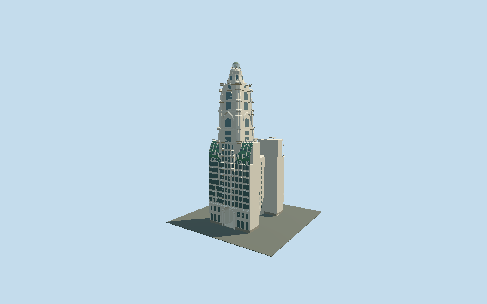

# Palacio Barolo

H-plan palace with a through passage, repeated projecting bow windows, three-level green mansards, central bays and circular balconies, pointed tower arches, layered cornices, ribbed crown and glazed lighthouse.

## Evidence and reconstruction

Published dimensions and reconstructed details are separated in spec.json. Primary references:

- [Reference](https://palaciobarolo.com.ar/palacio-barolo/resena-historica/)
- [Reference](https://palaciobarolo.com.ar/palacio-barolo/arquitectura/)
- [Reference](https://palaciobarolo.com.ar/multimedia/)
- [Reference](https://buenosaires.gob.ar/areas/cultura/cpphc/archivos/libros/temas_15.pdf)
- [Reference](https://www.argentina.gob.ar/node/439660)
- [Reference](https://documentosboletinoficial.buenosaires.gob.ar/publico/PE-DIS-MJGGC-DGIUR-663-26-ANX.pdf)
- [Reference](https://commons.wikimedia.org/wiki/File:Palacio_Barolo_(desde_calle_Yrigoyen).JPG)
- [Reference](https://elojodelarte.com/patrimonio/el-palacio-barolo)

No third-party geometry, photograph or bitmap texture is embedded. Shared surface graphs come from the central library; vertex tints carry model colors. Glazing uses PBR materials; transparent surfaces are declared per model.

## Model and axes

62,940 triangles; 127,964 vertices; 5 material groups; 5,365,120 bytes. Native bounds: -15.500, 0.000, -23.866 to 15.500, 100.000, 23.866. Source hash: `sha256:fcb0a63abd36b33013ce8513ccd3d73b0e751e39956523368f0e595ce0f3881d`.

{"up":"+Y","longitudinal":"+Z toward Hipólito Yrigoyen","front":"-Z toward Avenida de Mayo","origin":"Working parcel center at pavement datum, not a verified geographic anchor"}

The cached exact-QID OSM footprint is inconsistent with the documented parcel width. The retained anchor and heading are evidence only; automatic placement is disabled pending a corrected parcel and signed orientation review.

## Reproduce

Run `node packages/worldgen/scripts/generate-signature-towers.mjs --ids=N0234` (or add `--check`). The generator preserves manually edited masters by checking their baseline hashes. Import through the standard authored-model workflow with optimization disabled; then capture all QA cameras, including shared-surface views.

## Pending work

- Original 49608172-byte instanced master is preserved and reproducible from the original baroloPalaceStudy.encodeAssembly (new optional runtime arch-relief switch does not change original master bytes), hash sha256:5c42c7f8fb940c395cbbe2cb43631798ebe12e94090792c8b941e980c87046d8, 870924 expanded /646738 stored triangles, four parts/116 placements and five material groups with three shared graphs and zero images. The new browser source uses the existing authored close-up reconstruction, reducing moulding/arch sampling and relief while retaining H-plan light courts, 7.5 m wide/13.5 m high through passage, repeated projecting bow bays, three-level green mansards, curved balconies, pointed arches, offset tower, ribbed crown and clear lighthouse. Skyline now retains passage and H-plan; district/street omit subpixel concentric arch-relief tubes while retaining arched glazing silhouettes to meet triangle budgets, close retains authored 62940-triangle facade. Owner 100 m overall height is retained; national 103 m overall and municipal 86 m/owner 90 m dome figures remain separate. Plot dimensions 30.88 by 44.21 m and passage dimensions follow the municipal book and owner. Intermediate elevations, bay profiles, mansard shape, tower center -14 m, court widths, ornament and lighthouse mechanism are photographic reconstructions, not measured drawings. Rear and light courts remain schematic; interiors, exact inscriptions/sculpture, shop signage and modern rooftop equipment are not modeled. Three canonical shared concrete, painted-metal and marble graphs plus opaque glazing and 52-percent clear lantern glazing give five groups with zero embedded images. Geographic registration remains unresolved: exact-QID OSM way 1386044833 spans about 60 m rather than the documented 30.88 m frontage; no stretch or footprint replacement is allowed. Official cadastral download was denied by automatic approval review; permission is pending. Physical-device performance measurements and terrain grade remain unmeasured.

This bundle follows the medium-fi standard. Medium-fi appearance and geographic fit are reviewed separately. Hash-bound visual acceptance is recorded separately after capture inspection.
