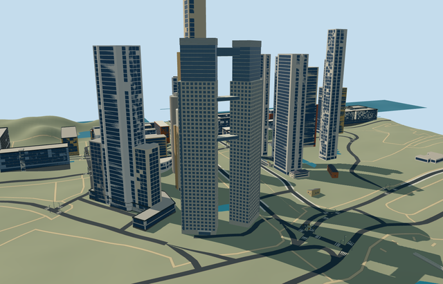

# N0635 — El Faro Towers

Reviewed 2026-10-20 in one continuous author/build/inspect/fix round.

## Appearance

Inspected all47 current source/shared/medium-fi/native-map views. Both independently angled shafts, pale punched-window frames, recessed closed blue glazing, continuous inner-end strips, stepped glazed upper storeys, attached pale louver crowns/closed roofs and all three bounded inter-tower bridges remain intact. Ground entrances are attached to their respective shafts. Two ordinary front/reverse pictures guide the specific silhouette and materials; no neighboring tower, construction crane, copied text or furnished interior is included. Native review camera was moved to an unobstructed whole-compound view without hiding independent buildings.

## Shared materials and browser levels

Four existing256-square concrete_plain/window_grid/metal_painted/membrane graphs; all canonical material refs, no embedded images or per-building atlas. Actual shared-loader reads each graph once and disposes model geometry on unload. Window slot retains the shared blue glass without a vertex tint; source-only portable frames show the bare material factors while runtime/shared/medium-fi views show the real graph bindings. Four near-level draws, separate POSITION/NORMAL GPU streams and equal CPU/GPU geometry byte accounting.

| Level | Triangles | Bytes | Draws |
| --- | ---: | ---: | ---: |
| skyline | 372 | 37144 | 1 |
| district | 2996 | 265468 | 4 |
| street | 13028 | 1159012 | 4 |
| closeup | 36068 | 3371588 | 4 |

Four independently authored browser levels retain the two different orientations, stepped upper masses and three links. Initial skyline+district302612bytes, below the3MB phone/6MB laptop budgets. Street13028triangles/1159012bytes; closeup36068triangles/3371588bytes. All four levels remain under their respective1000/4000/16000/64000triangle limits. Economy/high noon/late-afternoon and transitions inspected; distant facade grids intentionally coarsen. Physical laptop/phone and dense downtown measurements remain pending. Levels372/2996/13028/36068 triangles; at most four draws.

## Approximate map fit

Own anchor-58.35944444,-34.61230556/global heading0/native east-south. PMTilesways123417773/256804283 and high connector256804284 control the two separate rectangular frames and connected scope; picture/reference matching identifies the pair, while live OSM tags were rate limited and no exact live QID-tag verification is claimed. Shaft centres[3.105901641,-18.185626831]/[12.136751089,26.599991332]m; widths29.2417/29.1693m and depths18.7782/18.8120m retain distinct mapped axes. Separate floor datums.811111m/2.190000m and bounded buried feet meet original6m grade. All175 independent resident inputs among178 originals (249 wider records), native road inputs and526931.4535675554m2 water remain unchanged. Only the pair and high connector are removed, with zero old-shell residual. No terrain/water cutouts or broad platform; failure restores178 originals and each level releases all model geometry.

## Limits

Accepted medium-fi visualization of the whole connected pair. Native160m shafts and147..153m top-bridge values have unqualified provenance, not survey accuracy. Main concrete128m/glazed155m/crowns160m, floor rhythm, the two picture-led links79..81.4m/112..114.4m, louver and hidden reverse inventory remain explicit approximations. Fine facade alignment retains20degree/2m uncertainty. Native terrain/water are coarse, not surveyed foundation/flood levels. No claim of measured floor count, interior circulation, exact current glazing condition or complete surrounding site landscaping.

## Selected checks

Six Khronos files: zero errors/warnings.548 actual mesh/material/contact checks; 47 current inspected views. Scene validation/sim30 and strict selected medium-fi audit pass. Source/runtime/LOD hashes and material bindings verified.

Rebuild: node packages/worldgen/scripts/generate-additional-landmarks.mjs --ids=N0635; node packages/worldgen/scripts/import-next-1000-models.mjs --ids=N0635; node packages/tooling/scripts/generate-landmark-lods.mjs --ids=N0635 --force.

Source: sha256:a8c06f3c6044c723560fc2bed60439a18b4ddf12c4fd7bbb74f493756070553b

Runtime: sha256:74311e5dda3674564f4e6b46e4241d00b0fe66131a679ff36bab9da20516d59e

Input: sha256:5dec3b839914d9b71076ed22a9873b6997406d6360e53c545189f94ff3320408

## Viewed ordinary pictures

https://commons.wikimedia.org/wiki/File:Torres_El_Faro_en_Puerto_Madero.jpg — Dario Alpern; CC-BY-SA-4.0. Viewed only; no pixels copied.

https://commons.wikimedia.org/wiki/File:Reserva_ecol%C3%B3gica_Torres_el_faro_Buenos_Aires.jpg — Roberto Fiadone; CC-BY-SA-3.0. Viewed only; no pixels copied.
