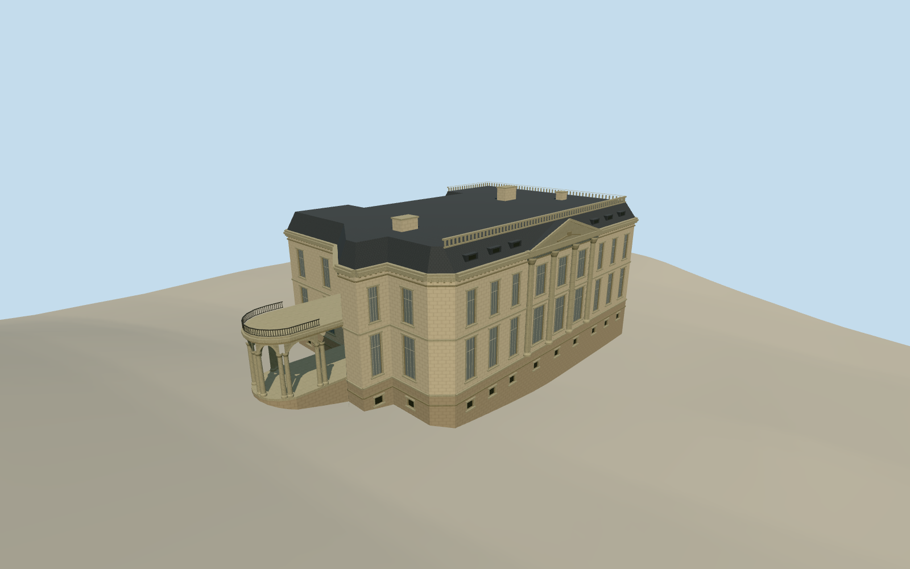

# Palacio Errázuriz Alvear, Buenos Aires

The French neoclassical Palacio Errázuriz Alvear in Buenos Aires, with its limestone avenue front, arched garden doors and open circular entrance portico.

Authoring state: **review-in-qa.json**. Current completion evidence is in [qa.json](qa.json) and the [completion ledger](../../../../qualla-structures/batches/qualla-003.PROGRESS.md).

- [National Museum of Decorative Arts, Buenos Aires](https://qualla.com/national-museum-of-decorative-arts-buenos-aires/)

Original photographs establish the December 2007 garden and portico appearance. A later cleared avenue photograph corroborates the surviving fixed silhouette.

Exact roof joins, carving, individual rear windows, stairs and vertical thresholds are approximations from the mapped footprint and photographs.

Detached garden monuments, gate, neighboring buildings and interiors are outside the scope. Photographic pixels are not embedded.

The original independent terrain is preserved. Vertical registration is an approximate source-ground fit.

Build: `node content/worldgen/source/places/69/69y/national_museum_of_decorative_arts_buenos_aires/models/generate-palace.mjs`. Add `--check` to verify exact regeneration. 15551 triangles; 5 materials; no embedded photographs.
