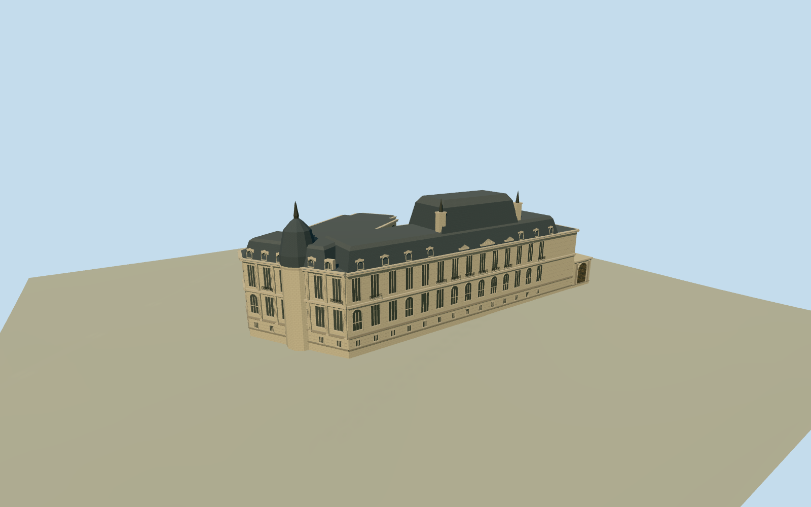

# Paz Palace

The Beaux-Arts Buenos Aires residence with an open light court, chamfered mansard corner, sculpted main range, semicircular Maipú bay, and lower Santa Fe gate.

Authoring state: **review-in-qa.json**. Current completion evidence is in [qa.json](qa.json) and the [completion ledger](../../../../qualla-structures/batches/qualla-004.PROGRESS.md).

- [Paz Palace](https://qualla.com/paz-palace/)

Draft exterior: approximate photographic proportions and simplified ornament. It is not a survey, photogrammetric reconstruction or approved current geographic replacement.

The exact June 1916 photograph establishes façade orders, mansards, curved corner, dormers and cornices. The Argentine listing identifies the sculpted principal front and lower gate.

Terrain sampling/contact, geographic alignment and site activation remain pending. Runtime LODs are produced by the registered after-import pipeline and require visual review.

Reference photos remain in the local Qualla corpus; only provenance, paths and hashes are retained here.

Build: `node content/worldgen/source/places/69/69y/paz_palace/models/generate-paz-palace.mjs`. Add `--check` to verify exact regeneration. 17816 triangles; 6 materials; no embedded photographs.
