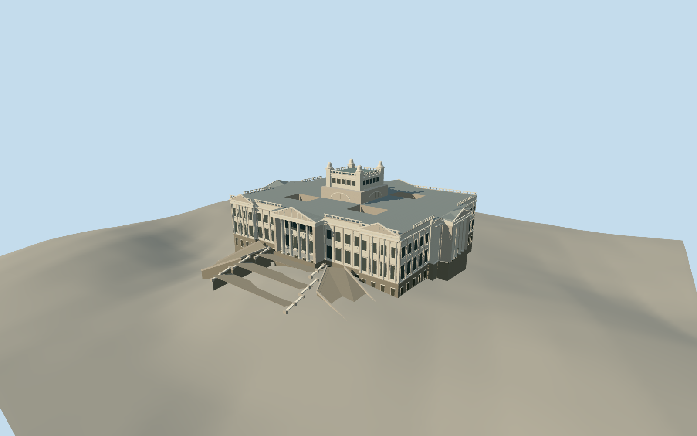

# Legislative Palace of Uruguay

The standing Legislative Palace at Montevideo, with pale neoclassical porticoes, the sculpted square lantern, four mapped courts and the monumental southern stairs.

Authoring state: **review-in-qa.json**. Current completion evidence is in [qa.json](qa.json) and the [completion ledger](../../../../qualla-structures/batches/qualla-003.PROGRESS.md).

- [Legislative Palace of Uruguay](https://qualla.com/legislative-palace-of-uruguay/)

Standing exterior. The native map grounds the building wall projections and four open light courts. Individual statues, coats of arms, cornice carving and concealed roof details are interpreted at medium fidelity.

Main stairs, ramp grades, window depths, rear capital details and exact height datums are approximate. The original source elevation samples are retained independently.

The ensemble is the palace itself with its attached podium and principal approach. Interior rooms, perimeter gardens, and transport or utility fixtures are outside the documented scope.

Build: `node content/worldgen/source/places/6c/6cb/legislative_palace_of_uruguay/models/generate-legislative-palace-of-uruguay.mjs`. Add `--check` to verify exact regeneration. 33706 triangles; 5 materials; no embedded photographs.
