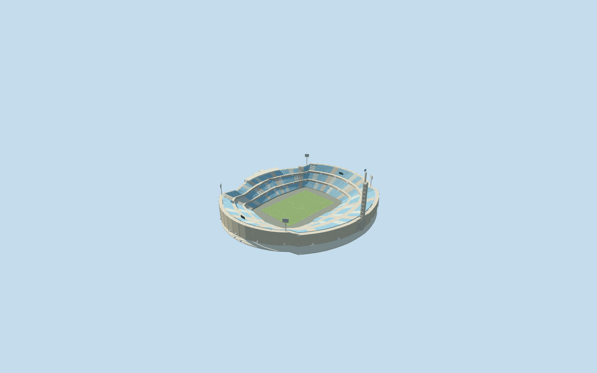
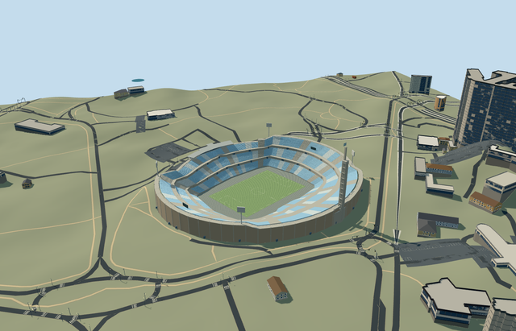

# N0732 — Estadio Centenario

Reviewed2026-10-20 in one author/build/inspect/fix pass.

## Appearance

Inspected all 48 final current source, shared-surface, medium-fi and native views. Specific asymmetrical Centenario with three blue-pale banks/closed concourse belts/visible neutral portal faces and pale aisles, paved apron/neutral field/goals, central America canopy/press gallery/connected mapped-curve posts and rakers, masonry frontage/supports, four tall light heads/neutral displays and fluted Torre de los Homenajes with side recesses/nine ledges/stepped top/shorter upper spine/crossarm and attached blue-white flag. Corrected the overlong upper spine, crossarm exposure, hidden portal faces, flag attachment and initially straight support positions during this same author/inspect/fix pass. Full tower is shown in the portable/native views; some shared/medium detail crops emphasize its shaft/ledges. No event installations, crowd, trophy, copied lettering/emblem or furnished hidden rooms.

## Shared surfaces and browser budgets

Six existing 256px graphs: concrete_plain, brick, metal_painted, metal_standing_seam, window_grid and fabric_canvas. Masonry, painted blue/pale seating/metal, low-frequency roof, shared glazing, apron and turf reuse the library. No new graph, embedded image or private atlas. Six near draws/one skyline draw; each graph read once; separate POSITION/NORMAL streams and equal CPU/GPU accounting. Opaque glazing/flag/lights approximate real optics; no working elevator or furnished rooms.

| Level | Triangles | Bytes | Draws |
| --- | ---: | ---: | ---: |
| skyline | 868 | 72596 | 1 |
| district | 3332 | 292528 | 6 |
| street | 10118 | 878828 | 6 |
| closeup | 39674 | 3437456 | 6 |

Four authored browser levels retain the mapped asymmetric bowl/open field, three principal banks, short western canopy and eastern landmark tower/mast silhouette. Fine rows, flutes, nine ledges, flag, portals and frame appear near. Levels 868/3332/10118/39674 triangles; skyline plus district 365124 bytes, below3MB phone/6MB laptop initial asset targets. Physical ordinary-laptop/phone/tablet and dense-city timing measurements remain pending.

## Approximate native placement

Retained Q498245 and named native stadiumPOI52776560645765 establish parent52776566859001, four stand records52776566858998/999/59000/59002, central western canopy52776566859020 and tower components35185924616062/63/64/65. All ten native building inputs belong to the one stadium model. Two pitch35184551622004 fragments are unioned before measuring105.209821x68.207751m field axis. Own74-point outer/16-point inner control the asymmetric272x244m body/approximately146x108m open apron. Tower at internalZ about-128m sits on the eastern Olympic stand; positive internalZ is western America. Anchor[-56.152820063690555,-34.8945116403987]/heading0/native east-south/internal X[0.5131227460968085,0.8583152377990677]/Z[-0.8583152377990677,0.5131227460968085]. Every independent building remains native. Fine20degree/2m facing and tier allocation are approximate. Production helper removes the ten integrated stadium/stand/canopy/tower records. All46 independent resident records of56 originals and all103 wider independent records of113 remain unchanged. Original6m grid, roads and735.0178761733696square metres source water retained. Nineteen actual PMTiles13/14/15 cases pass, including all detailed owned tile fragments. Generalized complexes use bounded clipping. Failure retains56 originals; every level unload restores original terrain/water/zero live model geometry. Original standard6m Mapzen grid/roads/water and all independent buildings remain unchanged. Datum23.45236358081274m defines field/modelY0; boundary samples6.731082644102909..17.97230113028232m. Retaining base, separately partitioned apron/field and bounded opening remain within every level occupied floor; individual outer posts/roof/light contacts and the tower common foot follow original grades. Only the ten integrated stadium records are replaced at99.5percent coverage; generalized merged complexes use bounded clipping. No whole precinct slab or regional terrain flattening. Failure/unload retains/restores original context.

## Limits

Four independent ordinary photographs actually viewed: Artigas Pessio2021 final shows the tower silhouette/crossarm; municipal2021 empty-bowl photo shows three blue-pale banks; Uwebart2012 exterior shows flutes/stacked recesses; Uwebart2012 panorama shows the whole bowl and America canopy. Event content was excluded. Existing2021 appearance with supplementary2012 structural references; no proposed redevelopment/current-condition claim. Stadium website certificate failure and automatic rejection of its alternate hostname were respected; those site pictures were not inspected or used. No qualified native stadium height or height datum. Working fieldY0 uses original datum23.45236358081274m; three banks1.4..8.5/12..19.6/23..31m and lower western third-bank27.8m, central America canopy32.1..32.45m/press gallery27.8..30.8m, floodlight heads45..51m and display25..29m are picture-led allocations. Native tower components carry unqualified75/100/15m heights; working shaft75m/spine90m/buttresses15m above sampled common ground follow the photographs instead of taking the unqualified100m spine as surveyed. The crossarm sits21m above that foot; flagpole reaches96m. Nine ledges/ribs/window recesses/flag dimensions and all rows/framing/equipment counts are approximate. Existing2021 bowl appearance with supplementary2012 structural references; no later/current-condition, optical, engineering, access or functional elevator certification. Original standard6m Mapzen grid/roads/water and all independent buildings remain unchanged. Datum23.45236358081274m defines field/modelY0; boundary samples6.731082644102909..17.97230113028232m. Retaining base, separately partitioned apron/field and bounded opening remain within every level occupied floor; individual outer posts/roof/light contacts and the tower common foot follow original grades. Only the ten integrated stadium records are replaced at99.5percent coverage; generalized merged complexes use bounded clipping. No whole precinct slab or regional terrain flattening. Failure/unload retains/restores original context.

## Selected checks

Six Khronos files: zero errors/warnings.9384 actual geometry/material/contact checks,48 current inspected views,nineteen actual native map-level cases. Selected source/import/placement/strict medium-fi/scene validation pass. Sim30 hash711bf2c536e6197fbfe52ae1f9bb58b328756ab4459fa2f33bef21137eaefb29.

Source sha256:9bcd3c47911f3168caac7d4a5371d91ac223c3a442f12122e36c002940c61c32

Runtime sha256:35b6803f0e5b1920a4e186a6fc1a10bef71c85a464b0091698fd165fd8bae0af

Input sha256:e480b341a23db4d321aad9f7ad55b56f37b7c45297ccc0510dd63a0b5a733cb7

Rebuild: node packages/worldgen/scripts/generate-additional-landmarks.mjs --ids=N0732; node packages/worldgen/scripts/import-next-1000-models.mjs --ids=N0732; node packages/tooling/scripts/generate-landmark-lods.mjs --ids=N0732 --force.

## Ordinary picture references

https://commons.wikimedia.org/wiki/File:Final_de_la_Copa_CONMEBOL_Libertadores_en_el_Estadio_Centenario_-_20211127dicimouyap0154.jpg — https://thumb.wikimedia.org/wikipedia/commons/thumb/f/f6/Final_de_la_Copa_CONMEBOL_Libertadores_en_el_Estadio_Centenario_-_20211127dicimouyap0154.jpg/960px-Final_de_la_Copa_CONMEBOL_Libertadores_en_el_Estadio_Centenario_-_20211127dicimouyap0154.jpg; Artigas Pessio / Intendencia de Montevideo; CC-BY-SA-4.0; viewed only, no copied pixels. Viewed only/no copied pixels.

https://commons.wikimedia.org/wiki/File:Recorrida_por_obras_del_Estadio_Centenario_-_20211207dicimouysm2074.jpg — https://thumb.wikimedia.org/wikipedia/commons/thumb/5/5a/Recorrida_por_obras_del_Estadio_Centenario_-_20211207dicimouysm2074.jpg/960px-Recorrida_por_obras_del_Estadio_Centenario_-_20211207dicimouysm2074.jpg; Intendencia de Montevideo; individual photographer missing in file metadata; CC-BY-SA-4.0; viewed only, no copied pixels. Viewed only/no copied pixels.

https://commons.wikimedia.org/wiki/File:Torre_de_los_Homenajes_(Estadio_Centenario,_Montevideo)_from_outside_the_stadium.jpg — https://thumb.wikimedia.org/wikipedia/commons/thumb/7/72/Torre_de_los_Homenajes_%28Estadio_Centenario%2C_Montevideo%29_from_outside_the_stadium.jpg/500px-Torre_de_los_Homenajes_%28Estadio_Centenario%2C_Montevideo%29_from_outside_the_stadium.jpg; Uwebart; GFDL/CC-BY-SA-3.0; viewed only, no copied pixels. Viewed only/no copied pixels.

https://commons.wikimedia.org/wiki/File:Panorama_Estadio_Centenario_(Montevideo)_with_Torre_de_los_Homenajes.jpg — https://thumb.wikimedia.org/wikipedia/commons/thumb/f/f8/Panorama_Estadio_Centenario_%28Montevideo%29_with_Torre_de_los_Homenajes.jpg/960px-Panorama_Estadio_Centenario_%28Montevideo%29_with_Torre_de_los_Homenajes.jpg; Uwebart; GFDL/CC-BY-SA-3.0; viewed only, no copied pixels. Viewed only/no copied pixels.
