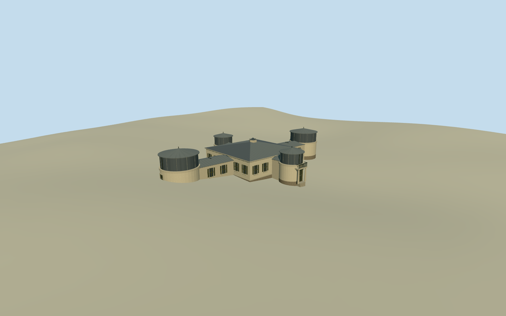

# Argentine National Observatory

The early four-tower Córdoba observatory, with twin long observing wings, dark metal cupolas and a narrow entrance balcony.

Authoring state: **review-in-qa.json**. Current completion evidence is in [qa.json](qa.json) and the [completion ledger](../../../../qualla-structures/batches/qualla-004.PROGRESS.md).

- [Argentine National Observatory](https://qualla.com/argentine-national-observatory/)

Historical appearance uses the completed early layout photographed around the close of 1898. The story opens in 1871 while the west tower was still being finished.

Original footprint is centered on the mapped successor site. Exact foundations outside the preserved instrument location, original paint colors and small roof hardware are approximate.

Historic grounds and nearby directors’ and assistants’ houses are outside the model scope.

Build: `node content/worldgen/source/places/6d/6d6/argentine_national_observatory/models/generate-argentine-national-observatory.mjs`. Add `--check` to verify exact regeneration. 7974 triangles; 7 materials; no embedded photographs.
