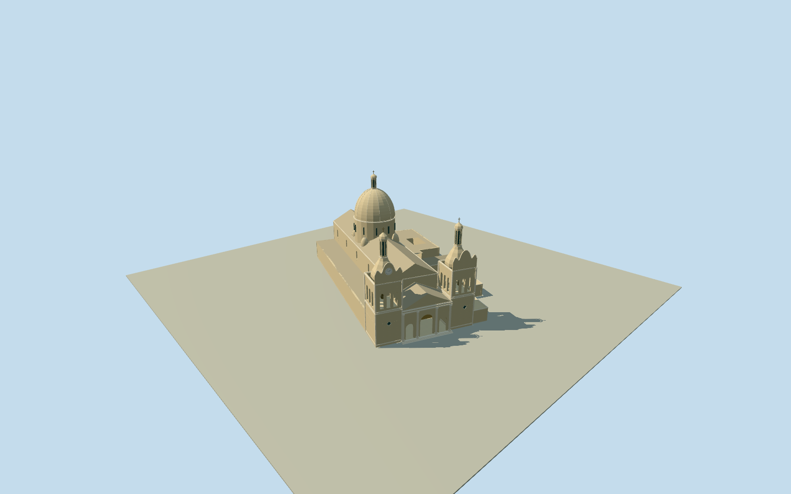

# Cathedral of Córdoba, Argentina

Whole current Argentine Cathedral of Córdoba, exact26controlnativefootprint/15actualnativeparts/151partcontrols. Fullthreenavebody/rear/lowaisles/northernattachments/openzero-levelpart, actual3archclassicalportico/pediment/colonnades, twinopenbaroquebelfries/curvedcrowns/lanterns/southclock, mainbaroquedome/drum/lantern/cross/fourcornerturrets. Three exactpublishedHermannLuyken creatorCC0 front/belfry references first/only, no copiedphotopixels/sacredart. Wholemappedparts retained, levelcounts/hippedcrown tags notcertifiedsurvey; uppersections/profiles/heights/ornament/window-bellcensus/hiddenjoins/currentfinish/exactgroundcryptcontact originalestimates. Geographicpreview/replacementfalse.

Authoring state: **review-in-qa.json**. Current completion evidence is in [qa.json](qa.json) and the [completion ledger](../../../../qualla-structures/batches/qualla-002.PROGRESS.md).

- [Cathedral of Córdoba, Argentina](https://qualla.com/cathedral-of-cordoba-argentina/)

Whole native26control cathedral footprint and15actualintegral native body/roof/dome/tower/porch/annex parts, fixednativebboxanchor/heading0/+Xeast+Zsouth chosen before independentfield/floor/sections/geometry. Levelcounts/roofheight tags rawevidence, not a surveyed heightmodel.

Whole26controlnativebuilding and15actualnative roof/body/tower/dome/porch/lowpart outlines/151partcontroloccurrences retained in originalfixedbboxanchor/heading0. Internalaxis derived only from actualnavepart1149552627 west-to-eastedge, no geographicreframe. Mainnave2627, eastgableportico2626, twinquadrangularlowerbelfries2625/4037 withoctagonaluppercrowns2619/4036, maincupola2624/fourcornerdomedturrets2620-23, northgabledhouse2618/lowparts2628-30. Nativelevels0 part2628 treated as openlowpart, no8mopaque roof acrossit; defaultloweraisle/rearroof only outside all mappedpartpolygons. No adjacentCabildo/SantaCatalina/otherbuildings/plazagrounds.

Original256m129x12916641sample/one rawtile/nativewholebboxanchor/heading0/fixedSW402.2007m provider-relative datum frozen before every floor/section/geometrychoice. Once-only nativeeasternportico exteriorpoint originalgrid sample fixesfloor0.2322m before geometry; no laterfit/flatten/reacquire/reframe/floorretune/raising. Whole26nativeperimeter+151nativepartcontrols/15actualparts retained. Primarynationalmonuments/universitymuseum facts:threenaves/crossing, classical3archportico/pediment, paired3stagebaroquebelltowers/curvedcrowns/lanterns andmainbaroquecupola/fouroctagonalcornerreinforcingturrets. Nativelevelcounts/hippedrooftagsoncrown/roofheight10 are rawevidence, notsurveyedheights; photo governs actualcurvedbaroquecrowns rather than genericpyramids. Originalphotoboundedsections:nave14.5-18.8,portico9.4-13.1/defaultlowerroof6.8; towers10.4/18.4/crown24.1/lantern29.2/cap30.7/cross32.1; maindrum13.8-23.4/dome33.4/lantern37.2/cap38.3/cross39.5; cornerturrets12.5-15.1/domes18.1/balls18.5; northhouse4-6/annex4.25/connector3.9; nativezero-levelpart2628openlow.24. Everyheight/profile/crown/clocktime/ornament/window-bellcensus/hiddenroofjoins/currentfinish andpreciseground/cryptcontact is anoriginalboundedestimate. No copiedpixels/ceilingart/statueart/people/trees/plaza/neighboringchurch. Geographicpreview/replaceFootprintfalse; independentfieldunchanged.

Three exactpublished2011HermannLuyken own/self-CC0 structuralfront/belfry originals individually/contactsheet inspected/nativeSHA1matched, unchangedinventorypassed. Fourthsideview/ceilinghero/interior/tombs/unrelatedmuseum notadopted; no supplemental/questionablesource/source-rightsrepair/reclassification/guardchange/samephotobypass/protectedadditionalimagery or copiedsourcepixels. Primarydescriptivefacts only, no protectedplans. Uppersections/clocktime/crowns/fineornament/lantern/census/hiddenroofs/currentfinish originalboundedestimates.

Originalindependent256m129x12916641sample/one rawtile field/fixedbboxanchor/heading0/SW402.2007mproviderdatum frozen before every floor/part/section/geometrychoice. Once-only eastportico field sample fixesfloor.2322m. No fit/flatten/reacquire/reframe/floorretune/late raising. Preciseground/crypt/foundationcontact unverified; geographicpreview/replacementfalse. Portableflatground/contextneighbors are reviewfixtures only.

Build: `node content/worldgen/source/places/6d/6d6/cathedral_of_cordoba_argentina/models/generate-cordoba-cathedral.mjs`. Add `--check` to verify exact regeneration. 24620 triangles; 5 materials; no embedded photographs.
