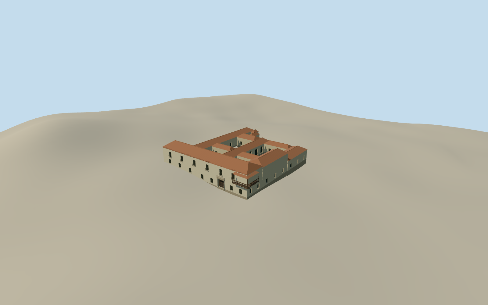

# Museo Histórico Provincial Marqués de Sobremonte

The whitewashed Sobremonte museum in Córdoba with its molded entrance, clay tile roofs, timber corner balcony and open patios.

Authoring state: **review-in-qa.json**. Current completion evidence is in [qa.json](qa.json) and the [completion ledger](../../../../qualla-structures/batches/qualla-003.PROGRESS.md).

- [Marquis of Sobremonte Provincial Historical Museum](https://qualla.com/marquis-of-sobremonte-provincial-historical-museum/)

The model depicts the January 2009 exterior of the museum on Rosario de Santa Fe and Ituzaingó.

The municipal parcels constrain the street corner and total extent. The Qualla photo controls the principal portal, barred windows and whitewashed eave. The heritage records inform the corner balcony and five patios. The exact interior roof divisions and unseen elevations are estimates.

The original Terrarium field is preserved. Pavement registration and terrace height are approximate.

Build: `node content/worldgen/source/places/6d/6d6/marquis_of_sobremonte_provincial_historical_museum/models/generate-sobremonte-museum.mjs`. Add `--check` to verify exact regeneration. 7126 triangles; 6 materials; no embedded photographs.
