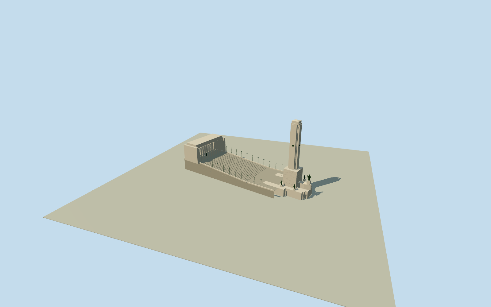

# National Flag Memorial

Whole NationalFlagMemorial ensemble in native9component plans: pale travertine70mtower/cross-shapedshaft/steppedcrown, layeredproa and genuinely recessed archedniche, rising30step civiccourt/parapets/22farolas, full78controlraisedpropylaeumroof above24freecolumns/twoendpiers and intrinsic votivevessel. Qualla41families first,8distinctexactBelgrano2009ownPD exteriororiginals. Hiddenprofiles/currentcondition/proablockheight/columncensus and sculpturalmasses are originalboundedestimates; notsurvey orphotogrammetry.

Authoring state: **review-in-qa.json**. Current completion evidence is in [qa.json](qa.json) and the [completion ledger](../../../../qualla-structures/batches/qualla-002.PROGRESS.md).

- [National Flag Memorial](https://qualla.com/national-flag-memorial-argentina/)

Actual9nativephysicalcomponent outlines/currentheight/minheight tags preserved, plus nativecivicstep route/count. Sitebboxanchor fixed BEFORE independentfield/floor/sections/geometry; relationextents contextual only.

Nativeexplicitheighttags retained:base7/proa12/tower66/67/crown70/roof16to20/endpiers17.5/17.8. These are building-relative heights, notproviderabsoluteRL. Hiddensection/piercensus/cryptentrance/roofjoint/finish/stairriserpositions are originalphoto-bounded estimates. Define floor/verticalsections onlyAFTER originalindependentfieldfreeze. Full78controlpropylaeum roof retained as raised slab/opencolonnade, never solid20mblock. Operatorprimarytext https://www.monumentoalabandera.gob.ar/arquitectura/detalles-tecnicos confirms approximately140m ensemble/51mpropylaeumwidth/70mtower and22farola-masts; nativephysicalplans notrescaled. Othergovernmenttext quotes75m, operatorapproximately70m/native70 retainedexplicitly. Allprotectedoperatorphoto/drawingpixelsunused. Native12mproablocktag isretained butsourcephotos support original24m layeredbodyinterpretation; notsilentlytreatedassurvey.

Original512m129field/16641samples/one rawtile fixed before once-onlyfloor-12.8105m (absolute20.686163749999995m/providerdatum33.4967m) and allsections. NativecomponentXZ andheighttags keptunchanged. Authoringinterpretation: native7m river-facingbase and70m totaltower/crossshape66/shoulder67/crown69to70; taller24m photo-estimated proablock uses actual6controlplan while its ambiguousnative12m tag remainsunmodified, notclaimedverifiedheight. Civiccourt7to12.4/30steps; propylaeumlocalfloor12.4 plus native16to20mroof gives28.4to32.4; endpiers local17.5/17.8 aboveuppercourt. Nativeheighttags are not absoluteproviderRL. These elevations/proablock/door/alcove/colonnadepiercensus/urn/hiddenprofiles are bounded originalphoto estimates. No later floor/mainsection/fieldtuning.

Eight exact2009Belgrano photographer-ownPD originals after publishedQualla41familysearch. No publication-unbound/PD-art/Flickr/questionableimages or protectedoperatorphoto/drawingpixels used. No imagepixels embedded.

Actual9nativeparts/183XZcontrols retained, relationextentcontextonly. Civiccourt plan/levels/columncensus/hiddenproabodyheight and niches/doors/medallions/urn are originalboundedreconstruction. Ambiguousnative12mproablocktag notaltered; photo-estimated24m body explicitlydistinguished. No belowgroundcrypt/galleryinteriors orneighborcathedral/council/parks/roads.

Figurative artwork, inscriptions and finehistoricreliefs are simplified originalabstract masses/geometricmedallions, not exactsculpture reproductions. No fountainwater/animatedfire/flagpixels. Distantthinfarolas omitted.

Originalindependent512m129field/one rawtile/floor/sections fixedbeforegeometry; negativeproviderartifactsretained unchanged andgroundcontactunverified. Geographicpreview/replacementfalse; isolatedflatstage andsyntheticneighbors are reviewfixtures.

Build: `node content/worldgen/source/places/6d/6dh/national_flag_memorial/models/generate-national-flag-memorial.mjs`. Add `--check` to verify exact regeneration. 6539 triangles; 4 materials; no embedded photographs.
