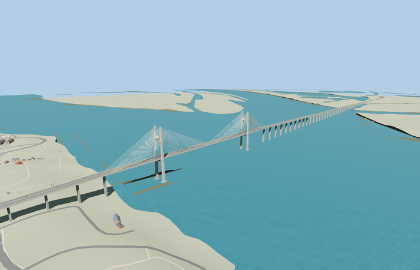

# Rosario–Victoria Bridge

Reviewed 2026-10-27. **Scoped full curved bridge/approach exterior and approximate native placement complete.**

Inspected 62 current frames: 11 portable, 11 shared-material/geographic, 23 medium-fi and 17 native. The full curved crossing, two H-pylon portals and tall heads, hourglass upper/lower crossbeams, outside stay fans, four-lane deck/barriers, long wall-pier viaduct, flared caps, bearings, sleeves and twin-head lamps are present. Near driver and main-span views carry detail review; default turntables and generic street/block/silhouette cameras frame only a thin distant line or a small viaduct section at this 4.1km scale. Corrected skewed/full-width landings, terrain-buried eastern paving, footing tops and cable contacts in this same pass.

Two existing shared 256px graphs concrete_plain and metal_painted; three merged semantic material groups near and one mean-tinted skyline group. Metric UVs and linear vertex colors; no private/embedded images or copied photograph pixels. Each graph is read once in near native views. Runtime uses four separate GPU attribute streams.

| Level | Triangles | Bytes | Draws |
| --- | ---: | ---: | ---: |
| skyline | 760 | 65240 | 1 |
| district | 2600 | 216564 | 3 |
| street | 15832 | 1302556 | 3 |
| closeup | 23992 | 2013496 | 3 |

Master 24760 triangles / 2973680 bytes. Runtime 760 / 2600 / 15832 / 23992 triangles; 65240 / 216564 / 1302556 / 2013496 bytes; 1 / 3 / 3 / 3 draws. Initial skyline plus district 281804 bytes. Strict medium-fi budgets pass; physical-device timings remain unmeasured.

Exact-QID OSM way368369459/Q2385650 preserves the complete curved crossing and approaches. Anchor [-60.678950356,-32.869225439], heading0.179910612468: +X east-northeast/Victoria, -X west-southwest/Rosario; +Z downstream/south-southeast, -Z upstream/north-northwest. The93.694m plan breadth describes curvature; nominal deck width is21.3m. Paired named RN174 PMTiles carriageway endpoints set landing centers. All24 mapped road-width samples per LOD have model support;18 retain native paving and meet within 0.0019998550415039062m. Six samples are inside replacement, not pavement joins. Main section/pylon stations and source grade are approximate. Eastern grade clears the highest sampled cross-road DEM; flared aprons cover the viewer’s wider default road ribbons. This is standard-viewer fit, not survey or legal-clearance certification.

All 743 fixture buildings and458 independent transport records remain. Clipping/replacement removes11 fully replaced bridge fragments from505 input road records, leaving494 on successful load; failed loading retains all505. Raw road inputs, DEM, displayed ground and native river geometry remain unchanged. Only connected landing paving is deliberately graded. Load failure restores the map crossing; unload releases all model/support geometry. No ground/building cutout is used.

## Reconstruction limits

- Complete mapped4.1km curved bridge/approach exterior at nominal21.3m width. Separate floodplain bridges/causeways along the much longer Rosario–Victoria connection are outside this footprint and are not claimed modeled. Map tags disagree on bridge form; inspected photos establish cable-stayed H-portals, not suspension or cantilever form.
- Main section610m,130/350/130m span rhythm, pylon stations-788/-438m,75m above deck, wall-pier spacing near50m, footing forms, cable counts and upper hourglass brace are photo-led geometric approximations. No exact pylon points or surveyed sections are supplied by the viewer map. The western bridge-way transition and bank drop place the main section near the Rosario bank, not centered on the whole4.1km footprint.
- Source origin2m and deck profiles clear the maximum sampled standard Mapzen terrain across each paired PMTiles landing, rising to roughly62m above sea level at the main span. Short flat end plateaus accommodate skewed map cuts. Main-span clearance is approximate, not surveyed/legal clearance. Water is the unchanged standard viewer result; flat per-polygon water stages and bank slopes can be coarse.
- Paired motorways carry a generalized default16m ribbon per direction in the viewer, wider than the nominal21.3m bridge body. Small7m-long flared landing aprons reach27.4m across to overlap incoming paving; they are renderer-fit adaptations. Independent roads, buildings, terrain and river are retained; connected landing paving is deliberately graded.
- Two existing shared256px graphs concrete_plain and metal_painted, three merged semantic groups nearby, metric UVs and linear tints; no private or embedded images. Skyline reduces repeated piers and cables, district simplifies caps, close levels retain full viaduct supports, cable sleeves, barriers, four lanes and twin-head lamps. Physical laptop/phone timings remain unmeasured.
- Standard native water stages in the main channel and eastern branches differ (about4.62m and9.00m); both remain untouched. Coarse bank slopes and automatic approach-retaining faces remain visible. The western pylon footing partly embeds in the coarse bank; exact bed/foundation levels are not claimed.
- Far repeated supports and cable counts are deliberately reduced. Default scale-based turntables/context cameras are not a useful close inspection of this exceptionally long asset; dedicated main-span, driver, stay and native landing cameras provide that inspection. Separate remote floodplain bridges remain map-generated context.
