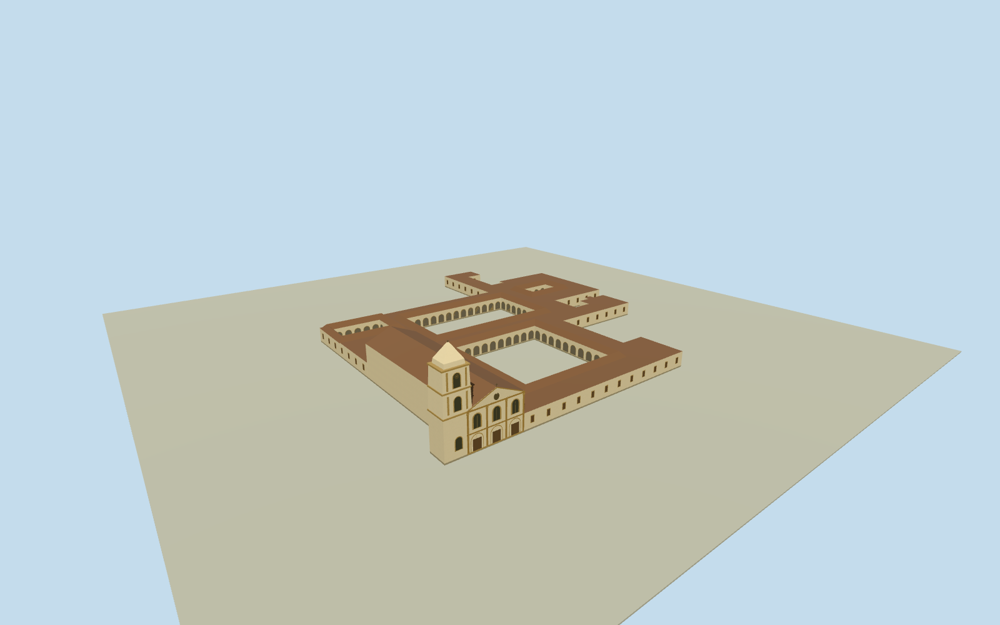

# San Carlos Convent, San Lorenzo

Franciscan convent complex with four open courtyards, a cream-and-ochre church front and a tall square bell tower.

Authoring state: **review-in-qa.json**. Current completion evidence is in [qa.json](qa.json) and the [completion ledger](../../../../qualla-structures/batches/qualla-003.PROGRESS.md).

- [San Carlos Convent](https://qualla.com/san-carlos-convent/)

The January 2011 Qualla exterior fixes the church’s ochre detailing, three bays, steep bell tower spire and front pediment. The photo documents the building long after its nineteenth-century additions.

The whole linked range follows the mapped exterior and all four open courtyards. Secondary elevations, roof divisions, individual cloister bays, and precise heights are proportional estimates.

The 128 m source field and local church-entry datum remain unmodified. Local thresholds and grading are approximate. The adjacent battlefield, museum interiors and separately managed structures are outside this model.

The model uses original geometry and shared surfaces without reference-photo pixels.

Build: `node content/worldgen/source/places/6d/6dh/san_carlos_convent/models/generate-house.mjs`. Add `--check` to verify exact regeneration. 3710 triangles; 6 materials; no embedded photographs.
