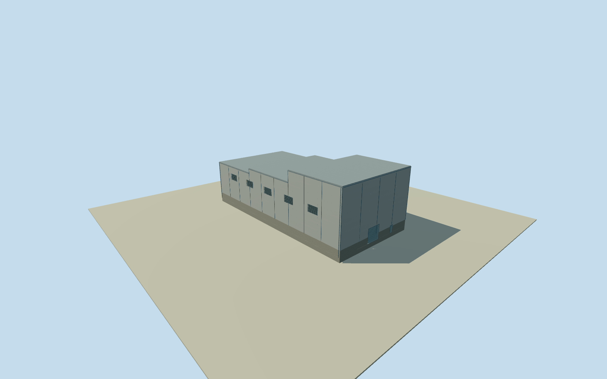

# Fray Bentos mill central hall

Whole independently placed central roofed hall inside Planta UPM Fray Bentos: full original four-corner footprint, closed industrial walls and roof, base, estimated service entrances, upper louver bays and modest exposed trim. Separate process plant, chimney, tanks, conveyors, roads and yards remain separate; no whole-factory proxy. Already cleared U.S. Embassy Montevideo original photographs supply factory-level industrial material vocabulary only: light metal/concrete cladding, gray structural trim and dark louvers. They do not identify this specific hall or its roof profile, opening census, doors or attached machinery. Numerical original footprint and 2023 relative heights govern this body; no source satellite photographs, orthophotos, map images, figures or owner report imagery used. Qualla-first 26 families already screened; no rights revalidation or new imagery adopted. Automated footprint has 5 m horizontal uncertainty; numerical height at least 3 m uncertainty, not survey. Original central hall roof and central east neighbor have13.97018488618778m² numerical edge overlap,0.78%of1792m²central footprint. Distinct centers/full bodies retained with no clipping, shrinking or moving either original polygon.5m horizontal source uncertainty; overlap is not a duplicate roof or a surveyed shared wall. Whole original 4-corner roof outline retained; no simplification or site/yard roof. Overall numerical relative-height median 16m from 102 of 113 passing original inside-roof observations. Effective source4m resolution; at least4m height/5m horizontal uncertainty. No surveyed floor count or precise physical roof profile. Three equal longitudinal analysis regions preserve the whole original outline and broad original numerical height gradient. Boundaries and piecewise-flat roof sections are conservative visualization estimates, not observed joints or surveyed process volumes. Separate original numerical height medians 14m (30 samples), 15.5m (35 samples), 19m (37 samples). Flat closed roof regions and vertical step faces are explicit approximate sections, not photographically identified process structures. Gray/light corrugated industrial wall and standing-seam metal roof, low concrete band, restrained structural battens/gutters, two closed service/personnel entries and 12 louver bays are conservative author estimates. Specific function, facade/opening census, bay rhythm, exact roof joins and historic condition unverified. Three previously cleared public-domain U.S.Embassy staff photographs inform factory-level material vocabulary only; no claim that they show this hall, and no photo-specific tanks/pipes/conveyor/stairs attached. Own original256m129x129/16641-height field/2rawtiles/datum21.415m frozen before floor.25m/foundation-1.2m/plinth2.3m/roof regions14.25/15.75/19.25m. Original field/frame/floor/main sections remain unmasked, unflattened and unfitted. Contact/vertical tie approximate; no survey. All four LODs retain whole original footprint, all exterior walls/full closed regional roof and step faces/base/two closed entries/louver cues. Near levels add physical recesses and louver blades; no process machinery or interior census. Qualla-first26families; previously cleared PD federal originals reused without new rights review. Satellite images, owner report images, plans/figures and map imagery unused. Approximate end2023 historical preview/current-world eligible false; whole factory unfinished.

Authoring state: **review-in-qa.json**. Current completion evidence is in [qa.json](qa.json) and the [completion ledger](../../../../qualla-structures/batches/qualla-002.PROGRESS.md).

- [Uruguay River Pulp Mill Dispute](https://qualla.com/uruguay-river-pulp-mill-dispute/)

Whole independently placed central roofed hall inside Planta UPM Fray Bentos: full original four-corner footprint, closed industrial walls and roof, base, estimated service entrances, upper louver bays and modest exposed trim. Separate process plant, chimney, tanks, conveyors, roads and yards remain separate; no whole-factory proxy. Already cleared U.S. Embassy Montevideo original photographs supply factory-level industrial material vocabulary only: light metal/concrete cladding, gray structural trim and dark louvers. They do not identify this specific hall or its roof profile, opening census, doors or attached machinery. Numerical original footprint and 2023 relative heights govern this body; no source satellite photographs, orthophotos, map images, figures or owner report imagery used. Qualla-first 26 families already screened; no rights revalidation or new imagery adopted. Automated footprint has 5 m horizontal uncertainty; numerical height at least 3 m uncertainty, not survey.

Original central hall roof and central east neighbor have13.97018488618778m² numerical edge overlap,0.78%of1792m²central footprint. Distinct centers/full bodies retained with no clipping, shrinking or moving either original polygon.5m horizontal source uncertainty; overlap is not a duplicate roof or a surveyed shared wall.

Whole original 4-corner roof outline retained; no simplification or site/yard roof. Overall numerical relative-height median 16m from 102 of 113 passing original inside-roof observations. Effective source4m resolution; at least4m height/5m horizontal uncertainty. No surveyed floor count or precise physical roof profile.

Three equal longitudinal analysis regions preserve the whole original outline and broad original numerical height gradient. Boundaries and piecewise-flat roof sections are conservative visualization estimates, not observed joints or surveyed process volumes. Separate original numerical height medians 14m (30 samples), 15.5m (35 samples), 19m (37 samples). Flat closed roof regions and vertical step faces are explicit approximate sections, not photographically identified process structures.

Gray/light corrugated industrial wall and standing-seam metal roof, low concrete band, restrained structural battens/gutters, two closed service/personnel entries and 12 louver bays are conservative author estimates. Specific function, facade/opening census, bay rhythm, exact roof joins and historic condition unverified. Three previously cleared public-domain U.S.Embassy staff photographs inform factory-level material vocabulary only; no claim that they show this hall, and no photo-specific tanks/pipes/conveyor/stairs attached.

Own original256m129x129/16641-height field/2rawtiles/datum21.415m frozen before floor.25m/foundation-1.2m/plinth2.3m/roof regions14.25/15.75/19.25m. Original field/frame/floor/main sections remain unmasked, unflattened and unfitted. Contact/vertical tie approximate; no survey.

All four LODs retain whole original footprint, all exterior walls/full closed regional roof and step faces/base/two closed entries/louver cues. Near levels add physical recesses and louver blades; no process machinery or interior census. Qualla-first26families; previously cleared PD federal originals reused without new rights review. Satellite images, owner report images, plans/figures and map imagery unused. Approximate end2023 historical preview/current-world eligible false; whole factory unfinished.

Build: `node content/worldgen/source/places/6d/6dn/fray_bentos_mill_central_hall/models/generate-house.mjs`. Add `--check` to verify exact regeneration. 2650 triangles; 6 materials; no embedded photographs.
