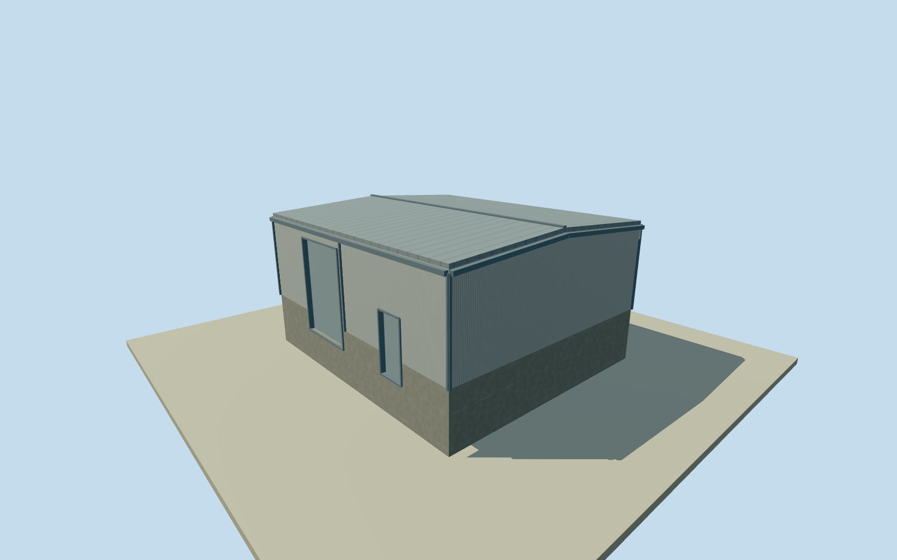

# Fray Bentos mill east central service block

Whole independently placed east central service block roofed body inside Planta UPM Fray Bentos: full original 4-corner footprint, closed industrial walls and roof, base, estimated service entrances, upper louver bays and modest exposed trim. Separate process plant, chimney, tanks, conveyors, roads and yards remain separate; no whole-factory proxy. Already cleared U.S. Embassy Montevideo original photographs supply factory-level industrial material vocabulary only: light metal/concrete cladding, gray structural trim and dark louvers. They do not identify this specific hall or its roof profile, opening census, doors or attached machinery. Numerical original footprint and2023 relative-height observations govern a nominal2023 preview; temporal continuity to2023 is unverified; no source satellite photographs, orthophotos, map images, figures or owner report imagery used. Qualla-first 26 families already screened; no rights revalidation or new imagery adopted. Automated footprint has at least5m horizontal uncertainty; nominal height has at least4m uncertainty. Height observations are2023 data, not a2023survey; exact temporal continuity unverified. Whole original 4-corner numerical roof, all exterior walls/closed roof/base retained. Learned relative-height median5m from2 of7 passing original observations, range5–5m, interquartile5–5m. Original height-source year2023 supplies a nominal2023preview only; temporal continuity unverified. Automated footprint confidence rank0.896, not a probability or surveyed classification. Effective4m resolution, at least4m height/5m horizontal uncertainty; no survey or floor census. Only two passing observations, both5m, weakly constrain an explicit nominal whole-body height;4m height uncertainty is retained, not a measured eave or roof section. All original sample values and their full range are retained. No artificial roof steps or process machinery inferred from the learned gradient. Specific process identity, wall enclosure and original roof profile are not photographically established. Restrained horizontal girts are estimated panel support rhythm. Original conservative industrial details: low dual-pitch standing-seam roof, light-gray corrugated metal over low concrete base, plain gray trim/gutters/downpipes, two closed service/personnel entries and0 upper louver bays. Roof pitch, opening census, facade positions/materials/finish, function and precise2023condition unverified;3m component uncertainty. Opening heights scaled below the low eaves. The smaller bodies use a bounded2.8m estimated service door and1.2m personnel door on the longest native edge, with separated openings and retained corner margins. Three already-cleared U.S.Embassy public-domain staff photographs supply factory material context only, not verified views of this specific hall; no process machinery transplanted. Own256m129x129/16641-height field/1rawtile/datum13.4616m fixed before floor.25m/foundation-1.2m/plinth1.1m/eave4.9m/ridge5.25m. Field/frame/floor/main sections remain unmasked, unflattened and unfitted; exact contact and threshold vertical tie approximate. New full original polygon has no numerical overlap with the current authored mill bodies. All native reentrant corners remain open outside the roofed outline; no box fill across the notches. Four authored LODs retain all original corners and the complete body/roof/base/two closed entries/louver cues. Near levels restore physical recesses/blades/frames. Qualla-first26families; exactly three previously cleared public-domain federal originals reused without new imagery or rights review. Source satellite images, map images, owner report images/figures, restricted local photos and photographic textures unused. Historical2023 preview/current-world eligible false; whole factory remains unfinished.

Authoring state: **review-in-qa.json**. Current completion evidence is in [qa.json](qa.json) and the [completion ledger](../../../../qualla-structures/batches/qualla-002.PROGRESS.md).

- [Uruguay River Pulp Mill Dispute](https://qualla.com/uruguay-river-pulp-mill-dispute/)

Whole independently placed east central service block roofed body inside Planta UPM Fray Bentos: full original 4-corner footprint, closed industrial walls and roof, base, estimated service entrances, upper louver bays and modest exposed trim. Separate process plant, chimney, tanks, conveyors, roads and yards remain separate; no whole-factory proxy. Already cleared U.S. Embassy Montevideo original photographs supply factory-level industrial material vocabulary only: light metal/concrete cladding, gray structural trim and dark louvers. They do not identify this specific hall or its roof profile, opening census, doors or attached machinery. Numerical original footprint and2023 relative-height observations govern a nominal2023 preview; temporal continuity to2023 is unverified; no source satellite photographs, orthophotos, map images, figures or owner report imagery used. Qualla-first 26 families already screened; no rights revalidation or new imagery adopted. Automated footprint has at least5m horizontal uncertainty; nominal height has at least4m uncertainty. Height observations are2023 data, not a2023survey; exact temporal continuity unverified.

Whole original 4-corner numerical roof, all exterior walls/closed roof/base retained. Learned relative-height median5m from2 of7 passing original observations, range5–5m, interquartile5–5m. Original height-source year2023 supplies a nominal2023preview only; temporal continuity unverified. Automated footprint confidence rank0.896, not a probability or surveyed classification. Effective4m resolution, at least4m height/5m horizontal uncertainty; no survey or floor census.

Only two passing observations, both5m, weakly constrain an explicit nominal whole-body height;4m height uncertainty is retained, not a measured eave or roof section. All original sample values and their full range are retained. No artificial roof steps or process machinery inferred from the learned gradient. Specific process identity, wall enclosure and original roof profile are not photographically established. Restrained horizontal girts are estimated panel support rhythm. Original conservative industrial details: low dual-pitch standing-seam roof, light-gray corrugated metal over low concrete base, plain gray trim/gutters/downpipes, two closed service/personnel entries and0 upper louver bays. Roof pitch, opening census, facade positions/materials/finish, function and precise2023condition unverified;3m component uncertainty. Opening heights scaled below the low eaves. The smaller bodies use a bounded2.8m estimated service door and1.2m personnel door on the longest native edge, with separated openings and retained corner margins. Three already-cleared U.S.Embassy public-domain staff photographs supply factory material context only, not verified views of this specific hall; no process machinery transplanted.

Own256m129x129/16641-height field/1rawtile/datum13.4616m fixed before floor.25m/foundation-1.2m/plinth1.1m/eave4.9m/ridge5.25m. Field/frame/floor/main sections remain unmasked, unflattened and unfitted; exact contact and threshold vertical tie approximate.

New full original polygon has no numerical overlap with the current authored mill bodies. All native reentrant corners remain open outside the roofed outline; no box fill across the notches.

Four authored LODs retain all original corners and the complete body/roof/base/two closed entries/louver cues. Near levels restore physical recesses/blades/frames. Qualla-first26families; exactly three previously cleared public-domain federal originals reused without new imagery or rights review. Source satellite images, map images, owner report images/figures, restricted local photos and photographic textures unused. Historical2023 preview/current-world eligible false; whole factory remains unfinished.

Build: `node content/worldgen/source/places/6d/6dn/fray_bentos_mill_east_central_service_block/models/generate-house.mjs`. Add `--check` to verify exact regeneration. 390 triangles; 5 materials; no embedded photographs.
