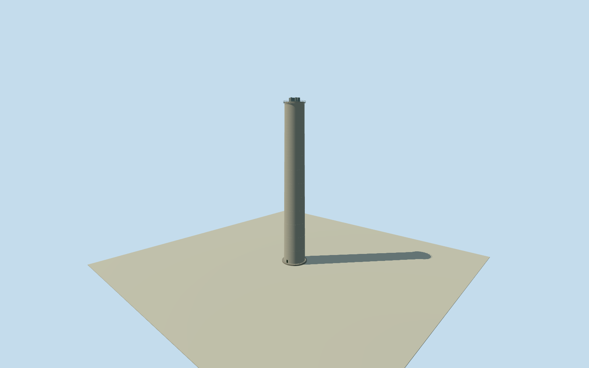

# Fray Bentos mill main chimney

Whole independent main concrete chimney. Builder117m civil shell, five numerical flue diameters and120m exhaust reference retained; radius/taper/rim/flue centres/platform/entry/finish estimated. Complete exterior, no generic entiremill substitute; every image unused.

Authoring state: **review-in-qa.json**. Current completion evidence is in [qa.json](qa.json) and the [completion ledger](../../../../qualla-structures/batches/qualla-002.PROGRESS.md).

- [Uruguay River Pulp Mill Dispute](https://qualla.com/uruguay-river-pulp-mill-dispute/)

Whole independently located main chimney at original native node10263472316 inside confirmed PlantaUPM factory way119015899. Builder COSUD project109 gives117m chimney height. Outer radius/taper, base/entry/top-platform and finish estimated, not from photographs. Five flue diameters4.6/2.5/1.5/1.2/.3m and120m exhaust reference retained from UNSAM2016 numerical Table2.7 citing Ecometrix2006; exact2018hardware carryover/centres/metal projection unverified. All source images, figures, plans and image-derived descriptions unused. No whole-mill proxy.

Whole117m civil shell and five projected flue mouths retained. Estimated outer base/top radii8/7m, assumed1m taper and.5m visible rim thickness; radius uncertainty3m and taper/profile uncertainty1.5m. Contractor117m total civil height distinguished from120m numerical exhaust reference:3m visible flue projection is an explicit geometric interpretation, not a measured metalwork section. No40m parliamentary-diameter claim,128m press claim,60m ENCE stack or15m newer PasoDeLosTorosstack dimensions adopted.

All five numerical flue diameters retained at everyLOD. Flue centres, rim thickness, top gallery/guardrails, service doorway, base slab, construction joints and plain concrete/steel finish are explicit estimates with2m component-position uncertainty. Buried/internal flue routing/equipment omitted; short inner-rim faces and dark occlusion surfaces are visual simplifications, not interior reconstruction. No plume, logo or guessed process building.

Original independent256m129x129field/16641heights/2rawtiles/datum18.2261m fixed before floor.25m/foundation-.8..+.25m/civil shelltop117.25m/flue mouths120.25m. Original source grade/contact approximate, no surveyed vertical tie. No field/frame/floor/mainsection cut/mask/flatten/refetch/reframe/refit.

Qualla first26families/0conflicts. Previously cleared DOS process photos do not establish this chimney profile and remain unused here. Every photograph/figure/plan/diagram/image-derived description unused; only written builder construction and numerical original site/flue data. Whole independent chimney, not entiremill proxy; factory process/drying/recovery buildings and other structures remain separate and unresolved. Approximate2018phase, current eligibility false.

Build: `node content/worldgen/source/places/6d/6dn/fray_bentos_mill_main_chimney/models/generate-house.mjs`. Add `--check` to verify exact regeneration. 5348 triangles; 4 materials; no embedded photographs.
