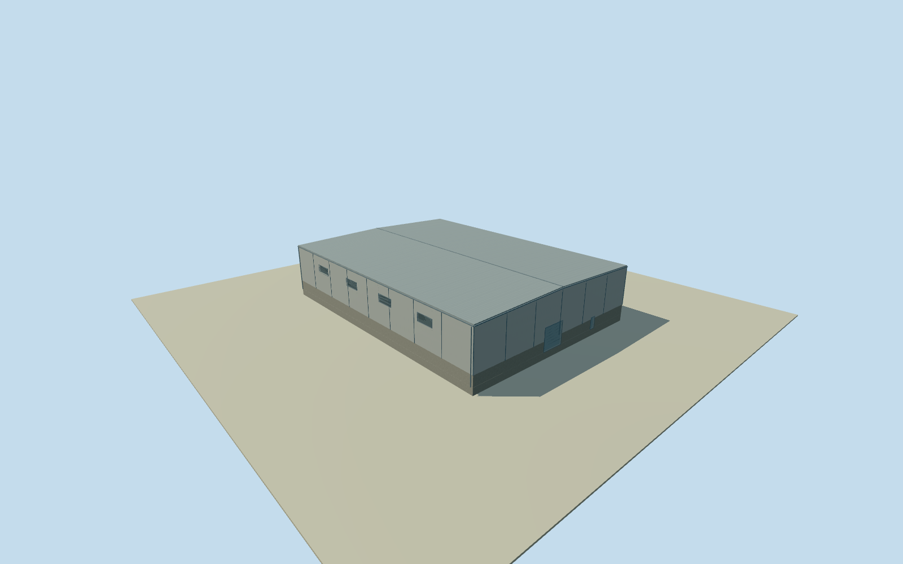

# Fray Bentos mill north hall

Whole independently placed northern roofed hall inside Planta UPM Fray Bentos: full original four-corner footprint, closed industrial walls and roof, base, estimated service entrances, upper louver bays and modest exposed trim. Separate process plant, chimney, tanks, conveyors, roads and yards remain separate; no whole-factory proxy. Already cleared U.S. Embassy Montevideo original photographs supply factory-level industrial material vocabulary only: light metal/concrete cladding, gray structural trim and dark louvers. They do not identify this specific hall or its roof profile, opening census, doors or attached machinery. Numerical original footprint and 2023 relative heights govern this body; no source satellite photographs, orthophotos, map images, figures or owner report imagery used. Qualla-first 26 families already screened; no rights revalidation or new imagery adopted. Automated footprint has 5 m horizontal uncertainty; numerical height at least 3 m uncertainty, not survey. All four full-precision original roof corners retained. Relative-height median 11 m from 131 of 146 original inside-roof observations; effective source resolution 4 m, height range 8–13.5 m and interquartile range 10.5–12 m. Distributed 0.5 m pixels do not imply survey accuracy. At least 3 m height uncertainty and 5 m horizontal uncertainty; no surveyed floor or facade census. Photographs are three previously cleared U.S. Embassy Montevideo originals by named government photographer Juan Francisco Casal. They show factory-level silver/gray/white metal, concrete, steel trim and dark louvers, not a full view of this specific north hall. They supply material vocabulary only. No exact photograph-to-building correspondence or process function claimed; image-specific tanks, pipes, staircases, cranes and conveyor are not attached to this hall. Whole hall has an estimated low dual-pitch closed roof, eave 10.6 m and ridge 11.25 m, gray corrugated cladding over a low concrete band, gray standing-seam roof, structural battens/gutters/downpipes, two closed service/personnel entries and ten upper louver bays. Roof pitch, opening census, positions, bay rhythm, cladding/roof material, paint and exact 2023 condition are conservative author estimates with 3 m component uncertainty. No sign, logo, machinery, people or adjacent building modeled. Own original 256 m field, 129 x 129 / 16641 height values and 4 raw tiles frozen before floor .25 m, foundation -1.2 m, concrete plinth 2.3 m, eave 10.6 m and ridge 11.25 m. Original field datum 19 m is provider-relative and not surveyed ground. Do not mask, flatten, reframe, replace or fit terrain/floor/main sections to a render. Exact contact remains approximate. Four authored runtime LODs retain the whole original building, full roof/walls/base and both closed entries plus louver cues. Street/closeup add physical louver/door recesses and blade/framing detail. No whole-factory completion credit: process buildings, tanks, conveyors, yards and other independent bodies remain separate. Approximate end-2023 historical preview, current-world eligible false.

Authoring state: **review-in-qa.json**. Current completion evidence is in [qa.json](qa.json) and the [completion ledger](../../../../qualla-structures/batches/qualla-002.PROGRESS.md).

- [Uruguay River Pulp Mill Dispute](https://qualla.com/uruguay-river-pulp-mill-dispute/)

Whole independently placed northern roofed hall inside Planta UPM Fray Bentos: full original four-corner footprint, closed industrial walls and roof, base, estimated service entrances, upper louver bays and modest exposed trim. Separate process plant, chimney, tanks, conveyors, roads and yards remain separate; no whole-factory proxy. Already cleared U.S. Embassy Montevideo original photographs supply factory-level industrial material vocabulary only: light metal/concrete cladding, gray structural trim and dark louvers. They do not identify this specific hall or its roof profile, opening census, doors or attached machinery. Numerical original footprint and 2023 relative heights govern this body; no source satellite photographs, orthophotos, map images, figures or owner report imagery used. Qualla-first 26 families already screened; no rights revalidation or new imagery adopted. Automated footprint has 5 m horizontal uncertainty; numerical height at least 3 m uncertainty, not survey.

All four full-precision original roof corners retained. Relative-height median 11 m from 131 of 146 original inside-roof observations; effective source resolution 4 m, height range 8–13.5 m and interquartile range 10.5–12 m. Distributed 0.5 m pixels do not imply survey accuracy. At least 3 m height uncertainty and 5 m horizontal uncertainty; no surveyed floor or facade census.

Photographs are three previously cleared U.S. Embassy Montevideo originals by named government photographer Juan Francisco Casal. They show factory-level silver/gray/white metal, concrete, steel trim and dark louvers, not a full view of this specific north hall. They supply material vocabulary only. No exact photograph-to-building correspondence or process function claimed; image-specific tanks, pipes, staircases, cranes and conveyor are not attached to this hall.

Whole hall has an estimated low dual-pitch closed roof, eave 10.6 m and ridge 11.25 m, gray corrugated cladding over a low concrete band, gray standing-seam roof, structural battens/gutters/downpipes, two closed service/personnel entries and ten upper louver bays. Roof pitch, opening census, positions, bay rhythm, cladding/roof material, paint and exact 2023 condition are conservative author estimates with 3 m component uncertainty. No sign, logo, machinery, people or adjacent building modeled.

Own original 256 m field, 129 x 129 / 16641 height values and 4 raw tiles frozen before floor .25 m, foundation -1.2 m, concrete plinth 2.3 m, eave 10.6 m and ridge 11.25 m. Original field datum 19 m is provider-relative and not surveyed ground. Do not mask, flatten, reframe, replace or fit terrain/floor/main sections to a render. Exact contact remains approximate.

Four authored runtime LODs retain the whole original building, full roof/walls/base and both closed entries plus louver cues. Street/closeup add physical louver/door recesses and blade/framing detail. No whole-factory completion credit: process buildings, tanks, conveyors, yards and other independent bodies remain separate. Approximate end-2023 historical preview, current-world eligible false.

Build: `node content/worldgen/source/places/6d/6dn/fray_bentos_mill_north_hall/models/generate-house.mjs`. Add `--check` to verify exact regeneration. 2328 triangles; 6 materials; no embedded photographs.
