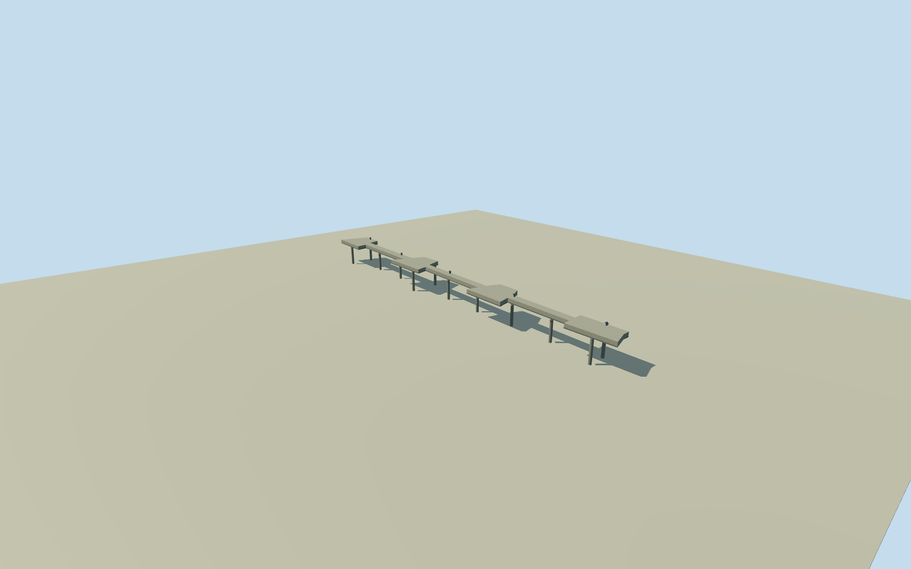

# Fray Bentos mill north river pier

Whole independent 29-corner river pier at the named Planta UPM Fray Bentos site: full original closed deck perimeter, an estimated structural deck and supports. No loading machinery, factory building, tank or whole-mill substitute. Previously cleared three U.S. Embassy Montevideo public-domain photographs provide factory-level plain concrete and gray steel material vocabulary only. They do not depict or establish this pier. Native OSM area geometry establishes the deck plan; exact deck elevation/thickness, pile positions, hardware, condition and historical continuity are estimates. No new imagery, orthophotos, report figures, satellite photographs or photo textures used. At least5m horizontal uncertainty for the unsurveyed mapped outline. Represented2023 continuity is approximate. Whole closed native29-corner area-pier perimeter retained at all four levels, including every narrow irregular projection. Mapped pier shares native factory-boundary nodes1337980783/7740099652/7740022527 and is not inferred from an unrelated rectangle or generic story point. No cargo/crane/pipeline function claimed. Own256m129x129/16641-height numerical field and2 raw source tiles frozen before choosing deck floor3.25m, deck underside2.35m and support bottom-2.4m. Source-field datum-0.1219m, absolute range-0.1977–2.7163m. No terrain mask, flattening, bathymetry repair, floor fitting or frame refit. Source terrain may contain shoreline/bathymetry artefacts; neither water level nor pier datum is surveyed. Deck elevation3.25m, thickness.9m, concrete material,12estimated pile positions/radius.28m,5estimated simple mooring posts and thin gray edge trim are conservative engineering appearance estimates with at least3m component/height and5m horizontal uncertainty. They are not an observed support or hardware census. Exact water/ground contact, access tie, historic2023 continuity and condition unverified. No rails, loading machinery, road bridge or whole factory invented. Three already-cleared U.S.Embassy Montevideo public-domain government originals supply factory-level concrete/gray-steel vocabulary only. They do not show this pier. Qualla-first26 source families retained, no new imagery adoption or rights reopening; source orthophotos, satellite pictures, report figures and photo textures unused. Historical2023 preview, current-world eligible false; whole mill unfinished.

Authoring state: **review-in-qa.json**. Current completion evidence is in [qa.json](qa.json) and the [completion ledger](../../../../qualla-structures/batches/qualla-002.PROGRESS.md).

- [Uruguay River Pulp Mill Dispute](https://qualla.com/uruguay-river-pulp-mill-dispute/)

Whole independent 29-corner river pier at the named Planta UPM Fray Bentos site: full original closed deck perimeter, an estimated structural deck and supports. No loading machinery, factory building, tank or whole-mill substitute. Previously cleared three U.S. Embassy Montevideo public-domain photographs provide factory-level plain concrete and gray steel material vocabulary only. They do not depict or establish this pier. Native OSM area geometry establishes the deck plan; exact deck elevation/thickness, pile positions, hardware, condition and historical continuity are estimates. No new imagery, orthophotos, report figures, satellite photographs or photo textures used. At least5m horizontal uncertainty for the unsurveyed mapped outline. Represented2023 continuity is approximate.

Whole closed native29-corner area-pier perimeter retained at all four levels, including every narrow irregular projection. Mapped pier shares native factory-boundary nodes1337980783/7740099652/7740022527 and is not inferred from an unrelated rectangle or generic story point. No cargo/crane/pipeline function claimed.

Own256m129x129/16641-height numerical field and2 raw source tiles frozen before choosing deck floor3.25m, deck underside2.35m and support bottom-2.4m. Source-field datum-0.1219m, absolute range-0.1977–2.7163m. No terrain mask, flattening, bathymetry repair, floor fitting or frame refit. Source terrain may contain shoreline/bathymetry artefacts; neither water level nor pier datum is surveyed.

Deck elevation3.25m, thickness.9m, concrete material,12estimated pile positions/radius.28m,5estimated simple mooring posts and thin gray edge trim are conservative engineering appearance estimates with at least3m component/height and5m horizontal uncertainty. They are not an observed support or hardware census. Exact water/ground contact, access tie, historic2023 continuity and condition unverified. No rails, loading machinery, road bridge or whole factory invented.

Three already-cleared U.S.Embassy Montevideo public-domain government originals supply factory-level concrete/gray-steel vocabulary only. They do not show this pier. Qualla-first26 source families retained, no new imagery adoption or rights reopening; source orthophotos, satellite pictures, report figures and photo textures unused. Historical2023 preview, current-world eligible false; whole mill unfinished.

Build: `node content/worldgen/source/places/6d/6dn/fray_bentos_mill_north_river_pier/models/generate-house.mjs`. Add `--check` to verify exact regeneration. 1812 triangles; 3 materials; no embedded photographs.
