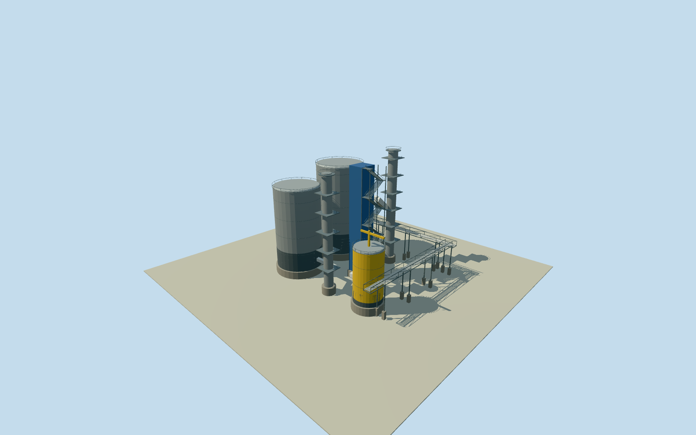

# Fray Bentos mill process train

Photo-based reconstruction of the characteristic Fray Bentos process vessels, blue external stair tower, yellow vessel/crane and trussed pipe racks. Whole connected equipment train; dimensions and arrangement explicitly estimated within the known factory.

Authoring state: **review-in-qa.json**. Current completion evidence is in [qa.json](qa.json) and the [completion ledger](../../../../qualla-structures/batches/qualla-002.PROGRESS.md).

- [Uruguay River Pulp Mill Dispute](https://qualla.com/uruguay-river-pulp-mill-dispute/)

Best-effort reconstruction authorized on 2026-11-03: use available terrain and cleared photographs and estimate missing measurements. The actual UPM factory is independently identified by way119015899. This installation anchor, 80x74m envelope and -0.3rad orientation are authored approximations, not mapped process footprints. Preserve existing mapped buildings and chimney. Photographic proportions establish recognizable features; exact vessel identity, process function, plan arrangement and as-built dimensions are unverified.

Photographs establish two large silver corrugated vessels with a darker lower shell, slender silver process columns, a blue stair casing, white segmented vertical duct, yellow vessel and yellow maintenance crane, open steel platforms and trussed pipe racks. These cues are reconstructed directly; exact total equipment census and unseen backs are estimates. No photographed people, signs, logos, stockpiles or plumes are modeled.

Estimated nominal dimensions: large vessels 23m/21m diameter and43m/37m tall; slender columns4.4m/4m diameter and52m/48m tall; blue tower7x8m and48m tall; yellow vessel12m diameter and22m tall; racks76m/56m long with11m deck. These are photo-proportion estimates, not engineering or survey dimensions. Anchor within the actual factory, -0.3rad heading, vessel spacing and hidden pipe routing are approximations; nominal80m placement/45degree yaw/25percent section allowances are descriptive estimates, not measured error bounds.

Own256m129x129 original terrain field/1 cached original tiles fixed before sections. Datum22.501m; first-pass pad deck1.799m and pad bottoms-1.6239m chosen from unmasked local source range. Exact engineered grade is unknown; footings bridge coarse source relief without altering it. No field masking, flattening, refetch or photographic ground texturing.

The continuous process train is one connected equipment installation. Existing independently mapped halls, chimney and piers remain separate assets. This reconstruction fills the previously missing characteristic machinery; exhaustive engineering equipment counts are outside the medium-fi model scope. Estimated nominal2020 appearance uses the cleared2020 views; temporal continuity outside the photographed period is unverified.

Build: `node content/worldgen/source/places/6d/6dn/fray_bentos_mill_process_train/models/generate-house.mjs`. Add `--check` to verify exact regeneration. 14372 triangles; 5 materials; no embedded photographs.
