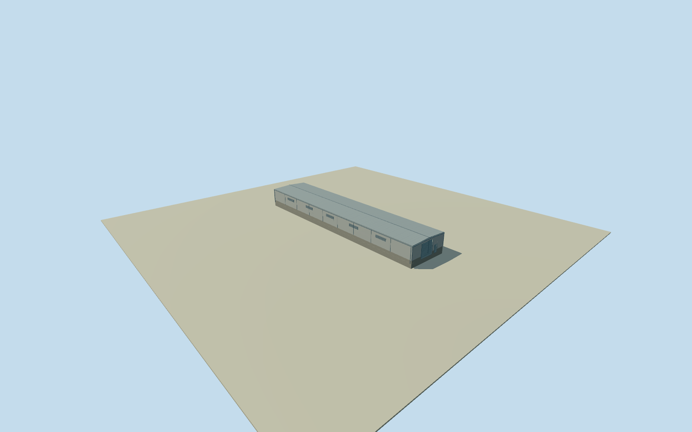

# Fray Bentos mill southeast yard north hall

Whole independently placed southeast yard north roofed hall inside Planta UPM Fray Bentos: full original 4-corner footprint, closed industrial walls and roof, base, estimated service entrances, upper louver bays and modest exposed trim. Separate process plant, chimney, tanks, conveyors, roads and yards remain separate; no whole-factory proxy. Already cleared U.S. Embassy Montevideo original photographs supply factory-level industrial material vocabulary only: light metal/concrete cladding, gray structural trim and dark louvers. They do not identify this specific hall or its roof profile, opening census, doors or attached machinery. Numerical original footprint and 2023 relative heights govern this body; no source satellite photographs, orthophotos, map images, figures or owner report imagery used. Qualla-first 26 families already screened; no rights revalidation or new imagery adopted. Automated footprint has 5 m horizontal uncertainty; numerical height at least 3 m uncertainty, not survey. Whole original 4-corner numerical roof, all exterior walls/closed roof/base retained. Learned relative-height median5.5m from41 of55 passing original observations, range4.5–5.5m, interquartile5–5.5m. Effective4m resolution, at least3m height/5m horizontal uncertainty; no survey or floor census. Original conservative industrial details: low dual-pitch standing-seam roof, light-gray corrugated metal over low concrete base, plain gray trim/gutters/downpipes, two closed service/personnel entries and12 upper louver bays. Roof pitch, opening census, facade positions/materials/finish, function and precise2023condition unverified;3m component uncertainty. Opening heights scaled below the low eaves. Three already-cleared U.S.Embassy public-domain staff photographs supply factory material context only, not verified views of this specific hall; no process machinery transplanted. Own256m129x129/16641-height field/1rawtile/datum22m fixed before floor.25m/foundation-1.2m/plinth1.1m/eave5.4m/ridge5.75m. Field/frame/floor/main sections remain unmasked, unflattened and unfitted; exact contact and threshold vertical tie approximate. Original southeast yard hall/north neighbor polygons have only .02514343555958476m² numerical boundary contact (under .003% of either roof), retained without trimming or moving either original roof. This is not a shared measured wall or site survey. Four authored LODs retain all original corners and the complete body/roof/base/two closed entries/louver cues. Near levels restore physical recesses/blades/frames. Qualla-first26families; exactly three previously cleared public-domain federal originals reused without new imagery or rights review. Source satellite images, map images, owner report images/figures, restricted local photos and photographic textures unused. Historical2023 preview/current-world eligible false; whole factory remains unfinished.

Authoring state: **review-in-qa.json**. Current completion evidence is in [qa.json](qa.json) and the [completion ledger](../../../../qualla-structures/batches/qualla-002.PROGRESS.md).

- [Uruguay River Pulp Mill Dispute](https://qualla.com/uruguay-river-pulp-mill-dispute/)

Whole independently placed southeast yard north roofed hall inside Planta UPM Fray Bentos: full original 4-corner footprint, closed industrial walls and roof, base, estimated service entrances, upper louver bays and modest exposed trim. Separate process plant, chimney, tanks, conveyors, roads and yards remain separate; no whole-factory proxy. Already cleared U.S. Embassy Montevideo original photographs supply factory-level industrial material vocabulary only: light metal/concrete cladding, gray structural trim and dark louvers. They do not identify this specific hall or its roof profile, opening census, doors or attached machinery. Numerical original footprint and 2023 relative heights govern this body; no source satellite photographs, orthophotos, map images, figures or owner report imagery used. Qualla-first 26 families already screened; no rights revalidation or new imagery adopted. Automated footprint has 5 m horizontal uncertainty; numerical height at least 3 m uncertainty, not survey.

Whole original 4-corner numerical roof, all exterior walls/closed roof/base retained. Learned relative-height median5.5m from41 of55 passing original observations, range4.5–5.5m, interquartile5–5.5m. Effective4m resolution, at least3m height/5m horizontal uncertainty; no survey or floor census.

Original conservative industrial details: low dual-pitch standing-seam roof, light-gray corrugated metal over low concrete base, plain gray trim/gutters/downpipes, two closed service/personnel entries and12 upper louver bays. Roof pitch, opening census, facade positions/materials/finish, function and precise2023condition unverified;3m component uncertainty. Opening heights scaled below the low eaves. Three already-cleared U.S.Embassy public-domain staff photographs supply factory material context only, not verified views of this specific hall; no process machinery transplanted.

Own256m129x129/16641-height field/1rawtile/datum22m fixed before floor.25m/foundation-1.2m/plinth1.1m/eave5.4m/ridge5.75m. Field/frame/floor/main sections remain unmasked, unflattened and unfitted; exact contact and threshold vertical tie approximate.

Original southeast yard hall/north neighbor polygons have only .02514343555958476m² numerical boundary contact (under .003% of either roof), retained without trimming or moving either original roof. This is not a shared measured wall or site survey.

Four authored LODs retain all original corners and the complete body/roof/base/two closed entries/louver cues. Near levels restore physical recesses/blades/frames. Qualla-first26families; exactly three previously cleared public-domain federal originals reused without new imagery or rights review. Source satellite images, map images, owner report images/figures, restricted local photos and photographic textures unused. Historical2023 preview/current-world eligible false; whole factory remains unfinished.

Build: `node content/worldgen/source/places/6d/6dn/fray_bentos_mill_southeast_yard_north_hall/models/generate-house.mjs`. Add `--check` to verify exact regeneration. 2560 triangles; 6 materials; no embedded photographs.
