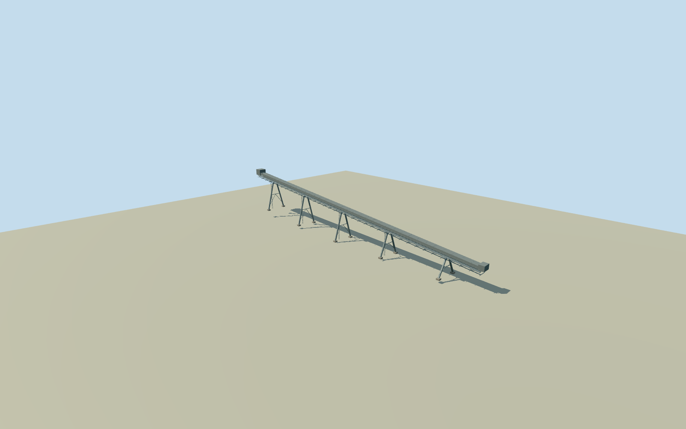

# Fray Bentos mill elevated wood conveyor

Complete photo-based elevated wood conveyor with a closed trough, exposed lower lattice, continuous maintenance walkway, A-frame supports and concrete pads. Dimensions, orientation and within-mill placement are explicit reconstruction estimates.

Authoring state: **review-in-qa.json**. Current completion evidence is in [qa.json](qa.json) and the [completion ledger](../../../../qualla-structures/batches/qualla-002.PROGRESS.md).

- [Uruguay River Pulp Mill Dispute](https://qualla.com/uruguay-river-pulp-mill-dispute/)

User-authorized best-effort reconstruction of the actual Fray Bentos mill elevated conveyor. Known factory identity from original way119015899; this190x28m envelope and within-site anchor are authored estimates. The cleared2020 conveyor photograph supplies silhouette and structural vocabulary. Nominal180m span,3.8m main width,10..28m deck height, five A-frames and terminal casing are estimated. No mapped conveyor centerline, exact endpoints or surveyed dimensions claimed.

Photo-based characteristic geometry: enclosed straight trough, exposed underside diagonal lattice, adjacent walkway with guardrails, and five tapered A-frame support sets. Count, exact span and equipment sections are original estimates; no complete engineering equipment census or surveyed roof/centerline is claimed.

Nominal180m end-to-end length,3.8m full trough width,1.6m trough height and10..28m nominal deck levels; local deck offset0m chosen before authoring for8m nominal clearance above the sampled support ground. Five A-frames at36m spacing with13m base spread; terminal transfer casing and minor service details are estimates. Nominal80m placement,45degree yaw and25percent section allowances are qualitative, not measured confidence bounds.

Each support foot uses the unchanged original coarse field value at its own local position: pad bottom0.45m below that value, pad top0.4m above. This is a first-pass footing reconstruction, not observed foundation depth or accurate grading. Source field, frame, foot positions and deck levels remain fixed. No terrain flattening, masking or photographic ground texture.

Nominal2020 appearance from the already-cleared Embassy conveyor photograph. All hidden routing, material seams, rollers, railing census and terminal geometry are estimates. Existing factory buildings, stockpiles, people, signs and logos are excluded; no new photo source/download.

Build: `node content/worldgen/source/places/6d/6dn/fray_bentos_mill_wood_conveyor/models/generate-house.mjs`. Add `--check` to verify exact regeneration. 7572 triangles; 4 materials; no embedded photographs.
