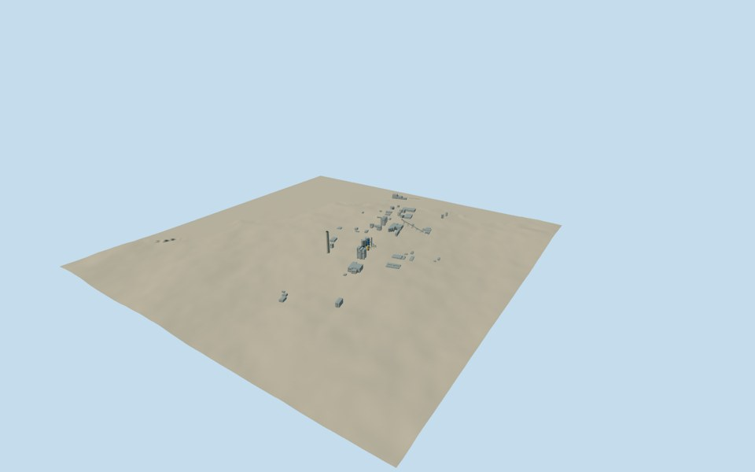

# Fray Bentos Pulp Mill

A complete medium-fi factory reconstruction assembled from62 independently registered assets: the60 previously completed buildings, chimney and piers, plus a new photo-based process installation and elevated wood conveyor. Runtime placement stays with each structure; there is no aggregate GLB or factory-centroid building.

The original mapped roofs, main chimney point and pier outlines are retained. Cleared public-domain U.S. Embassy photographs establish the silver two-tone vessels, blue stair tower, white duct, yellow process equipment, pipe racks and long A-frame conveyor. Missing dimensions, machinery locations and hidden details are original reconstruction estimates. This is a recognizable exterior visualization, not an engineering asset register or a measured pipe-by-pipe survey.

The assembly uses six already-cached original Terrarium tiles over1920m. Every member retains its own original terrain and local sections. The broad source field includes an unrealistic deep river/void artifact west of most structures; it is retained as a known source limitation. Ground ties, river conditions and engineered grading remain approximate. Source observations span2018/2020/2023; the assembled view is not a verified simultaneous historical state.

Three new whole-site views were inspected during completion of the new machinery. Existing individual approvals remain intact. Source and runtime hashes, four LODs, material bindings and story annotations for the two new models were verified in the same authoring pass.

[Qualla story](https://qualla.com/uruguay-river-pulp-mill-dispute/)

Regenerate the assembly scene with `node content/worldgen/source/places/6d/6dn/fray_bentos_pulp_mill/generate-collection-scene.mjs`; `--check` verifies the frozen existing inputs without rebuilding any member geometry.
