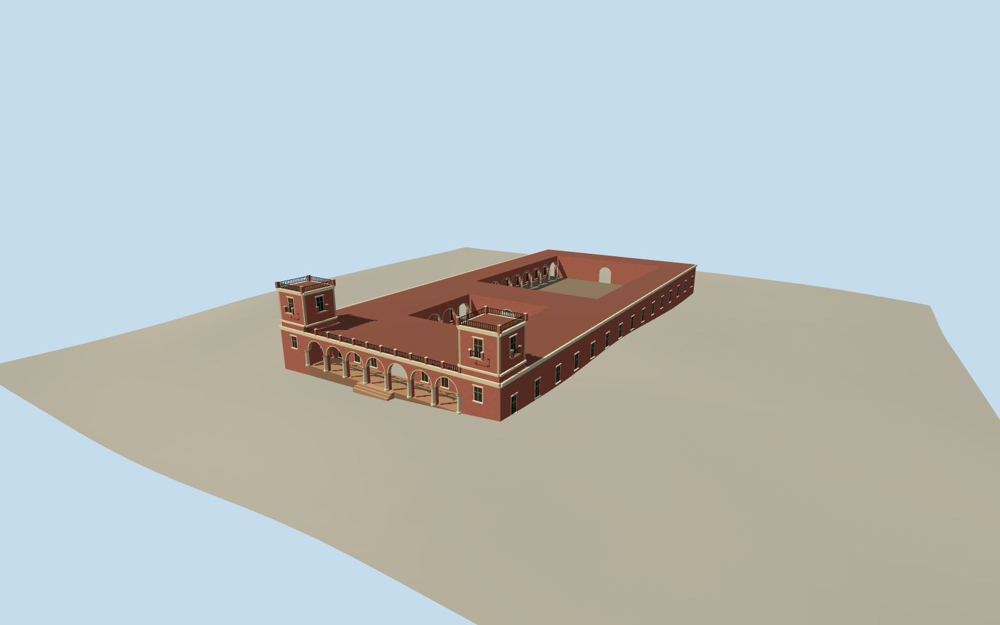

# Palacio San José, Entre Ríos

The pink Italianate residence at Palacio San José in Entre Ríos, with its twin towers, open Tuscan front arcade, and two axial courts.

Authoring state: **review-in-qa.json**. Current completion evidence is in [qa.json](qa.json) and the [completion ledger](../../../../qualla-structures/batches/qualla-003.PROGRESS.md).

- [San José Palace](https://qualla.com/san-jose-palace/)

January 2010 exterior of the main residence, including both open courtyards. The detached chapel, gardens, lake, ancillary buildings and interiors are outside the model.

Arcade bay spacing, precise roof slopes and balcony detailing, rear elevations and individual thresholds are approximate. The photographs establish exterior character and original architecture.

Terrain samples remain unchanged. The map frame and building registration are an approximate visualization.

Build: `node content/worldgen/source/places/6d/6dn/san_jose_palace/models/generate-san-jose.mjs`. Add `--check` to verify exact regeneration. 16578 triangles; 5 materials; no embedded photographs.
