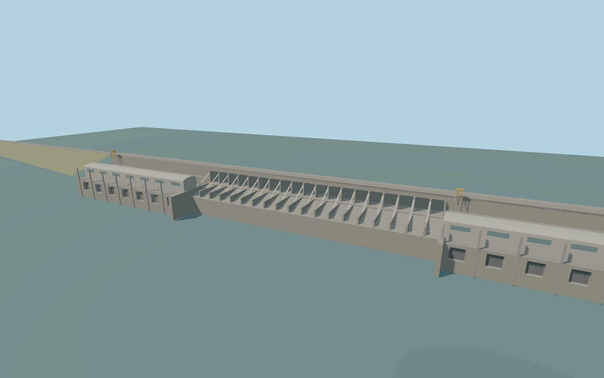

# Salto Grande Dam

Salto Grande Dam’s 852 m concrete crossing, nineteen-bay spillway, paired 236 m generating halls, both earthfill wings, yellow crest cranes, and combined international road and rail deck.

Rebuild: `node packages/worldgen/scripts/generate-salto-grande-dam.mjs`;append `--check` for exact source bytes. Select import/LOD/placement with `--ids=salto_grande_dam`. Detailed source and four browser tiers are separate ignored GLB outputs.

The modeled road crown is approximately 39.5 m at the main crossing. The fixed absolute vertical origin is 32.0116 m. Normal level 14 and 15 tile probes sample 32.13–32.65 m in the reservoir and 3.46–3.56 m below the dam.

The main shape, crossing alignment and channel fit use standard PMTiles and the photographed exterior. Exact gate settings, trim and embankment grades are approximate.

The model shows the disused rail as static track. Interiors, generating equipment below the turbine deck and the separately planned navigation system are outside this exterior.

The deck follows retained map centerlines and approximates the surveyed end grades with standard terrain. Host terrain and water levels can vary.

Original geometry:repository license. Map:© OpenStreetMap contributors,ODbL-1.0;Protomaps. Standard terrain:terrain-grid.json. Ordinary pictures stay local and are not redistributed or used as textures. Current acceptance:qa.json.
